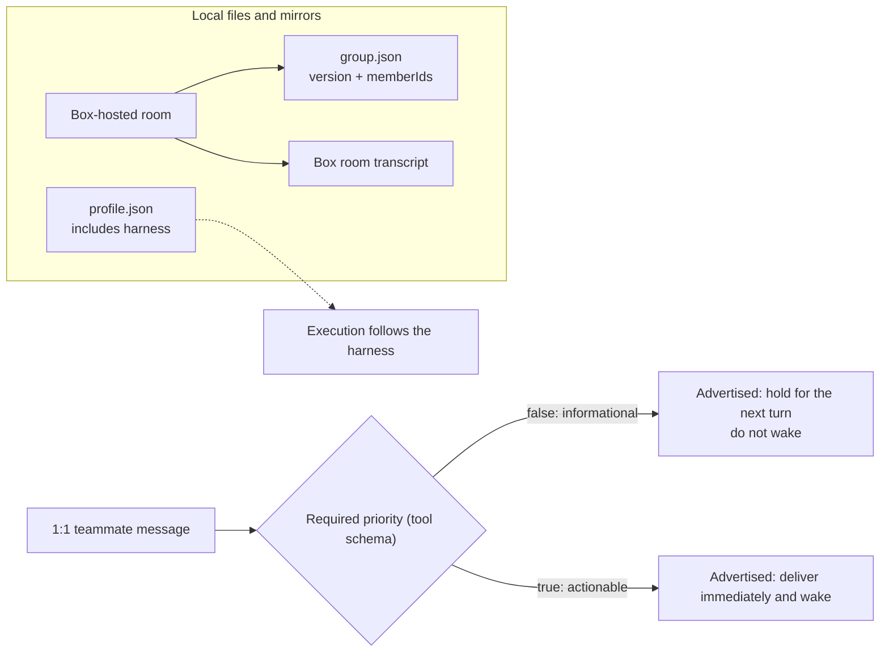
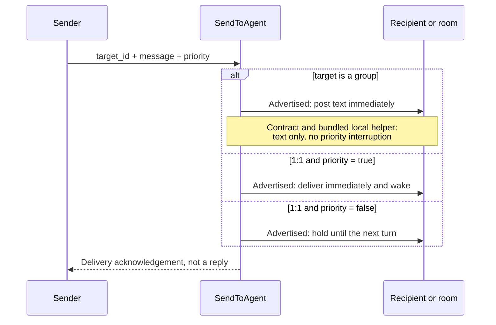
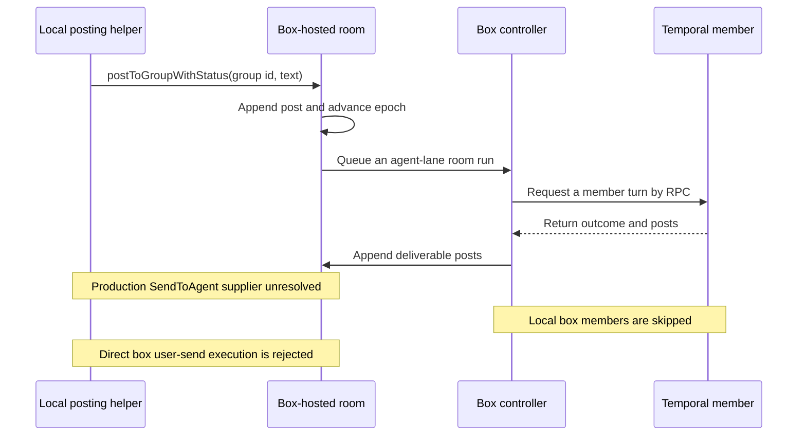
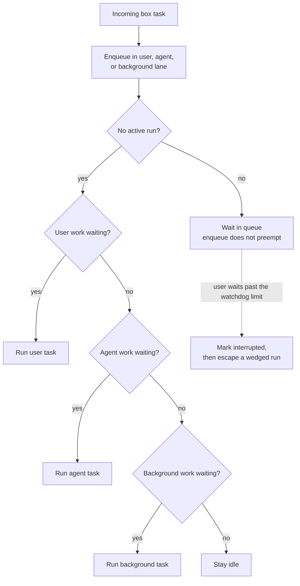
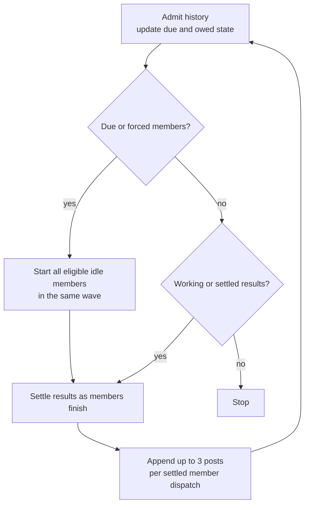

# Grok Bot 0.71.2 agent teams: 100 questions / Grok Bot 0.71.2 助手团队：100 问

This guide explains assistant teams and group rooms in Grok Bot 0.71.2. It describes the mechanisms, contracts, and evidence boundaries supported by the available local artifacts.

本文介绍 Grok Bot 0.71.2 的助手团队和群聊房间，依据本机可用材料说明运行机制、工具约定，以及材料无法确认的行为。

## Evidence and scope / 证据与范围

The desktop artifact is `Grok_Bot_0.71.2.dmg`. The host bundle is `fcbae14`. The extracted `host-main.cjs` and `sand-eval-runner.cjs` have the same SHA-256 digests as the files in the original bundle. macOS also accepted the disk image checksum.

桌面安装包是 `Grok_Bot_0.71.2.dmg`，宿主代码包是 `fcbae14`。解压出的 `host-main.cjs` 和 `sand-eval-runner.cjs` 与原始代码包中的对应文件具有相同的 SHA-256 摘要，macOS 的安装包校验也已通过。

| Artifact / 材料 | Version or path / 版本或路径 | SHA-256 |
|---|---|---|
| Desktop disk image / 桌面安装包 | `/Users/bowen/code/grok-bot-0.71.2/Grok_Bot_0.71.2.dmg` | `a6e586f4f9857dc97fcae600d443a31a8e9b6f6e9e67f1e1d103135e77d260ad` |
| Original host bundle / 原始宿主代码包 | `/Users/bowen/code/grok-bot-0.71.2/sand-host-bundle-fcbae14.tgz` | `069ddd0c8fddb364983b0e5acf7fed027a96e1df27cdc5c1b9e545d650d90536` |
| Readable host bundle / 可读宿主代码 | `/Users/bowen/code/grok-bot-0.71.2/host-fcbae14/sand-host/host-main.cjs` | `d9dcf2550d6e033fc752852dffc044d34622edfbe9a7421476199761c0ce0946` |
| Readable eval runner / 可读评测运行器 | `/Users/bowen/code/grok-bot-0.71.2/host-fcbae14/sand-host/sand-eval-runner.cjs` | `5d951bc76d9747e0c37c494c4bfd82d787f2d81742ead2627e26d36e3b0ef54c` |

A reference such as `host-main.cjs:491251-491264` or `sand-eval-runner.cjs:536997-536998` points to the matching readable file in this table. The bundles keep original module-path comments. These comments help identify the intended source module, but the bundled implementation is the primary evidence.

`host-main.cjs:491251-491264` 或 `sand-eval-runner.cjs:536997-536998` 这样的引用，对应表中的相应可读文件。代码包保留了原始模块路径注释，可以用来辨认模块；不过，判断行为时以代码包中的实际实现为准。

The artifacts do not contain the cloud-room server implementation. The production supplier of the injected `SendToAgent` implementation has not been located. Client prompts and tool descriptions alone do not establish server scheduling, delivery, or privacy behavior.

这些材料不包含云端房间的服务器实现，也没有定位到生产环境中为 `SendToAgent` 提供注入实现的位置。仅凭客户端提示词和工具说明，无法确认服务器的调度、投递或隐私行为。

A bundled function can require a caller or an injected dependency that the artifacts do not identify. Its presence alone does not prove that a production call reaches it. The answers state where a path is wired and where its live caller is unconfirmed.

包内函数可能需要调用方或注入依赖，而现有材料没有说明这些连接。函数存在本身不能证明生产环境会调用它。答案会说明已接入的路径，以及尚未确认实际调用方的路径。

## How to read the answers / 如何阅读答案

Each question has an English answer followed by a Chinese answer, starting with **Answer.** and **回答。**. The opening gives the direct rule or evidence boundary. The rest explains the conditions and scope, with supporting references at the end of each paragraph.

每个问题先给英文答案，再给中文答案，分别以 **Answer.** 和 **回答。** 开头。开头直接说明规则或证据边界，后文解释条件和适用范围，每段末尾附上依据。

The answers distinguish executable code, advertised tool contracts, and prompt instructions. An unavailable implementation or server path is identified explicitly. A local mechanism or constant applies to the named path; it does not establish the behavior of a server-hosted room.

答案区分可执行代码、工具说明中的约定和提示词指令；无法查看的实现或服务器路径会直接说明。本地机制和常量只适用于所指明的路径，不能用来推断服务器托管房间的行为。

## Diagrams / 图示

### Diagram 1. Local state and the delivery contract / 图 1：本地状态与投递约定

Local files can be profiles or mirrors. Their presence does not prove local execution. The `harness` value selects the box or temporal route. A local room config contains only `version` and `memberIds`. The advertised 1:1 contract says actionable mail wakes the recipient and informational mail is held without a wake. The located code does not show the server store that implements this contract. Evidence: host-main.cjs:485310-485355, host-main.cjs:491436-491490, host-main.cjs:757322-757359, host-main.cjs:769145-769174.

本地文件可能是资料或镜像，不能据此判断执行位置。`harness` 决定使用 box 还是 temporal 路径。本地房间配置只包含 `version` 和 `memberIds`。一对一工具说明规定，需要处理的消息会唤醒接收方，纯信息消息则暂存到下一轮，不主动唤醒。已定位的代码没有展示实现这套约定的服务端存储。依据：host-main.cjs:485310-485355, host-main.cjs:491436-491490, host-main.cjs:757322-757359, host-main.cjs:769145-769174。

### Diagram 2. An agent sends to another agent or a room / 图 2：助手向另一个助手或房间发消息

Each call has one target, and `priority` is required even for a group. The diagram shows the advertised `SendToAgent` contract. A bundled local helper implements immediate text-only group posts with no special priority interruption. The production send implementation has not been located, so the diagram does not establish which path a production call reaches. A post through the local helper advances the epoch and cancels earlier pending temporal member turns. The remote-peer path sends text only and reports priority as unsupported. Evidence: host-main.cjs:734432-734505, host-main.cjs:738394-738405, host-main.cjs:740193-740200, host-main.cjs:757277-757364, host-main.cjs:769145-769174.

每次调用只有一个目标，即使目标是群聊，也必须填写 `priority`。本图展示 `SendToAgent` 工具说明中的约定。包内的本地辅助函数会立即发布纯文本群消息，priority 不会触发特殊中断。生产环境的发送实现尚未定位，因此本图无法确认生产调用实际进入哪条路径。经本地辅助函数发布的消息会推进 epoch，并取消此前等待完成的 temporal 成员请求。远程助手路径只投递文本，并明确报告不支持 priority。依据：host-main.cjs:734432-734505, host-main.cjs:738394-738405, host-main.cjs:740193-740200, host-main.cjs:757277-757364, host-main.cjs:769145-769174。

### Diagram 3. A local helper posts to a box-hosted room / 图 3：本地辅助函数向 box 宿主房间发布消息

The local `postToGroupWithStatus` helper can append a post and queue a run for a box-hosted room. This diagram describes the path reachable from that helper; it does not establish that a temporal member's `SendToAgent` call reaches it. The controller requests temporal member turns through RPC and skips local box members. It appends returned deliverable posts to the box room transcript. `SendPipeline.sendPrompt` rejects direct box user turns. The artifacts do not establish server user-message fan-out. Evidence: host-main.cjs:734432-734443, host-main.cjs:738366-738408, host-main.cjs:738503-738510, host-main.cjs:738642-738751, host-main.cjs:740157-740191, host-main.cjs:769145-769174.

本地 `postToGroupWithStatus` 辅助函数可以向 box 宿主房间追加消息，并把房间运行加入队列。本图说明从该函数可以进入的路径，不能证明 temporal 成员调用 `SendToAgent` 时会进入这里。编排器通过 RPC 请求 temporal 成员运行，并跳过本地 box 成员，再把返回的可发布消息写入 box 房间记录。`SendPipeline.sendPrompt` 拒绝直接执行 box 用户轮次。现有材料无法确认服务器如何分发用户消息。依据：host-main.cjs:734432-734443, host-main.cjs:738366-738408, host-main.cjs:738503-738510, host-main.cjs:738642-738751, host-main.cjs:740157-740191, host-main.cjs:769145-769174。

### Diagram 4. Box scheduler lane selection / 图 4：box 调度器的通道选择

The scheduler selects work when no run is active, in user, agent, then background lane order. Enqueueing a task does not preempt an active run. A separate watchdog can escape a wedged run when user work waits past its limit. These mechanisms do not establish ordinary priority-peer interruption or server scheduling. Evidence: host-main.cjs:739617-739765, host-main.cjs:739834-739900.

调度器在没有任务运行时选择下一项，顺序是用户、助手、后台通道。任务入队不会打断正在运行的任务。独立的看门狗可以在用户任务等待超时、当前运行卡住时介入。这些机制不能证明普通的优先助手消息会中断运行，也不能说明服务器如何调度。依据：host-main.cjs:739617-739765, host-main.cjs:739834-739900。

### Diagram 5. A box-hosted room run / 图 5：box 宿主房间的一次运行

Audience and delivery state determine which idle members are due. The controller starts all eligible members in the same wave and settles results in completion order. Posts update delivery state and can create more waves. After three waves, ordinary eligibility is restricted to members owed catch-up work. These starts can be non-forced and increase the wave count; forced work follows a separate path. The loop does not require sequential rotation or a round in which every member is silent. Evidence: host-main.cjs:737383-737561, host-main.cjs:737681-737800.

房间根据消息的接收对象和投递状态，计算哪些空闲成员应当运行。编排器会在同一波中启动所有符合条件的成员，再按完成顺序处理结果。发言会更新投递状态，并可能触发更多波次。三波之后，普通启动只允许尚有消息需要补看的成员参加。这类启动可以是非强制启动，并继续增加波次计数；强制任务走另一条路径。循环不要求按顺序轮换，也不要求出现一轮全员沉默。依据：host-main.cjs:737383-737561, host-main.cjs:737681-737800。

## Limits / 上限

The generic orchestrator tracks a three-wave threshold and a ten-post budget for each admission trigger. With the optional callbacks wired, inbound work resets that trigger state. The inspected `GroupChatGlue` does not wire those callbacks, so the threshold and budget apply per run on that path. Three waves restrict ordinary eligibility to owed catch-up work; they do not cap all non-forced waves. The 36-dispatch safety cap covers the whole run, and each settled member dispatch can supply at most three deliverable posts. Evidence: host-main.cjs:491251-491264, host-main.cjs:737400-737555, host-main.cjs:738552-738571, host-main.cjs:737613-737621.

通用编排器为每个接收消息的触发周期记录三波阈值和十条发言预算。接入可选回调后，收到消息会重置该触发周期的状态。检查到的 `GroupChatGlue` 没有接入这些回调，因此这条路径上的阈值和预算按每次运行计算。三波之后，普通启动仅允许需要补看的成员参加，并非所有非强制波次都必须在三波内结束。36 次派发的安全上限覆盖整个运行；每次成员派发完成后，最多发布其返回的三条消息。依据：host-main.cjs:491251-491264, host-main.cjs:737400-737555, host-main.cjs:738552-738571, host-main.cjs:737613-737621。

| Limit / 上限 | Value / 数值 | Scope / 作用范围 |
|---|---:|---|
| Group members / 群成员数 | 6 | Local group configuration and membership rules / 本地群配置和成员规则 |
| Ordinary waves before catch-up-only eligibility / 转入仅补看模式前的普通波次 | 3 | Threshold, not a hard cap on non-forced waves; per trigger, and per run in the inspected glue / 阈值而非非强制波次硬上限；每个触发周期，检查到的宿主路径按每次运行计算 |
| Room posts / 房间发言 | 10 | Per trigger; per run in the inspected glue / 每个触发周期；检查到的宿主路径按每次运行计算 |
| Posts per settled member dispatch / 每次成员派发完成后的发言 | 3 | Deliverable returned posts / 可发布的返回消息 |
| Prompt and RPC history / 提示和 RPC 中的历史 | 24 messages / 24 条消息 | Group history formatters / 群历史格式化代码 |
| Teammate message text / 助手消息文本 | 8,000 characters / 8,000 字符 | `AGENT_MESSAGE_MAX_TEXT_LENGTH` |
| Group message text / 群消息文本 | 8,000 characters / 8,000 字符 | History text and reply quotes; not a universal rich-post limit / 历史正文和回复引用；不是所有富内容的统一上限 |
| Failed-turn rearms / 失败后的重新派发 | 2 | Consecutive not-shown outcomes; a shown outcome resets the count / 连续未展示结果；成功展示后清零 |
| Room dispatch safety cap / 房间派发安全上限 | 36 | `2 × 3 × 6`; covers the whole orchestrator run / 覆盖整个编排运行 |
| Wind-down post threshold / 收尾提示的消息阈值 | ≤ 2 posts left / 剩余不超过 2 条 | The third wave also enables the note / 第三波也会启用收尾提示 |
| Member dispatch RPC timeout / 成员派发 RPC 超时 | 20,000 ms | Timeout on the dispatch RPC / 派发 RPC 调用超时 |
| Member requested deadline / 成员请求截止时间 | 300,000 ms | Deadline included in the member request / 随成员请求发送的截止时间 |
| Member host wait / 成员请求的宿主等待 | 600,000 ms | On timeout, settle locally and cancel upstream / 超时后本地结束，并通知上游取消 |

The temporal time limits govern three separate stages: dispatch RPC, requested deadline, and host wait. The 24-message and 8,000-character values apply to the inspected formatting and messaging glue. These constants do not establish the limits of a server-hosted room. Evidence: host-main.cjs:491256-491260, host-main.cjs:491396-491399, host-main.cjs:708282-708314, host-main.cjs:708332-708438, host-main.cjs:734314-734316.

三个 temporal 时间限制分别用于派发 RPC、请求截止时间和宿主等待。24 条历史和 8,000 字符限制适用于检查到的格式化及消息衔接代码。这些常量无法确定服务器托管房间的上限。依据：host-main.cjs:491256-491260, host-main.cjs:491396-491399, host-main.cjs:708282-708314, host-main.cjs:708332-708438, host-main.cjs:734314-734316。

## A. The root model / A. 基本模型

### 1. What is an agent team in this product? / 产品中的助手团队是什么？

**Answer.** A team is a roster of durable assistants with separate chats, personas, memories, and asynchronous messaging. Profiles can bind agents to a `serverId` and select a `box` or `temporal` harness. The roster supports Team Bots and sectioned discovery; the shared `teamBotDiscovery` default is false. The artifacts do not establish the effective desktop rollout or server-side ownership. Evidence: sand-eval-runner.cjs:536939-536957, host-main.cjs:490823-490866, host-main.cjs:752329-752382.

**回答。** 团队由一批持久助手组成，各自拥有会话、人设、记忆和异步消息能力。助手资料可以通过 `serverId` 绑定服务器，并选择 `box` 或 `temporal` 执行方式。名单支持 Team Bot 和分区查找；共享配置中的 `teamBotDiscovery` 默认值为 false。现有材料无法确认桌面实际启用情况或服务器内部的归属规则。依据：sand-eval-runner.cjs:536939-536957, host-main.cjs:490823-490866, host-main.cjs:752329-752382。

### 2. When A messages B, do they join one conversation? / A 给 B 发消息时，双方会进入同一个会话吗？

**Answer.** A and B have separate conversations; sending a message does not combine their model calls. The generic `SendToAgent` schema requires `priority`. Its description says `true` delivers and wakes the recipient, `false` holds the message for the next turn, and group posts are immediate. Execution forwards `priority` to an injected `host.sendToAgentImpl`, but its production supplier has not been located. The bundled local implementation appends messages for either value and shows neither a holding store for `false` nor a wake invocation for `true`. These artifacts do not establish production wake behavior. Evidence: host-main.cjs:757322-757364, host-main.cjs:769145-769174, host-main.cjs:734418-734472, host-main.cjs:734473-734506, host-main.cjs:734586-734632.

**回答。** A 和 B 各有独立会话，发送消息不会合并双方的模型调用。通用 `SendToAgent` 工具要求提供 `priority`。工具说明规定，`true` 立即投递并唤醒接收方，`false` 将消息保留到下一轮，群聊消息则立即发布。执行时会把 `priority` 转给注入的 `host.sendToAgentImpl`，但尚未找到生产环境中提供该实现的位置。包内的本地实现会写入两种取值的消息，却没有展示 `false` 的保留队列或 `true` 的唤醒调用。因此，现有材料无法确认生产环境的实际唤醒行为。依据：host-main.cjs:757322-757364, host-main.cjs:769145-769174, host-main.cjs:734418-734472, host-main.cjs:734473-734506, host-main.cjs:734586-734632。

### 3. What does `SendToAgent` return to A? / `SendToAgent` 会向 A 返回什么？

**Answer.** A receives a delivery acknowledgement from `SendToAgent`. The tool returns either the implementation's string result or `sent.ack`. It forwards the send to `host.sendToAgentImpl` without waiting for B to run, and the tool contract does not permit polling for a reply in the same turn. B's reply must arrive separately. Evidence: host-main.cjs:757358-757364, host-main.cjs:757397-757430, host-main.cjs:769145-769174.

**回答。** A 从 `SendToAgent` 收到的是投递回执。工具会返回实现给出的字符串或 `sent.ack`。发送交给 `host.sendToAgentImpl` 后，工具不会等待 B 运行；工具约定也不允许在同一轮中轮询回复。B 的回复必须另行到达。依据：host-main.cjs:757358-757364, host-main.cjs:757397-757430, host-main.cjs:769145-769174。

### 4. Where does B’s reply arrive? / B 的回复会到达哪里？

**Answer.** The generic tool description says B's reply arrives as a later message: a priority reply wakes a hidden turn, while an informational reply waits for the next turn. The roster prompt identifies these messages with `[agent]`. The tool can resolve and forward an optional `task_id`. The concrete production `sendToAgentImpl` has not been located, so the artifacts do not establish production receipt or task-routing behavior. A bundled local receive path appends inbound user-role transcript entries; its live caller and any subsequent wake are unconfirmed. Evidence: host-main.cjs:754438-754440, host-main.cjs:757352-757359, host-main.cjs:757402-757419, host-main.cjs:769145-769174, host-main.cjs:734507-734577, host-main.cjs:734586-734632.

**回答。** 通用工具说明称，B 的回复会作为之后的消息到达：priority 回复触发隐藏轮次，普通信息回复等待下一轮。名单提示词用 `[agent]` 标记这些消息。工具也能解析并转发可选的 `task_id`。生产环境的具体 `sendToAgentImpl` 尚未定位，因此现有材料无法确认实际的接收和任务路由行为。包内的本地接收路径会追加 user 角色的收件记录，但它的实际调用方和后续唤醒过程都没有确认。依据：host-main.cjs:754438-754440, host-main.cjs:757352-757359, host-main.cjs:757402-757419, host-main.cjs:769145-769174, host-main.cjs:734507-734577, host-main.cjs:734586-734632。

### 5. What does the `[agent]` cue tell the model? / `[agent]` 标记告诉模型什么？

**Answer.** In the roster prompt, `[agent]` identifies a message from another assistant rather than user input. The prompt tells the recipient to use `SendToAgent` only for useful replies and to avoid acknowledgement loops. It describes priority messages as user-visible and held messages as hidden, and reserves `SendToUser` for new user-facing results. These are instructions to the model; they do not verify the unresolved delivery mechanism. Evidence: host-main.cjs:754438-754440.

**回答。** 名单提示词用 `[agent]` 表示消息来自另一个助手，而非用户输入。提示要求接收方只在回复有用时使用 `SendToAgent`，避免反复互发确认。它把 priority 消息描述为用户可见、保留消息描述为不可见，并要求只在有新的用户结果时使用 `SendToUser`。这些是对模型的指令，不能据此确认尚未定位的投递实现会如何运行。依据：host-main.cjs:754438-754440。

### 6. Is the private 1:1 the same history as a group? / 私聊和群聊是否共用同一份记录？

**Answer.** The bundled guidance places private DMs and group turns in distinct contexts within one unified conversation. Group tags identify group turns; untagged user messages are private DMs. This is a prompt-level context contract. The observed host RPC sends structured room history, but the artifacts do not show how the server assembles history or physically stores transcripts. Evidence: host-main.cjs:753871-753875, host-main.cjs:738652-738681.

**回答。** 包内指引把私聊和群聊轮次放在同一会话中的不同上下文里。群聊轮次带群聊标记，没有该标记的用户消息属于私聊。这是提示词中的上下文约定。观察到的宿主 RPC 会发送结构化房间历史，但现有材料没有展示服务器如何组装历史或实际存储会话记录。依据：host-main.cjs:753871-753875, host-main.cjs:738652-738681。

### 7. Who owns memory and persona? / 谁拥有记忆和人设？

**Answer.** An agent's durable identity owns its profile; a room turn does not replace that profile. The inspected host controller supplies temporal members with room, member, peer, and message context. Non-temporal local members return `skipped` and `not_shown`. Memory routing supports user, agent, user-bot, and conversation scopes, with team-audience rules and shard or JSONL targets. Evidence: host-main.cjs:738642-738701, host-main.cjs:708332-708384, host-main.cjs:771533-771595.

**回答。** 助手的持久身份拥有自己的资料，房间轮次不会替换这份资料。检查到的宿主编排器会向 temporal 成员提供房间、成员、其他助手和消息上下文；非 temporal 的本地成员返回 `skipped` 和 `not_shown`。记忆可按用户、助手、用户与助手、会话等范围存储，并有团队受众规则以及 shard 或 JSONL 存储目标。依据：host-main.cjs:738642-738701, host-main.cjs:708332-708384, host-main.cjs:771533-771595。

### 8. Can Bob read Alice’s private chat with the user? / Bob 能读取 Alice 与用户的私聊吗？

**Answer.** The messaging and room-context paths do not give Bob Alice's private transcript. A 1:1 send records the supplied message, and a temporal room request carries room history and peer identities without private DM history. The bundled room guidance forbids looking for a teammate's private chats, memory, or files. Team-shared memory uses a separate explicit scope. These boundaries describe messaging and supplied context; they do not establish an OS-level block on every file-reading tool. Evidence: host-main.cjs:734411-734472, host-main.cjs:708345-708384, host-main.cjs:753871-753880, host-main.cjs:771577-771591.

**回答。** 消息和房间上下文路径不会把 Alice 的私聊记录交给 Bob。一对一发送只记录本次提供的消息；temporal 房间请求携带房间历史和其他助手身份，不包含私聊历史。包内房间指引禁止主动查找其他助手的私聊、记忆或文件。团队共享记忆使用单独的明确范围。这些边界适用于消息和上下文传递，不能证明所有文件读取工具都受到操作系统级隔离。依据：host-main.cjs:734411-734472, host-main.cjs:708345-708384, host-main.cjs:753871-753880, host-main.cjs:771577-771591。

### 9. What is inside one turn, and what starts another turn? / 一轮包含什么，什么会开始下一轮？

**Answer.** A turn consists of an assistant run, its tool calls, and a stop. `SendToAgent` does not run the recipient's reply inside the sender's turn. Its description assigns wake and next-turn behavior to `priority`, but the production send implementation has not been located. The bundled local receive methods show transcript appends without a model-run invocation, and the direct local box-turn path rejects execution. The artifacts therefore do not establish which peer messages start a production turn. Evidence: host-main.cjs:757358-757364, host-main.cjs:769145-769174, host-main.cjs:734586-734632, host-main.cjs:740170-740191.

**回答。** 一轮包含一次助手运行、工具调用和结束过程。`SendToAgent` 不会在发送方这一轮中运行接收方的回复。工具说明用 `priority` 描述唤醒和等待下一轮的规则，但生产环境的发送实现尚未定位。包内的本地接收方法只展示会话记录追加，没有展示模型运行调用；直接执行本地 box 轮次的路径则拒绝执行。因此，现有材料无法确认哪些助手消息会在生产环境触发新一轮。依据：host-main.cjs:757358-757364, host-main.cjs:769145-769174, host-main.cjs:734586-734632, host-main.cjs:740170-740191。

### 10. How is a teammate different from a Task-style subagent? / 助手与 Task 式子助手有什么区别？

**Answer.** A teammate is a durable assistant with its own conversation and mailbox. Its later reply arrives as a separate message, not a nested tool result. A Task-style subagent is a child task whose final result returns to its parent. The child's work can continue after the parent's turn ends. Evidence: host-main.cjs:763474-763539, host-main.cjs:741807-741816, host-main.cjs:757358-757364.

**回答。** 助手拥有持久身份、自己的会话和收件箱，之后的回复会作为单独消息到达，不是嵌套的工具结果。Task 式子助手是父助手的子任务，最终结果返回给父助手；父助手结束自己的轮次后，子助手也可以继续工作。依据：host-main.cjs:763474-763539, host-main.cjs:741807-741816, host-main.cjs:757358-757364。

## B. Identity and files / B. 身份与文件

### 11. Where does an agent live? / 助手存放在哪里？

**Answer.** The desktop file-based roster stores each agent in a sibling directory under `agentsRoot`, with `profile.json`, an optional `group.json`, and a per-agent session opened through `sessionStore`. `getSandRootDir` accepts an absolute `SAND_DATA_ROOT` override, uses `<SAND_USER_DATA_DIR>/sand-data` when configured, and otherwise selects a variant-specific default. The production `sand` variant uses `~/.grokbot`; `getSandAgentsRootDir` appends `agents`. Session filenames are `store.db` and `conversation-blobs.db`. Profiles support server binding and harness metadata, and memory has several scoped targets. Local folders do not prove that all authoritative state is local. The artifacts do not establish effective live overrides or cloud mirroring boundaries. Evidence: sand-eval-runner.cjs:536997-536998, host-main.cjs:430845-430914, host-main.cjs:494893-494910, host-main.cjs:718197-718208, host-main.cjs:490823-490866, host-main.cjs:785617-785646.

**回答。** 桌面的文件名单把每个助手存放在 `agentsRoot` 下的同级目录中，包含 `profile.json`、可选的 `group.json`，并由 `sessionStore` 打开各自会话。`getSandRootDir` 可以使用绝对的 `SAND_DATA_ROOT` 覆盖路径；配置 `SAND_USER_DATA_DIR` 时，根目录是其下的 `sand-data`；否则按运行变体选择默认位置。生产 `sand` 变体使用 `~/.grokbot`，`getSandAgentsRootDir` 再追加 `agents`。会话文件名是 `store.db` 和 `conversation-blobs.db`。助手资料支持服务器绑定和执行方式信息，记忆也有多种存储范围。本地目录本身无法证明所有权威状态都在本地；实际生效的路径覆盖和云端镜像范围无法从现有材料确认。依据：sand-eval-runner.cjs:536997-536998, host-main.cjs:430845-430914, host-main.cjs:494893-494910, host-main.cjs:718197-718208, host-main.cjs:490823-490866, host-main.cjs:785617-785646。

### 12. What identifies an individual agent versus a room? / 如何区分普通助手和房间？

**Answer.** The local directory check `isSandGroupDir` recognizes a room when `group.json` can be read and parsed and contains at least one valid normalized member id. A temporal profile makes `localGroupConfig` return null. This prevents local orchestration without affecting room identification. Evidence: host-main.cjs:491453-491490, host-main.cjs:738503-738513.

**回答。** `isSandGroupDir` 通过目录中的 `group.json` 识别房间：文件必须可读取、可解析，并且至少包含一个有效的规范化成员 id。temporal 资料会让 `localGroupConfig` 返回 null。这会阻止本地编排，但不影响房间识别。依据：host-main.cjs:491453-491490, host-main.cjs:738503-738513。

### 13. What is in `group.json`? / `group.json` 中包含什么？

**Answer.** The supported desktop local representation of `group.json` contains only `version` and `memberIds`. The reader ignores other raw JSON properties rather than rejecting them; rewriting the file removes those properties. `remoteMembers` and `sharedRoomId` are not part of this supported local representation. Server-backed rooms use RPCs, and the artifacts do not show their server-side records. Evidence: host-main.cjs:491441-491488, host-main.cjs:714806-714883.

**回答。** 桌面本地实现只从 `group.json` 返回 `version` 和 `memberIds`，写入时也只保留这两个字段。读取器会忽略其他字段，不会主动拒绝含有额外字段的原始 JSON；重写文件时会删除这些额外字段。`remoteMembers` 和 `sharedRoomId` 不属于这套实现支持的本地配置。服务器房间通过 RPC 管理，现有材料没有展示服务器内部的房间记录。依据：host-main.cjs:491441-491488, host-main.cjs:714806-714883。

### 14. How many members can a group have? / 一个群聊可以有多少成员？

**Answer.** Local group creation and the server-room creation client deduplicate member ids and keep at most six agent members. Local creation silently drops ids absent from the roster. Server-room creation preflights non-temporal members and rejects a missing or invalid local profile instead of applying that local filter. The visible `setRoomMembers` client does not truncate, so the artifacts do not establish how the server enforces the limit when membership is updated. Evidence: host-main.cjs:738441-738453, host-main.cjs:714806-714829, host-main.cjs:495358-495379, host-main.cjs:714862-714883.

**回答。** 本地群聊创建和服务器房间创建客户端都会对成员 id 去重，并最多保留 6 个助手成员。本地创建会静默丢弃不在名单中的 id；服务器房间创建会预检非 temporal 成员，本地资料缺失或无效时会拒绝创建，而不是套用本地过滤规则。可见的 `setRoomMembers` 客户端没有执行截断，因此现有材料无法确认服务器在更新成员时如何执行上限。依据：host-main.cjs:738441-738453, host-main.cjs:714806-714829, host-main.cjs:495358-495379, host-main.cjs:714862-714883。

### 15. Can a group be a member of another group? / 群聊可以成为另一个群聊的成员吗？

**Answer.** Local creation and update paths reject a group as a member with `SandGroupNestingError`. If stored configuration contains a nested room id, member resolution skips it and emits a warning instead of recursively running that room. The desktop RPC client does not establish whether the server applies the same validation. Evidence: host-main.cjs:491265-491278, host-main.cjs:738441-738449, host-main.cjs:738582-738605.

**回答。** 本地创建和更新路径会通过 `SandGroupNestingError` 拒绝把群聊设为成员。如果存储配置中含有嵌套房间 id，成员解析会跳过它并记录警告，不会递归运行该房间。桌面 RPC 客户端无法证明服务器是否执行同样的检查。依据：host-main.cjs:491265-491278, host-main.cjs:738441-738449, host-main.cjs:738582-738605。

### 16. What happens if you create a group with the same members as an existing one? / 创建一个成员与现有群聊完全相同的新群，会发生什么？

**Answer.** Local group creation creates a fresh agent and marks it as a room without searching for an existing room with the same member set. The server-room client requests a fresh random UUID and requires confirmation of that same id. Member-id deduplication removes repeated members; it does not deduplicate rooms. Server internals are not visible, but a response with a different room id would fail this client's confirmation check. Evidence: host-main.cjs:738416-738454, host-main.cjs:714806-714840.

**回答。** 本地创建群聊时会创建一个新助手，并把它标记为房间，不会查找成员集合相同的现有房间。服务器房间客户端会生成新的随机 UUID，并要求服务器确认同一个 id。成员 id 去重只会移除重复成员，不等于房间去重。服务器内部逻辑不可见，但如果返回另一个房间 id，就无法通过该客户端的确认检查。依据：host-main.cjs:738416-738454, host-main.cjs:714806-714840。

### 17. Can the model delete a teammate? / 模型可以删除助手吗？

**Answer.** The inspected model-tool builder registers no delete-agent tool. The management builder exposes creation and update operations, and `CreateAgent` directs users to delete agents from the sidebar. The host gateway provides `deleteAgent` and `deleteAgents` for UI or host use; they are not registered as model tools. Evidence: host-main.cjs:757458-757473, host-main.cjs:772014-772026, host-main.cjs:492628-492631.

**回答。** 检查到的模型工具构建器没有注册删除助手的工具。管理构建器提供创建、更新等操作，`CreateAgent` 引导用户从侧边栏删除助手。宿主网关提供 `deleteAgent` 和 `deleteAgents`，供界面或宿主调用，但没有将它们注册为模型工具。依据：host-main.cjs:757458-757473, host-main.cjs:772014-772026, host-main.cjs:492628-492631。

### 18. How does an agent rename itself, versus renaming someone else? / 助手如何重命名自己，又如何重命名其他助手？

**Answer.** An agent updates its own profile with `UpdateProfile`, which applies supplied fields with `target:"profile"` and `action:"set"` and can update settings separately. Renaming another agent uses patch-style `UpdateAgent`: empty supplied name and description values are ignored, and an empty patch returns “Nothing to update”. The tool builder wires `UpdateProfile` for self-update; the presence of `UpdateState` in the registry does not establish an active `update_state` path. Tool availability depends on runtime dependencies, and the artifacts do not show lower server validation. Evidence: host-main.cjs:771823-771879, host-main.cjs:771973-771983, host-main.cjs:772088-772169, host-main.cjs:757475-757502.

**回答。** 助手通过 `UpdateProfile` 修改自己的资料，传入字段以 `target:"profile"` 和 `action:"set"` 应用，设置项可以单独保存。重命名其他助手使用补丁式的 `UpdateAgent`：空的名称和描述会被忽略，没有有效字段时返回 “Nothing to update”。工具构建器为自身修改接入的是 `UpdateProfile`；注册表中的 `UpdateState` 条目本身不能证明 `update_state` 路径可用。具体工具是否提供取决于运行时依赖，现有材料没有展示服务器底层的进一步校验。依据：host-main.cjs:771823-771879, host-main.cjs:771973-771983, host-main.cjs:772088-772169, host-main.cjs:757475-757502。

### 19. How many teammates do the prompt renderers list? / 提示词渲染器会列出多少助手？

**Answer.** The roster limit constant is 40, with different layouts across renderers. The unsectioned renderer lists up to 40 other addresses plus up to 40 detailed groups. Sectioned mode shares 40 slots across roster categories and has a separate detailed-group list. Other variants trim the prompt or place the roster in a `<teammates>` user-info block. Shared runner defaults set `sendToAgentRoster` and `teamBotDiscovery` to false. Evaluations also use false baselines for both unless `evalGateOverrides` explicitly supplies other values. These defaults and eval overrides do not establish the effective desktop rollout. Evidence: sand-eval-runner.cjs:536959-536995, sand-eval-runner.cjs:537032-537143, sand-eval-runner.cjs:553277-553327, sand-eval-runner.cjs:596590-596629, sand-eval-runner.cjs:596737-596778, host-main.cjs:752329-752382.

**回答。** 名单数量常量是 40，不同渲染器使用不同布局。未分区模式最多列出 40 个其他地址，并另外列出最多 40 个详细群聊；分区模式让各类名单共享 40 个位置，同时单独列出详细群聊。其他模式会精简提示，或把名单放进 `<teammates>` 用户信息块。共享 runner 默认把 `sendToAgentRoster` 和 `teamBotDiscovery` 设为 false。评测基线对两者也使用 false，除非 `evalGateOverrides` 显式提供其他值。这些默认值和评测覆盖值都不能确定桌面实际启用情况。依据：sand-eval-runner.cjs:536959-536995, sand-eval-runner.cjs:537032-537143, sand-eval-runner.cjs:553277-553327, sand-eval-runner.cjs:596590-596629, sand-eval-runner.cjs:596737-596778, host-main.cjs:752329-752382。

### 20. How does the model look someone up when the list is not enough? / 名单信息不足时，模型如何查找助手？

**Answer.** When an agents root is available, the roster instructions direct the model to use `Shell` to read `<agentsRoot>/<agentId>/profile.json` and `<agentId>/group.json` as the fresh source. Several roster variants include this fallback. The `SendToAgent` description names `ListAgents` and `ListGroups`, but no corresponding registrations were found in the available artifacts. The management builder registers `ListSections`, `CreateAgent`, and `UpdateAgent`. This absence does not exclude separately supplied server-only tools. Evidence: sand-eval-runner.cjs:536997-536998, sand-eval-runner.cjs:537065-537088, host-main.cjs:757334-757360, host-main.cjs:772014-772026.

**回答。** 宿主提供 agents 根目录时，名单指引要求模型用 `Shell` 读取 `<agentsRoot>/<agentId>/profile.json` 和 `<agentId>/group.json`，作为最新来源。多种名单渲染器都包含这条补充查找路径。`SendToAgent` 的说明提到 `ListAgents` 和 `ListGroups`，但现有材料中没有找到对应注册。管理构建器注册的是 `ListSections`、`CreateAgent` 和 `UpdateAgent`。这一结果不能排除其他运行环境单独提供服务器工具。依据：sand-eval-runner.cjs:536997-536998, sand-eval-runner.cjs:537065-537088, host-main.cjs:757334-757360, host-main.cjs:772014-772026。

## C. Tools / C. 工具

### 21. Which tool speaks to the user, and which tool speaks to a teammate? / 哪个工具对用户说话，哪个工具联系助手？

**Answer.** `SendToUser` is Grok Bot's canonical tool for messages to the user. `SendMessage` is an execution alias, not a separately offered tool. The bundled `SendToUser` description says that during a local group-chat turn it posts to the room by default, while `to:"dm"` sends private text to the user's 1:1 chat. `SendToAgent` contacts another agent or a group. Room/DM routing is an advertised tool contract; the artifacts do not independently verify the server behavior behind it. Evidence: host-main.cjs:761331-761368, host-main.cjs:761127-761127, host-main.cjs:757358-757360.

**回答。** Grok Bot 使用 `SendToUser` 向用户发送消息；`SendMessage` 是执行别名，不作为独立工具提供。包内 `SendToUser` 的说明约定，在本地群聊轮次中默认发到房间，设置 `to:"dm"` 则向用户的私聊发送私人文本。`SendToAgent` 用于联系另一个助手或群聊。房间和私聊之间的路由属于工具声明的约定，现有材料没有独立验证背后的服务端行为。依据：host-main.cjs:761331-761368, host-main.cjs:761127-761127, host-main.cjs:757358-757360。

### 22. What arguments does `SendToAgent` take? / `SendToAgent` 接受哪些参数？

**Answer.** `SendToAgent` requires `target_id`, `message`, and a boolean `priority`. `images` and `task_id` are optional. Each image needs a `file://` or `https://` URL and may include `alt`. The tool accepts several legacy parameter aliases for compatibility, and `task_id` can direct a reply to a task thread. Evidence: host-main.cjs:757277-757285, host-main.cjs:757322-757357, host-main.cjs:757392-757419.

**回答。** `SendToAgent` 的必填参数是 `target_id`、`message` 和布尔值 `priority`，选填参数是 `images` 和 `task_id`。每张图片必须使用 `file://` 或 `https://` 地址，可以附带 `alt`。工具兼容几个旧参数别名；`task_id` 可以把回复指定到某个任务串。依据：host-main.cjs:757277-757285, host-main.cjs:757322-757357, host-main.cjs:757392-757419。

### 23. What happens if the target id is yourself? / 如果目标 id 是自己，会怎样？

**Answer.** `SendToAgent` rejects a self-target with `You can't message yourself with SendToAgent. Use SendToUser to talk to the user, or pick a different target id.` A bundled local helper has its own check for the same condition and returns `An agent can't message itself.` These are separate checks in the tool and the local helper. Evidence: host-main.cjs:757397-757401, host-main.cjs:734418-734423.

**回答。** `SendToAgent` 会拒绝把自己作为目标，并提示使用 `SendToUser` 联系用户，或者选择其他目标。包内本地辅助函数也有单独的检查，遇到相同情况时返回 `An agent can't message itself.` 工具和本地辅助函数分别执行这项检查。依据：host-main.cjs:757397-757401, host-main.cjs:734418-734423。

### 24. What happens if the message is empty or only whitespace? / 消息为空或只有空白字符时会怎样？

**Answer.** The tool schema trims `message` and rejects an empty result before execution. The bundled local and remote helpers also check for empty text and return `Message was empty; nothing was sent.` That acknowledgement belongs to the helpers' defensive checks; an empty tool call fails parameter validation. Evidence: host-main.cjs:757334-757340, host-main.cjs:734418-734420, host-main.cjs:734473-734476.

**回答。** 工具的参数检查会先去除 `message` 两端的空白，结果为空时直接拒绝执行。包内本地和远程辅助函数也会检查空文本，并返回 `Message was empty; nothing was sent.` 这句确认语来自辅助函数的防御检查；普通工具调用传入空消息时，会在参数检查阶段被拒绝。依据：host-main.cjs:757334-757340, host-main.cjs:734418-734420, host-main.cjs:734473-734476。

### 25. What happens if the id is unknown? / 如果目标 id 不存在，会怎样？

**Answer.** The bundled local sender checks the roster and returns `No agent found with id <id>.` when the target is missing. A remote send returns the acknowledgement supplied by its delivery result, while remote inbound maps a missing target to `target_not_found`. The local error text does not establish the exact acknowledgement returned by a production remote send. Evidence: host-main.cjs:734427-734430, host-main.cjs:734473-734480, host-main.cjs:734507-734515.

**回答。** 包内本地发送函数会查助手名单，找不到目标时返回 `No agent found with id <id>.` 远程发送使用投递结果提供的确认语；远程接收端把找不到目标记为 `target_not_found`。本地提示语不能说明生产环境中远程发送会返回什么具体文案。依据：host-main.cjs:734427-734430, host-main.cjs:734473-734480, host-main.cjs:734507-734515。

### 26. What happens if that agent was deleted? / 如果目标助手已经删除，会怎样？

**Answer.** The bundled local sender checks `isAgentGone` before looking up the roster and returns `That agent no longer exists.` for a deleted target. Remote inbound reports `target_not_found` for both deleted and unknown agents, so that result does not distinguish the two cases. Evidence: host-main.cjs:734424-734430, host-main.cjs:734507-734515.

**回答。** 包内本地发送函数先检查 `isAgentGone`，再查助手名单；目标已删除时返回 `That agent no longer exists.` 远程接收端对已删除和不存在的助手都返回 `target_not_found`，这个结果不区分两种情况。依据：host-main.cjs:734424-734430, host-main.cjs:734507-734515。

### 27. What happens if the id is a shared chat hosted by someone else? / 如果 id 指向别人托管的共享聊天，会怎样？

**Answer.** The artifacts do not establish whether a send can reach another user's room because the production router is not included. The bundled local sender uses roster lookup and group branches, with no rejection specific to a shared chat hosted by another user; group posting checks membership. Remote inbound also has group-specific results. These helpers alone do not establish delivery through the production router. Evidence: host-main.cjs:734427-734444, host-main.cjs:734544-734567, host-main.cjs:738370-738374.

**回答。** 生产路由代码不在材料中，因此无法确认消息能否发到其他用户托管的房间。包内本地发送函数按助手名单查找目标，再进入相应的群聊分支，没有专门针对别人托管的共享聊天设置拒绝逻辑；向群聊发消息时会检查成员身份。远程接收端也有针对群聊的处理结果。仅凭这些辅助函数，不能确认生产路由能完成投递。依据：host-main.cjs:734427-734444, host-main.cjs:734544-734567, host-main.cjs:738370-738374。

### 28. How long can a teammate message be? / 发给助手的消息最长可以是多少？

**Answer.** The bundled local and remote-peer helpers clamp message text to `AGENT_MESSAGE_MAX_TEXT_LENGTH`, which is `8000`. A separate temporal room-history path also limits message text and reply quotes to 8,000 characters. The tool schema itself does not declare a maximum. Evidence: host-main.cjs:734314-734317, host-main.cjs:734418-734420, host-main.cjs:734473-734476, host-main.cjs:708282-708305.

**回答。** 包内本地和远程助手发送辅助函数会按 `AGENT_MESSAGE_MAX_TEXT_LENGTH` 截断消息，这个常量的值是 `8000`。另一条 temporal 房间历史路径也会把消息正文和回复引用限制在 8,000 字符。工具的参数定义本身没有声明最大长度。依据：host-main.cjs:734314-734317, host-main.cjs:734418-734420, host-main.cjs:734473-734476, host-main.cjs:708282-708305。

### 29. Do images arrive for a person and for a group? / 私聊和群聊都会收到图片吗？

**Answer.** The tool description advertises image support for 1:1 messages, and a bundled local inbound helper can store images in the transcript. Group posts discard images and add a warning, while messages to agents running elsewhere are text-only. Image support therefore depends on the delivery path. The artifacts do not show model-side image delivery. Evidence: host-main.cjs:757370-757384, host-main.cjs:734432-734438, host-main.cjs:734494-734505, host-main.cjs:734611-734620.

**回答。** 工具说明声明一对一消息支持图片，包内本地接收辅助函数也能把图片写入聊天记录。群聊消息会丢弃图片并附上警告，发给运行在其他位置的助手的消息则只包含文字。因此，能否携带图片取决于投递路径。现有材料没有展示图片实际如何交给模型。依据：host-main.cjs:757370-757384, host-main.cjs:734432-734438, host-main.cjs:734494-734505, host-main.cjs:734611-734620。

### 30. Is fan-out blocked in code? / 代码会阻止一次联系多个助手吗？

**Answer.** `SendToAgent` validation rejects `target_ids` or `targets` when no single `target_id` is supplied, requiring one recipient per call. Multiple separate calls are possible, and the artifacts show no per-turn recipient counter. A separate prompt instruction requires explicit user approval before contacting multiple agents. The parameter check and the approval instruction govern different things. Evidence: host-main.cjs:757277-757305, host-main.cjs:757361-757361.

**回答。** 如果没有提供单一 `target_id`，而是传入 `target_ids` 或 `targets`，`SendToAgent` 的参数检查会报错，要求每次调用只指定一个接收者。连续调用多次是可行的，材料中没有展示每轮接收者计数器。提示词另行要求：联系多个助手前必须得到用户明确同意。参数检查限制的是一次调用，用户同意要求约束的是联系多个助手的行为。依据：host-main.cjs:757277-757305, host-main.cjs:757361-757361。

## D. The 1:1 mailbox / D. 一对一信箱

### 31. What is written on the sender's transcript? / 发送方的聊天记录会写入什么？

**Answer.** The bundled host helper writes an assistant-role entry containing `toAgent:{id,name,kind:"agent"}`, text, time, and optional images. It requires a live sender session and returns without writing if none exists. If that session is the currently selected session, it uses the active transcript; otherwise it writes to that session's database. The local delivery helper records this outbound entry after the recipient's inbound write is accepted. Evidence: host-main.cjs:734450-734470, host-main.cjs:734664-734691.

**回答。** 包内宿主辅助函数会写入一条助手角色的记录，包含 `toAgent:{id,name,kind:"agent"}`、正文、时间和可选图片。它先查找发送方的可用会话；找不到时直接返回，不写入。找到后，若该会话正被选中，就写入当前聊天记录；否则写入该会话自己的数据库。本地投递辅助函数会先确认接收方写入成功，再记录发送方的这条记录。依据：host-main.cjs:734450-734470, host-main.cjs:734664-734691。

### 32. What is written on the recipient before the model runs? / 模型运行前，接收方会写入什么？

**Answer.** The bundled local helper immediately writes a user-role row containing `fromAgent`, text, time, and optional images. It does not use `isDisplayed` to suppress a repeated write. The harness prompt separately says priority messages are visible to the user, while held informational messages are hidden. The artifacts do not show how this helper and that prompt policy connect in the active delivery pipeline. Evidence: host-main.cjs:734586-734632, host-main.cjs:754438-754440.

**回答。** 包内本地辅助函数会立即写入一条用户角色记录，包含 `fromAgent`、正文、时间和可选图片，没有通过 `isDisplayed` 检查来阻止重复写入。运行框架的提示词另行说明：优先消息会展示给用户，暂缓的信息性消息则不展示。材料没有展示这个辅助函数和这条提示词要求如何接入实际使用的投递流程。依据：host-main.cjs:734586-734632, host-main.cjs:754438-754440。

### 33. How do transcript entries identify conversation partners? / 聊天记录如何标识对话双方？

**Answer.** Transcript rows use `fromAgent` on inbound messages and `toAgent` on outbound messages to identify the other agent. These fields record the relationship and direction in the transcript, but they do not establish a separately maintained partner set or another relationship store. Evidence: host-main.cjs:734606-734632, host-main.cjs:734664-734692.

**回答。** 聊天记录在收到的消息中使用 `fromAgent`，在发出的消息中使用 `toAgent`，以此标识另一个助手。这些字段记录对话关系和消息方向，但不能证明系统维护独立的伙伴集合或另一套关系存储。依据：host-main.cjs:734606-734632, host-main.cjs:734664-734692。

### 34. Which lane runs the recipient? / 接收方在哪个队列通道中运行？

**Answer.** The artifacts do not identify the `lane` or `source` used for 1:1 delivery. `SendPipeline.sendPrompt` rejects server-hosted turns and throws `SandBoxHarnessRetiredError` on the box-hosted path. The generic scheduler has three lanes, but no shown wiring connects `SendToAgent` to `pendingAgent` or establishes that queue as an informational-message holding store. The builder delegates to `host.sendToAgentImpl`, whose supplying implementation was not located. A group-delivery lane does not establish the 1:1 lane. Evidence: host-main.cjs:740157-740191, host-main.cjs:739617-739680, host-main.cjs:769145-769174, host-main.cjs:738396-738405.

**回答。** 材料没有说明一对一投递使用哪个 `lane` 和 `source`。`SendPipeline.sendPrompt` 会拒绝服务器托管的回合，并在 box 托管路径上抛出 `SandBoxHarnessRetiredError`。通用调度器有三类队列，但没有展示把 `SendToAgent` 接到 `pendingAgent` 的代码，也不能把这个队列视为信息性消息的暂存区。工具构建器转发到 `host.sendToAgentImpl`，但没有找到提供该实现的代码；群聊使用的通道也不能证明一对一消息使用哪个通道。依据：host-main.cjs:740157-740191, host-main.cjs:739617-739680, host-main.cjs:769145-769174, host-main.cjs:738396-738405。

### 35. What marks a hidden wake prompt? / 什么标记隐藏的唤醒提示？

**Answer.** The marker code recognizes both `[GROK_BOT_HIDDEN_PROMPT]` and `[SAND_HIDDEN_PROMPT]`. A feature gate selects `[GROK_BOT_HIDDEN_PROMPT]`; the default marker is `[SAND_HIDDEN_PROMPT]`, preserving compatibility with that name. The artifacts do not show a 1:1 runner call with `hidden:true`, so these marker readers alone do not establish an active local wake path. Evidence: host-main.cjs:460821-460830, host-main.cjs:491142-491165.

**回答。** 标记代码同时识别 `[GROK_BOT_HIDDEN_PROMPT]` 和 `[SAND_HIDDEN_PROMPT]`。功能开关控制是否使用 `[GROK_BOT_HIDDEN_PROMPT]`，默认标记为 `[SAND_HIDDEN_PROMPT]`，以兼容这个名称。材料没有展示一对一的 `hidden:true` 运行调用，因此仅凭标记读取逻辑，不能确认存在实际使用的本地唤醒路径。依据：host-main.cjs:460821-460830, host-main.cjs:491142-491165。

### 36. Why is silence allowed on a peer wake? / 为什么收到助手消息后可以保持沉默？

**Answer.** The harness prompt permits silence when a peer message leaves the recipient with nothing useful to add. The visible local path has no `isSilenceAllowed` mechanism, and `SendPipeline.sendPrompt` refuses box-hosted turns. The artifacts do not show how remote or server middleware enforces this policy, including whether a reminder can interrupt that silence. Evidence: host-main.cjs:734586-734632, host-main.cjs:740157-740191, host-main.cjs:754438-754440.

**回答。** 运行框架的提示词允许助手在没有有用内容可补充时不回复同伴消息。可见的本地路径没有 `isSilenceAllowed` 机制，`SendPipeline.sendPrompt` 也会拒绝 box 托管的回合。现有材料没有展示远程或服务端的执行层如何落实这条要求，也无法确认提醒机制是否会打断这种沉默。依据：host-main.cjs:734586-734632, host-main.cjs:740157-740191, host-main.cjs:754438-754440。

### 37. What should the recipient do with a pure FYI? / 收到一条纯知会消息时，接收方应该怎么做？

**Answer.** The harness prompt says a pure FYI needs no acknowledgement; reply only when asked or when there is something useful to add. The tool description says a `priority=false` message starts no turn and becomes context at the recipient's next turn. These are reply instructions and an advertised delivery contract. The artifacts do not establish the holding or wake implementation behind that contract. Evidence: host-main.cjs:754438-754440, host-main.cjs:757322-757322, host-main.cjs:769145-769174.

**回答。** 运行框架的提示词规定，纯知会消息不需要回复“收到”，只有被提问或确实有内容值得补充时才回复。工具说明约定，`priority=false` 的消息不单独启动一轮，而是在接收方下一轮作为上下文出现。这些内容分别是回复要求和工具声明的投递约定；材料没有展示对应的暂存或唤醒实现。依据：host-main.cjs:754438-754440, host-main.cjs:757322-757322, host-main.cjs:769145-769174。

### 38. Can A poll or wait for B inside the same turn? / A 能在同一轮里等待或轮询 B 的回复吗？

**Answer.** The `SendToAgent` contract is fire-and-forget: the call returns a delivery acknowledgement, not B's reply, and its description forbids waiting or polling within the same turn. The description says a priority reply wakes A later, while an informational reply waits until A's next turn. The holding and wake implementations were not located, so the artifacts do not confirm how the production path executes that contract. Evidence: host-main.cjs:757358-757360, host-main.cjs:769145-769174.

**回答。** `SendToAgent` 的约定是发出后返回投递确认，不在这次调用中等待 B 的回复，工具说明也明确禁止在同一轮里等待或轮询。说明文字约定，优先回复会在此后唤醒 A，信息性回复则等到 A 的下一轮再交付。对应的暂存和唤醒实现尚未找到，因此现有材料无法确认生产路径如何执行这项约定。依据：host-main.cjs:757358-757360, host-main.cjs:769145-769174。

### 39. What acknowledgement does the bundled local helper return for a normal send? / 包内本地辅助函数的普通发送确认语是什么？

**Answer.** The bundled local helper returns `Sent to <name>. This is asynchronous — if they reply, it'll arrive later as a new message that wakes you; don't wait on it now.` This literal describes the helper's acknowledgement; it does not establish the wording or wake behavior of every delivery path. Remote sends return the injected `result.ack`, while the tool description says `priority=false` informational messages wait for the next turn. Evidence: host-main.cjs:734471-734471, host-main.cjs:734478-734505, host-main.cjs:757358-757360.

**回答。** 包内本地辅助函数的确认语含义是：“已发送给某助手；这是异步消息，如果对方回复，会在以后作为新消息唤醒你；现在不要等待。”这句话只说明该辅助函数返回的确认内容，不能据此推断所有投递路径的提示语或唤醒行为。远程发送返回注入的 `result.ack`；工具说明则约定，`priority=false` 的信息性消息等到下一轮再交付。依据：host-main.cjs:734471-734471, host-main.cjs:734478-734505, host-main.cjs:757358-757360。

### 40. What does a priority acknowledgement say? / 优先发送的确认语是什么？

**Answer.** The bundled local priority acknowledgement says the message jumps the queue and interrupts routine or background work. If the recipient is handling the user or another agent, delivery follows that turn. Replies are asynchronous. For remote peers, the helper reports a normal send and says priority is unsupported. The artifacts do not show the interruption implementation. Evidence: host-main.cjs:734471-734471, host-main.cjs:734500-734505.

**回答。** 包内本地优先发送确认语说明：消息会插队，并打断例行任务或后台工作；如果接收方正在处理用户消息或另一条助手消息，就等该回合结束后再投递。回复是异步的。对于远程助手，辅助函数会报告按普通消息发送，并说明不支持优先投递。现有材料没有展示真正执行打断的实现。依据：host-main.cjs:734471-734471, host-main.cjs:734500-734505。

## E. Priority, queue order, and redrive / E. 优先消息、队列顺序与重跑

### 41. Where does a priority inbound sit? / 优先消息存放在哪里？

**Answer.** The local inbound method appends each message directly to the transcript without scheduling a wake. The tool description says `priority: true` wakes the recipient immediately, while `false` holds the message for a later turn. The artifacts do not show the server storage or ordering that implements this contract. Evidence: host-main.cjs:734418-734471, host-main.cjs:734586-734632, host-main.cjs:757334-757358.

**回答。** 本地收件方法直接把每条消息写入聊天记录，不安排唤醒。工具描述称，`priority: true` 会立即唤醒接收方，`false` 会把消息保留到后续轮次。现有材料没有展示服务端如何实现这项约定所需的存储和排序。依据：host-main.cjs:734418-734471, host-main.cjs:734586-734632, host-main.cjs:757334-757358。

### 42. When does priority interrupt a running turn? / 优先消息何时中断正在运行的轮次？

**Answer.** The acknowledgement text limits priority interruption to routine or background work and excludes user turns and other-agent turns. The local method only appends the inbound message, so it does not establish when the server actually interrupts a running turn. Evidence: host-main.cjs:734450-734471, host-main.cjs:734586-734632, host-main.cjs:757340-757358.

**回答。** 确认文本称，优先消息只会中断常规或后台工作，不会中断用户轮次或其他助手的轮次。本地方法只负责写入收到的消息，不能据此确认服务端实际何时中断正在运行的轮次。依据：host-main.cjs:734450-734471, host-main.cjs:734586-734632, host-main.cjs:757340-757358。

### 43. When does priority wait? / 优先消息何时等待？

**Answer.** The acknowledgement text says a priority message waits while the recipient handles a user turn or another agent’s message. Separately, the tool description says `priority: false` holds a message without waking the recipient. These describe delivery contracts; the artifacts do not show how the server coordinates delivery with active user or agent work. Evidence: host-main.cjs:734464-734471, host-main.cjs:740170-740191, host-main.cjs:757340-757358.

**回答。** 确认文本称，接收方正在处理用户轮次或其他助手的消息时，优先消息会等待。工具描述另有一项约定：`priority: false` 会保留消息，不唤醒接收方。这些文本说明了投递约定，但现有材料没有展示服务端如何协调消息投递与正在进行的用户或助手任务。依据：host-main.cjs:734464-734471, host-main.cjs:740170-740191, host-main.cjs:757340-757358。

### 44. Does priority work on a group post? / 优先标志对群消息有效吗？

**Answer.** For a box-hosted room, either value of `priority` posts immediately, and the room turn uses lane `agent` and source `agent`. Each post advances the epoch and cancels pending temporal member turns from the preceding room turn. The priority flag adds no separate delivery or interruption effect. The artifacts do not establish server-hosted room behavior. Evidence: host-main.cjs:734432-734443, host-main.cjs:738382-738405, host-main.cjs:738503-738510, host-main.cjs:740193-740200.

**回答。** 对于 box 宿主房间，`priority` 的两个取值都会立即发消息，房间轮次使用 `agent` 通道和 `agent` 来源。每次发言都会推进 epoch，并取消上一房间轮次中等待完成的 temporal 成员轮次。优先标志本身不会额外改变投递方式或增加中断。现有材料无法确认服务器托管房间的行为。依据：host-main.cjs:734432-734443, host-main.cjs:738382-738405, host-main.cjs:738503-738510, host-main.cjs:740193-740200。

### 45. What is recorded when a group member is steered this way? / 群成员被优先消息中断时会记录什么？

**Answer.** The host tracks pending temporal member turns by nonce and cancels them when the room epoch advances. This bookkeeping concerns room-turn supersession and does not record a priority-DM steering event. The artifacts do not include server-side steering bookkeeping, so they do not establish what is recorded when a priority DM interrupts a group member. Evidence: host-main.cjs:708332-708350, host-main.cjs:708431-708437, host-main.cjs:738682-738692, host-main.cjs:740193-740200.

**回答。** 宿主按 nonce 跟踪等待完成的 temporal 成员轮次，并在房间 epoch 推进时取消这些轮次。这套记录对应房间轮次被替换，不记录优先私聊消息造成的中断。现有材料没有包含服务端的中断记录逻辑，因此无法确认群成员被优先私聊消息中断时会记录什么。依据：host-main.cjs:708332-708350, host-main.cjs:708431-708437, host-main.cjs:738682-738692, host-main.cjs:740193-740200。

### 46. What happens when priority arrives during an inbound batch? / 处理一批收件时收到优先消息会怎样？

**Answer.** The local receive path appends each message immediately. It has no inbound batch loop, between-message priority check, or remaining batch to mark and merge back into a queue. The tool description’s wake-or-hold contract does not specify how the server inserts a priority message into a batch being processed. Evidence: host-main.cjs:734450-734456, host-main.cjs:734507-734576, host-main.cjs:734586-734632, host-main.cjs:757340-757358.

**回答。** 本地收件路径会立即写入每条消息。它没有收件批处理循环，也没有消息之间的优先检查，因此没有需要标记或合并回队列的剩余批次。工具描述中的唤醒或保留约定，没有说明服务端如何把优先消息插入正在处理的批次。依据：host-main.cjs:734450-734456, host-main.cjs:734507-734576, host-main.cjs:734586-734632, host-main.cjs:757340-757358。

### 47. How does the inbound merge order work? / 收件合并顺序是什么？

**Answer.** The local receive path appends messages directly to the transcript and does not implement an inbound-message merge. The scheduler appends run tasks to the `user`, `agent`, or `background` lane; run-task ordering does not define a message merge order. The artifacts do not expose a server-side inbound merge rule. Evidence: host-main.cjs:734586-734632, host-main.cjs:739633-739679, host-main.cjs:739754-739765.

**回答。** 本地收件路径直接把消息写入聊天记录，没有实现收件消息合并。调度器会把运行任务加入 `user`、`agent` 或 `background` 通道，但任务的调度顺序不等于消息的合并顺序。现有材料没有展示服务端的收件合并规则。依据：host-main.cjs:734586-734632, host-main.cjs:739633-739679, host-main.cjs:739754-739765。

### 48. How does inbound deduplication work? / 收件消息如何去重？

**Answer.** The common append helper writes transcript rows without checking whether a message has been displayed. Remote-peer receiving deduplicates with in-memory message ids and in-flight records. Cloud-agent inbound uses deterministic entry ids and skips an id that already exists. These mechanisms prevent duplicate transport entries; they do not indicate whether a message has appeared on screen. Evidence: host-main.cjs:734404-734409, host-main.cjs:734515-734632, host-main.cjs:734633-734663.

**回答。** 通用消息追加函数写入聊天记录时，不检查消息是否已显示。远程助手收件使用内存中的消息 id 和投递中记录去重；cloud-agent 收件使用确定的条目 id，并跳过已存在的 id。这些机制用于防止传输产生重复条目，不表示消息是否已显示在屏幕上。依据：host-main.cjs:734404-734409, host-main.cjs:734515-734632, host-main.cjs:734633-734663。

### 49. Which retry rules apply to peer wakes and room turns? / 助手唤醒和房间轮次分别适用哪些重试规则？

**Answer.** The local receive path appends and deduplicates messages, but the artifacts do not show a retry rule for an aborted 1:1 peer wake. Room delivery has a separate rule: `RoomDeliveryRecord.rearmAfterFailedTurn` restores the prior room-delivery position and permits at most `GROUP_MAX_MEMBER_REDELIVERIES = 2` consecutive rearms. This room retry limit does not requeue a 1:1 peer wake. Server-side peer-wake retry behavior is not exposed. Evidence: host-main.cjs:734507-734605, host-main.cjs:737739-737755, host-main.cjs:491251-491264.

**回答。** 本地收件路径只展示消息写入和去重，现有材料没有展示一对一助手唤醒中止后的重试规则。房间投递有另一套规则：`RoomDeliveryRecord.rearmAfterFailedTurn` 会恢复先前的房间投递位置，并最多允许 `GROUP_MAX_MEMBER_REDELIVERIES = 2` 次连续重投。这个房间重试上限不会把一对一助手唤醒重新加入队列。服务端如何处理助手唤醒重试，现有材料也没有展示。依据：host-main.cjs:734507-734605, host-main.cjs:737739-737755, host-main.cjs:491251-491264。

### 50. When is an aborted peer wake requeued or dropped? / 中止的助手唤醒何时重新排队，何时丢弃？

**Answer.** Remote receiving validates, deduplicates, and appends messages without starting a local model run, so this path provides no decision to requeue or drop an aborted peer wake. The room’s two-redelivery limit applies to room delivery retries. The artifacts do not expose server-side peer-wake abort handling or retry behavior. Evidence: host-main.cjs:734507-734605, host-main.cjs:737748-737755, host-main.cjs:491251-491264.

**回答。** 远程收件只负责校验、去重和写入消息，不启动本地模型轮次，因此这条路径没有决定中止的助手唤醒应重新排队还是丢弃的逻辑。房间的两次重投上限适用于房间投递重试。现有材料没有展示服务端如何处理助手唤醒中止，以及是否重试。依据：host-main.cjs:734507-734605, host-main.cjs:737748-737755, host-main.cjs:491251-491264。

## F. Lanes and interruption / F. 队列通道与中断

### 51. Name the three lanes in scheduler order. / 调度器取任务时，三个通道的顺序是什么？

**Answer.** The enabled local host scheduler takes tasks from `user`, then `agent`, then `background`. When the run scheduler is disabled, `enqueueExclusiveRun` serializes work through per-agent `runChains` without applying lane priority. This local scheduling rule does not establish server ordering. Evidence: host-main.cjs:739754-739765, host-main.cjs:739905-739912, host-main.cjs:739956-739973.

**回答。** 本地宿主调度器启用时，依次从 `user`、`agent`、`background` 通道取任务。运行调度器被禁用时，`enqueueExclusiveRun` 会通过每个助手各自的 `runChains` 串行执行，不应用通道优先级。这项本地调度规则不能证明服务端采用相同的顺序。依据：host-main.cjs:739754-739765, host-main.cjs:739905-739912, host-main.cjs:739956-739973。

### 52. Does the scheduler preempt a running turn on its own? / 调度器会自行中断正在运行的轮次吗？

**Answer.** The ordinary `pump` waits while `queue.active` exists. After a user task has waited 120 seconds, the watchdog marks the active phase interrupted and allows a 30-second grace period. Its escape path resolves the queue item, tracks later settlement as a zombie, clears the active slot, and pumps again. This escape releases queue ownership without establishing that the underlying work has stopped. Evidence: host-main.cjs:739754-739757, host-main.cjs:739834-739900, host-main.cjs:739905-739912.

**回答。** 普通的 `pump` 会在 `queue.active` 存在时等待。用户任务等待 120 秒后，看门狗会把活动阶段标记为中断，再给予 30 秒宽限期。解除阻塞的路径会完成该队列项，将之后的结算记为 zombie，清空活动槽位并继续取任务。这个过程只释放队列占用，不能证明底层任务已经停止。依据：host-main.cjs:739754-739757, host-main.cjs:739834-739900, host-main.cjs:739905-739912。

### 53. What happens when the user sends a new 1:1 message during a run? / 运行期间用户发送新的一对一消息会怎样？

**Answer.** Temporal user sends go through `sendGrokBotUserMessage`. A separate interrupt RPC exists, but it does not establish that every send interrupts active work. Locally, `SendPipeline.sendPrompt` refuses box execution, and the `interruptAgentRun` stub reports no active run. These paths do not reveal the server’s interruption behavior when a user sends during a run. Evidence: host-main.cjs:740170-740191, host-main.cjs:492603-492615, host-main.cjs:710256-710315, host-main.cjs:710335-710348.

**回答。** Temporal 用户消息通过 `sendGrokBotUserMessage` 发送。另有独立的中断 RPC，但它的存在不能证明每次发送都会中断活动任务。在本地，`SendPipeline.sendPrompt` 拒绝 box 执行，`interruptAgentRun` 的占位实现报告没有活动轮次。这些路径没有展示用户在运行期间发消息时，服务端实际如何处理中断。依据：host-main.cjs:740170-740191, host-main.cjs:492603-492615, host-main.cjs:710256-710315, host-main.cjs:710335-710348。

### 54. How does the generic user-lane preference relate to dispatched group members? / 通用用户通道的优先规则与群成员派发有什么关系？

**Answer.** The generic scheduler's `takeNextUserTask` prefers a user-lane task whose source is not `group-member`. The observed host does not enqueue tasks with that source: it skips local members and sends temporal-member work directly by RPC. Its wired user-lane form wake uses source `group`. The preference therefore describes generic scheduler code, not a demonstrated choice between two host-produced tasks. Evidence: host-main.cjs:739619-739623, host-main.cjs:738642-738681, host-main.cjs:740697-740710.

**回答。** 通用调度器中的 `takeNextUserTask` 会优先选择来源不是 `group-member` 的用户通道任务。观察到的宿主没有以该来源加入任务：它会跳过本地成员，temporal 成员任务直接通过 RPC 执行。实际接入的用户通道表单唤醒使用 `group` 来源。因此，这项优先规则属于通用调度器代码，不代表宿主中实际存在两类任务的先后选择。依据：host-main.cjs:739619-739623, host-main.cjs:738642-738681, host-main.cjs:740697-740710。

### 55. Does local lane order determine whether a peer wake or an automation runs first? / 本地通道顺序能决定助手唤醒和自动化任务谁先运行吗？

**Answer.** The generic scheduler checks `pendingAgent` before `pendingBackground`. The host does not wire a local peer-wake producer into these queues. Local automation refuses box execution, while temporal automation uses a separate path. These artifacts therefore do not demonstrate peer wakes and automations competing through the local scheduler. Evidence: host-main.cjs:739759-739765, host-main.cjs:734296-734298, host-main.cjs:492758-492770.

**回答。** 通用调度器会先检查 `pendingAgent`，再检查 `pendingBackground`。宿主没有接入向这些队列提交本地助手唤醒的路径。本地自动化拒绝在 box 内执行，temporal 自动化则走独立路径。因此，现有材料没有展示助手唤醒与自动化任务通过本地调度器竞争执行顺序的场景。依据：host-main.cjs:739759-739765, host-main.cjs:734296-734298, host-main.cjs:492758-492770。

### 56. Can box lane order establish server ordering between user and peer messages? / box 的通道顺序能确定服务端如何处理用户消息和助手消息的先后吗？

**Answer.** The generic local scheduler gives pending user tasks precedence over the `agent` lane. The host does not enqueue ordinary 1:1 user turns or peer wakes through this local path. One wired example gives a user-lane form wake precedence over an agent-lane room post. The artifacts do not show server arbitration between user and peer messages. Evidence: host-main.cjs:739759-739765, host-main.cjs:734586-734605, host-main.cjs:738398-738405, host-main.cjs:740697-740710.

**回答。** 通用本地调度器会优先处理等待中的用户任务，然后才考虑 `agent` 通道。宿主不会通过这条本地路径将普通一对一用户轮次或助手唤醒加入队列。实际接入的一个例子是，用户通道的表单唤醒先于 `agent` 通道的房间发言。现有材料没有展示服务端如何决定用户消息与助手消息的处理顺序。依据：host-main.cjs:739759-739765, host-main.cjs:734586-734605, host-main.cjs:738398-738405, host-main.cjs:740697-740710。

### 57. What is a turn epoch? / 什么是轮次 epoch？

**Answer.** `SendPipeline` stores a numeric turn epoch for each session id. `nextTurnEpoch` increments that value and cancels pending temporal member turns with reason `room_turn_superseded`. The orchestrator continues only while its captured epoch matches the session’s current value and the room has not been deleted. Evidence: host-main.cjs:738552-738571, host-main.cjs:740165-740203, host-main.cjs:708431-708437.

**回答。** `SendPipeline` 为每个会话 id 保存一个数值形式的轮次 epoch。`nextTurnEpoch` 会递增该值，并以 `room_turn_superseded` 为原因取消等待完成的 temporal 成员轮次。只有在记录的 epoch 与会话当前值一致、且房间未被删除时，编排器才继续运行。依据：host-main.cjs:738552-738571, host-main.cjs:740165-740203, host-main.cjs:708431-708437。

### 58. Who bumps the epoch for a person’s group message? / 谁为用户发送的群消息推进 epoch？

**Answer.** Ordinary local sends do not start a box room turn. `wakeFormAuthor` advances the epoch and enqueues lane `user`, source `group`, for a form response rather than a plain composer message. Temporal room sends use the server RPC; the artifacts do not expose the server’s message acceptance or epoch handling. Evidence: host-main.cjs:740170-740191, host-main.cjs:740697-740710, host-main.cjs:710256-710315.

**回答。** 普通本地发送不会启动 box 房间轮次。`wakeFormAuthor` 会推进 epoch，并以 `user` 通道、`group` 来源加入队列，但它处理的是表单响应，不是普通输入框消息。Temporal 房间消息通过服务器 RPC 发送；现有材料没有展示服务器如何接收消息或处理 epoch。依据：host-main.cjs:740170-740191, host-main.cjs:740697-740710, host-main.cjs:710256-710315。

### 59. Who bumps the epoch when an agent posts into a group? / 助手在群里发言时，谁推进 epoch？

**Answer.** For a box-hosted room, `GroupChatGlue.postToGroupWithStatus` appends the post, advances the epoch, and enqueues the room turn with lane `agent` and source `agent`. Members are not enqueued as `group-member` tasks inheriting that lane: local members are skipped, and temporal members use RPC. Advancing the epoch also cancels pending temporal member turns from the preceding room turn. Evidence: host-main.cjs:738340-738409, host-main.cjs:738503-738570, host-main.cjs:738642-738702, host-main.cjs:740193-740200.

**回答。** 对于 box 宿主房间，`GroupChatGlue.postToGroupWithStatus` 会写入发言、推进 epoch，并以 `agent` 通道、`agent` 来源将房间轮次加入队列。成员不会以继承该通道的 `group-member` 任务加入队列：本地成员会被跳过，temporal 成员通过 RPC 执行。推进 epoch 还会取消上一房间轮次中等待完成的 temporal 成员轮次。依据：host-main.cjs:738340-738409, host-main.cjs:738503-738570, host-main.cjs:738642-738702, host-main.cjs:740193-740200。

### 60. What does `isCurrent()` stop? / `isCurrent()` 会停止什么？

**Answer.** In the generic orchestrator, `isCurrent()` guards the loop, optional inbound acceptance, and failed-turn retry. The host also uses it to suppress stale temporal member results, but does not wire the orchestrator’s `takeInbound` or `waitForInbound` callbacks. Separately, `nextTurnEpoch` cancels pending temporal member turns. The host code does not establish whether upstream cancellation immediately stops server work. Evidence: host-main.cjs:737407-737417, host-main.cjs:737466-737544, host-main.cjs:738552-738571, host-main.cjs:738663-738700, host-main.cjs:740193-740200.

**回答。** 通用编排器通过 `isCurrent()` 检查是否继续循环、是否接收可选的新消息，以及是否重试失败轮次。宿主也通过它阻止过期 temporal 成员结果生效，但没有接入编排器的 `takeInbound` 和 `waitForInbound` 回调。另外，`nextTurnEpoch` 会取消等待完成的 temporal 成员轮次。宿主代码不能证明上游取消操作会立即停止服务器上的任务。依据：host-main.cjs:737407-737417, host-main.cjs:737466-737544, host-main.cjs:738552-738571, host-main.cjs:738663-738700, host-main.cjs:740193-740200。

## G. The group controller / G. 群聊协调器

### 61. What object runs one room turn? / 什么对象负责运行一个房间回合？

**Answer.** `GroupChatOrchestrator` runs a box-hosted room turn, and `GroupChatGlue.runGroupTurn` constructs it. The orchestrator tracks delivery records and runs member promises concurrently. The glue dispatches only temporal members; local non-temporal members are skipped and return `not_shown`. Evidence: host-main.cjs:737384-737387, host-main.cjs:738503-738571, host-main.cjs:738642-738681.

**回答。** `GroupChatOrchestrator` 负责运行 box 宿主房间的回合，由 `GroupChatGlue.runGroupTurn` 创建。编排器跟踪投递记录，并发运行成员。连接代码只派发 temporal 成员；本地非 temporal 成员会被跳过，并返回 `not_shown`。依据：host-main.cjs:737384-737387, host-main.cjs:738503-738571, host-main.cjs:738642-738681。

### 62. How many ordinary waves can one room turn take? / 一个房间回合可以进行多少个普通唤醒波次？

**Answer.** The first three waves can start all due members. Beyond that threshold, only owed members that have not received catch-up are eligible. These catch-up starts can be non-forced and increase the wave count, so three is not a hard cap on all non-forced waves. Forced starts do not increment the count. The post and dispatch caps bound the run. Generic inbound admission can reset the counter, but this glue does not wire that input. Evidence: host-main.cjs:737400-737422, host-main.cjs:737464-737530, host-main.cjs:738552-738571.

**回答。** 前 3 个波次可以启动所有符合投递条件的成员。超过这个阈值后，只有错过新消息且尚未补看的成员还能启动。这些后续补看可以属于非强制启动，也会增加波次计数，因此 3 不是所有非强制波次的硬上限。强制启动不增加这个计数，实际运行受发言数和派发数上限约束。通用编排器允许新消息重置计数，但这段连接代码没有接入这个输入。依据：host-main.cjs:737400-737422, host-main.cjs:737464-737530, host-main.cjs:738552-738571。

### 63. How many posts can one room turn publish? / 一个房间回合最多发布多少条发言？

**Answer.** The host publishes at most 10 deliverable result posts per admission trigger across all members. Silence is filtered before counting. Running member turns finish after the cap is reached, and excess posts are dropped. Generic inbound admission resets the counter, but this host glue does not wire that path. Evidence: host-main.cjs:737400-737416, host-main.cjs:737526-737559, host-main.cjs:738552-738571.

**回答。** 每个触发周期中，所有成员合计最多发布 10 条可投递结果，沉默在计数前被过滤。达到上限后，正在运行的成员回合会完成，超出的发言会被丢弃。通用编排器允许新消息重置计数，但宿主连接代码没有接入这条路径。依据：host-main.cjs:737400-737416, host-main.cjs:737526-737559, host-main.cjs:738552-738571。

### 64. How many posts can one member publish in one visit? / 一个成员在一次访问中最多发布多少条发言？

**Answer.** The host keeps at most three deliverable posts from one member outcome. It filters first and keeps the first three survivors. The room's remaining 10-post budget can reduce this number. Supported rich posts count alongside text. Evidence: host-main.cjs:491253-491264, host-main.cjs:737545-737551, host-main.cjs:737613-737621.

**回答。** 每个成员结果最多保留 3 条可投递发言。宿主先过滤沉默等结果，再保留前 3 条。房间剩余的 10 条总额度可能进一步减少这个数量。受支持的富内容发言和文本都计入上限。依据：host-main.cjs:491253-491264, host-main.cjs:737545-737551, host-main.cjs:737613-737621。

### 65. What counts as speech? / 什么算作发言？

**Answer.** A post counts as speech if it survives `deliverableGroupPost`. Empty and pass-only text is silence. The filter can strip a leading parenthesized `(pass)` and keep the answer that follows. Supported rich posts also count as speech. Evidence: host-main.cjs:491371-491384, host-main.cjs:708203-708215, host-main.cjs:708415-708428, host-main.cjs:737613-737621.

**回答。** 通过 `deliverableGroupPost` 过滤的内容才算发言。空文本和纯 pass 文本都表示沉默。过滤器可以去掉开头的括号形式 `(pass)`，保留后面的实际回答。受支持的富内容也算发言。依据：host-main.cjs:491371-491384, host-main.cjs:708203-708215, host-main.cjs:708415-708428, host-main.cjs:737613-737621。

### 66. When does a room turn stop although caps remain? / 额度尚未用完时，房间回合还会在什么时候停止？

**Answer.** A turn stops when no eligible work remains, no members resolve, or the epoch changes. Failure and the separate 36-dispatch cap can also prevent new starts. There is no special stop check for a quiet wave; silence creates no new admissions. Missing, invalid, or nested member ids are skipped. The generic orchestrator can return held work, but this glue ignores that result. Evidence: host-main.cjs:737389-737416, host-main.cjs:737464-737524, host-main.cjs:738532-738539, host-main.cjs:738582-738604.

**回答。** 没有可运行的工作、没有解析出成员，或者 epoch 发生变化时，回合会停止。失败和单独的 36 次派发上限也会阻止新的启动。代码没有专门检查“整波无人发言”；沉默不会产生新的唤醒。缺失、无效或嵌套的成员 id 会被跳过。通用编排器可以返回待续工作，但这段连接代码会忽略这个结果。依据：host-main.cjs:737389-737416, host-main.cjs:737464-737524, host-main.cjs:738532-738539, host-main.cjs:738582-738604。

### 67. How is speaker order chosen? / 发言顺序如何确定？

**Answer.** Due members start in roster order without waiting for earlier members to finish. Members already working are excluded from new starts. Completion order determines settlement and posting order. Evidence: host-main.cjs:737464-737493, host-main.cjs:737536-737556.

**回答。** 宿主按成员名单顺序启动所有符合唤醒条件的成员，不等待前面的成员完成。已经在运行的成员不会重复启动。实际完成顺序决定结算和发布顺序。依据：host-main.cjs:737464-737493, host-main.cjs:737536-737556。

### 68. Who must respond if the user @-mentions one member? / 用户 @ 一个成员时，谁必须回应？

**Answer.** For a user line admitted to the host orchestrator, an exact member mention produces a named audience. A reply to a member also adds that member. The supplied artifacts do not contain user-originated cloud-room dispatch, so they cannot establish whom a production cloud room wakes or guarantee that an admitted member will speak. Evidence: host-main.cjs:491361-491370, host-main.cjs:737696-737711, host-main.cjs:740157-740191.

**回答。** 对已经进入宿主编排器的用户消息，精确 @ 某个成员会形成指定受众；回复某个成员也会把该成员加入受众。现有材料没有包含用户主动发往云端房间的派发路径，因此无法确定线上云端房间实际唤醒谁，也不能保证被唤醒的成员一定发言。依据：host-main.cjs:491361-491370, host-main.cjs:737696-737711, host-main.cjs:740157-740191。

### 69. Who responds if nobody is mentioned? / 没有点名任何成员时，谁会回应？

**Answer.** In the host orchestrator, a line with no named targets has an open audience. An open user line admits every resolved member; an open member line admits every resolved member except its author. An open user line therefore gives every resolved member an opportunity to run in this host path. Evidence: host-main.cjs:491350-491370, host-main.cjs:737702-737710.

**回答。** 在宿主编排器中，没有指定目标的消息属于开放受众。开放的用户消息会接纳所有已解析成员；开放的成员消息会接纳除作者外的所有已解析成员。在这条宿主路径中，未点名的用户消息会让所有已解析成员都有机会运行。依据：host-main.cjs:491350-491370, host-main.cjs:737702-737710。

### 70. What counts as mentioning everyone? / 什么算点名全体成员？

**Answer.** The host recognizes `@everyone` and `@all` case-insensitively as whole tokens, excluding matches embedded in larger words. Either mention overrides named targets and sets the audience to everyone. Evidence: host-main.cjs:491287-491317, host-main.cjs:491361-491369.

**回答。** 独立出现的 `@everyone` 和 `@all` 都表示点名全体。宿主匹配时不区分大小写，也不会把更长单词中的一部分算作匹配。这两个词元都优先于具名目标，并把消息受众设为全体成员。依据：host-main.cjs:491287-491317, host-main.cjs:491361-491369。

### 71. Do mentions in member speeches count, or only the user's line? / 成员发言中的点名也算数吗，还是只有用户消息中的点名算数？

**Answer.** The host evaluates addresses on each newly admitted line. Member lines support `@` mentions, bare-name addressing, and reply targets; user lines support `@` mentions and member reply targets. New member posts can immediately admit later work. Evidence: host-main.cjs:491350-491369, host-main.cjs:737549-737556, host-main.cjs:737696-737711.

**回答。** 宿主逐条处理新进入消息中的点名。成员发言支持 `@`、直接写名字和回复目标；用户消息支持 `@` 和回复成员。新成员发言可以立即触发后续工作。依据：host-main.cjs:491350-491369, host-main.cjs:737549-737556, host-main.cjs:737696-737711。

### 72. Which name forms match a member? / 哪些名称形式可以匹配成员？

**Answer.** The `@` matcher accepts the full name, the name without spaces, and the first word. Member-originated lines also support bare names. A bare full name needs at least two words; a bare first word needs at least three characters and must not be a reserved generic word. Bare-name matching does not apply to user lines. Evidence: host-main.cjs:491279-491359, host-main.cjs:491361-491369.

**回答。** `@` 匹配支持全名、去掉空格的全名和第一个单词。成员发言也支持不带 `@` 直接写名字：全名至少要有两个单词；首词至少要有 3 个字符，而且不能是保留的通用词。用户消息不使用这种直接写名字的匹配。依据：host-main.cjs:491279-491359, host-main.cjs:491361-491369。

### 73. What history does a member in a box-hosted room see? / box 宿主房间中的成员在自己的回合能看到哪些历史记录？

**Answer.** For a temporal member in a box-hosted room, `unseen` starts after `shownThrough`, or after the member's last own position when no shown watermark exists. Own lines are excluded. The host-built prompt and RPC retain the last 24 messages. Non-temporal local members are skipped. Evidence: host-main.cjs:737719-737730, host-main.cjs:737793-737800, host-main.cjs:708297-708305, host-main.cjs:738642-738681.

**回答。** 对于 box 宿主房间中的 temporal 成员，`unseen` 从 `shownThrough` 之后开始；如果没有这个已展示位置标记，则从该成员最后一条自己的消息之后开始。成员自己的消息会被排除。宿主构造的提示词和 RPC 请求只保留最后 24 条消息。本地非 temporal 成员会被跳过。依据：host-main.cjs:737719-737730, host-main.cjs:737793-737800, host-main.cjs:708297-708305, host-main.cjs:738642-738681。

### 74. What history does a shared-room member see? / 共享房间成员能看到哪些历史记录？

**Answer.** Stored group configuration does not preserve `remoteMembers` or `sharedRoomId`, and the box-hosted orchestrator excludes temporal rooms. The supplied artifacts do not include the server's shared-room history selection, so they cannot establish a fixed 24-message history window for shared-room members. Evidence: host-main.cjs:491453-491473, host-main.cjs:738503-738510, host-main.cjs:738642-738681.

**回答。** 保存的群聊配置不保留 `remoteMembers` 或 `sharedRoomId`，box 宿主编排器也排除了 temporal 房间。现有材料没有包含服务端如何选择共享房间历史，因此无法确认共享房间成员是否使用固定的 24 条历史窗口。依据：host-main.cjs:491453-491473, host-main.cjs:738503-738510, host-main.cjs:738642-738681。

### 75. What is the group chat tag? / 群聊标记是什么？

**Answer.** The format is `[Group chat: "<name>" - with Alice, Bob]`; the with-clause is omitted without peers. The host-built prompt starts with this tag, and detection accepts either of two hidden-prompt markers before it. The temporal runner does not forward that prompt, so the artifacts cannot prove that a temporal member receives the tagged text. Evidence: host-main.cjs:491142-491177, host-main.cjs:491404-491433, host-main.cjs:738652-738681.

**回答。** 标记格式是 `[Group chat: "<name>" - with Alice, Bob]`；没有其他成员时省略 with 部分。宿主构造的提示词以这个标记开头，检测逻辑允许前面出现两种隐藏提示词标记中的任一种。temporal 路径不会转发这段提示词，因此现有材料无法证明 temporal 成员实际收到了这段标记文本。依据：host-main.cjs:491142-491177, host-main.cjs:491404-491433, host-main.cjs:738652-738681。

### 76. What is in the member system prompt? / 成员系统提示词包含什么？

**Answer.** The host builds a turn prompt with the group tag, room context, history, `SendToUser` guidance, and optional winding-down copy. The temporal runner discards that prompt and sends structured fields instead. The supplied artifacts do not show the final member system prompt or establish its privacy wording. Evidence: host-main.cjs:491408-491433, host-main.cjs:738652-738681.

**回答。** 宿主构造的回合提示词包含群聊标记、房间上下文、历史记录、`SendToUser` 指引，以及可选的收尾提示。temporal 路径会丢弃这段提示词，改为发送结构化字段。现有材料没有展示成员最终收到的系统提示词，也无法确认其中的隐私要求。依据：host-main.cjs:491408-491433, host-main.cjs:738652-738681。

### 77. What happens if a member's loop throws? / 成员循环抛出错误时会发生什么？

**Answer.** The supplied artifacts do not include the temporal server's member loop, so its internal throw behavior cannot be confirmed. In the host, delegate exceptions and `error`, `timeout`, or `skipped` outcomes become `not_shown`; `cancelled` becomes `stopped`. A rejected host `runMemberTurn` can record a room failure. Evidence: host-main.cjs:737444-737455, host-main.cjs:737497-737524, host-main.cjs:738682-738699.

**回答。** 现有材料没有包含 temporal 服务端的成员循环，因此无法确认其内部抛错行为。在宿主侧，代理调用异常以及 `error`、`timeout`、`skipped` 结果会变成 `not_shown`，`cancelled` 会变成 `stopped`。如果宿主的 `runMemberTurn` 本身以错误结束，也可能记录为房间失败。依据：host-main.cjs:737444-737455, host-main.cjs:737497-737524, host-main.cjs:738682-738699。

### 78. How many times can a member turn be redelivered? / 一个成员回合最多可以重投多少次？

**Answer.** After an initial dispatch returns `not_shown`, the host allows at most two redeliveries, for at most three dispatches. The room must remain current, and the dispatch cap applies. `stopped` does not rearm the turn, while a shown outcome resets the failure count. Evidence: host-main.cjs:491253-491257, host-main.cjs:737536-737559, host-main.cjs:737739-737754.

**回答。** 首次派发得到 `not_shown` 后，宿主最多再重投 2 次，也就是最多派发 3 次。重投要求房间处于有效状态，也受派发上限约束。`stopped` 不会触发重投，已展示的结果会清零失败计数。依据：host-main.cjs:491253-491257, host-main.cjs:737536-737559, host-main.cjs:737739-737754。

### 79. Does the host add a note when it redelivers a member turn? / 宿主重投成员轮次时会附加说明吗？

**Answer.** The host does not build a dedicated redelivery note. Rearming preserves forced-turn data and rebuilds the ordinary prompt without adding a direct-message interruption or private-work explanation. The temporal runner discards both `hiddenPrompt` and the rebuilt prompt. The artifacts do not show whether the server supplies a separate redelivery note. Evidence: host-main.cjs:737418-737443, host-main.cjs:737542-737543, host-main.cjs:738652-738681.

**回答。** 宿主不会构造专门的重投说明。重新派发会保留强制运行携带的数据，并重建普通提示词，但不会添加私聊打断或私有工作说明。temporal 路径会丢弃 `hiddenPrompt` 和重建后的提示词。服务端是否提供单独的重投说明，现有材料没有展示。依据：host-main.cjs:737418-737443, host-main.cjs:737542-737543, host-main.cjs:738652-738681。

### 80. How does the host handle `(pass)` in results and previews? / 宿主如何处理结果和实时预览中的 `(pass)`？

**Answer.** The host filters and posts temporal results during settlement: final filtering removes silence and can strip a leading `(pass)`. Local non-temporal members are skipped, and this host path does not run a local streaming preview. The final-result filter is not a live-preview suppression mechanism. Evidence: host-main.cjs:738642-738650, host-main.cjs:737545-737550, host-main.cjs:708203-708215.

**回答。** 宿主在结算时过滤并发布 temporal 结果：最终过滤会删除沉默，也能去掉开头的 `(pass)`。本地非 temporal 成员会被跳过，这条宿主路径不运行本地流式预览。最终结果的过滤不能说明实时预览如何隐藏 `(pass)`。依据：host-main.cjs:738642-738650, host-main.cjs:737545-737550, host-main.cjs:708203-708215。

## H. What a member turn publishes / H. 成员轮次发布的内容

### 81. Where do the member's tools run? / 成员的工具在哪里运行？

**Answer.** The host dispatches only `temporal` members and reports local/`box` members as `skipped`; the reverse `runRoomMemberTurn` gateway is unavailable. `SendToUser` is the canonical output tool, while `SendMessage` is an execution alias. The supplied artifacts do not show the temporal toolkit. Evidence: host-main.cjs:738606-738650, host-main.cjs:493057-493061, host-main.cjs:761355-761368.

**回答。** 宿主只派发 `temporal` 成员，并把本地或 `box` 成员记为 `skipped`；反向的 `runRoomMemberTurn` 网关不可用。规范的输出工具是 `SendToUser`，`SendMessage` 是执行别名。现有材料没有展示 temporal 侧实际提供的工具集。依据：host-main.cjs:738606-738650, host-main.cjs:493057-493061, host-main.cjs:761355-761368。

### 82. What is copied into the room log? / 哪些内容会写入房间记录？

**Answer.** The room log receives final posts returned by the temporal turn. Results can carry rich `posts` or strings supported for compatibility; the allowlist includes attachments, widgets, and cards, but no tool traces. The host removes non-deliverable items, keeps at most three posts per member visit within the room's remaining 10-post budget, and appends them as `kind: "send-message"` with the member as author. The artifacts do not establish server-side filtering. Evidence: host-main.cjs:489695-489704, host-main.cjs:707993-708124, host-main.cjs:737536-737559, host-main.cjs:737613-737621, host-main.cjs:738727-738746.

**回答。** 房间记录保存 temporal 轮次返回的最终发言。结果可以携带富类型 `posts` 或兼容格式的字符串；允许的类型包括附件、小组件和卡片，但不包括工具调用轨迹。宿主会过滤不可投递内容，每次成员访问最多保留 3 条，同时受房间剩余的 10 条总额度限制，最后以成员为作者写入 `kind: "send-message"`。服务端是否提前过滤，现有材料无法确认。依据：host-main.cjs:489695-489704, host-main.cjs:707993-708124, host-main.cjs:737536-737559, host-main.cjs:737613-737621, host-main.cjs:738727-738746。

### 83. Does the room show the member “typing” only when the room is on screen? / 房间只在显示于屏幕时提示成员正在输入吗？

**Answer.** The host tracks the working member independently of `activeSession` and exposes `activeGroupMemberId`; final posts also reach off-screen room databases. The temporal path does not open a local streaming preview. These behaviors establish host state and storage, but the artifacts do not show when the client renders “typing.” Evidence: host-main.cjs:738669-738700, host-main.cjs:738709-738746, host-main.cjs:740053-740074.

**回答。** 宿主会独立于 `activeSession` 记录正在工作的成员，并暴露 `activeGroupMemberId`；房间没有显示在屏幕上时，最终发言也会写入数据库。temporal 路径不会打开本地流式预览。这些行为可以确认宿主状态和存储方式，但现有材料没有展示客户端何时显示“正在输入”。依据：host-main.cjs:738669-738700, host-main.cjs:738709-738746, host-main.cjs:740053-740074。

### 84. Are other members' room lines inserted into this member's private chat as user messages? / 其他成员的房间发言会作为用户消息写入该成员的私聊吗？

**Answer.** The host sends the selected member a structured `newMessages` window and does not write other members' private transcripts. The RPC contract says the member uses its own unified conversation, but the artifacts do not include server-side prompt assembly or transcript writes. They therefore cannot establish whether room lines are inserted into the member's private chat as user-role messages. Evidence: host-main.cjs:738652-738681, host-main.cjs:738727-738746, host-main.cjs:708297-708305, host-main.cjs:213963-213967.

**回答。** 宿主会向选中的成员发送结构化的 `newMessages` 窗口，不会写入其他成员的私聊记录。RPC 约定说明成员使用自己的统一会话，但现有材料没有包含服务端如何构造提示词、如何写入记录。因此，无法确认房间发言是否会作为 user 角色消息写入该成员的私聊。依据：host-main.cjs:738652-738681, host-main.cjs:738727-738746, host-main.cjs:708297-708305, host-main.cjs:213963-213967。

### 85. What does the room prompt forbid about private context? / 房间提示词如何限制私人上下文？

**Answer.** Bundled guidance treats use of a member's own unified private history as expected unless the user excluded it, and forbids seeking teammates' private data. Separate `SendToAgent` guidance prohibits verbatim relay of private or unfiltered words. The temporal glue does not append a blanket prohibition, and the artifacts do not include actual temporal prompt assembly, so the exact room prompt cannot be confirmed. Evidence: host-main.cjs:753871-753880, host-main.cjs:757358-757361, host-main.cjs:738652-738681.

**回答。** 包内的通用说明把使用自己的统一私聊历史视为正常做法，除非用户明确要求不要带入房间；它禁止主动查找队友的私聊、记忆或文件。独立的 `SendToAgent` 说明禁止逐字转述用户的私人或未过滤内容。temporal 连接代码没有追加全面禁令，现有材料也没有包含服务端实际如何组装 temporal 提示词，因此无法确认房间提示词的完整规则。依据：host-main.cjs:753871-753880, host-main.cjs:757358-757361, host-main.cjs:738652-738681。

### 86. Can a member react to a room message? / 成员可以对房间消息添加表情回应吗？

**Answer.** The temporal result schema has no reaction field, so this result path cannot apply a room reaction. The bundle contains a generic `ReactToMessage` tool, and generic `applyReaction` has no author-based self-reaction check. The artifacts show no group transport connecting these helpers, so cloud-member reaction behavior cannot be confirmed. Evidence: host-main.cjs:489687-489704, host-main.cjs:765565-765603, host-main.cjs:783146-783166.

**回答。** temporal 结果结构没有表情回应字段，因此这条结果路径不能把表情回应写入房间。包内有通用的 `ReactToMessage` 工具，通用 `applyReaction` 也没有按作者阻止自我回应的检查。现有材料没有展示将两者连接起来的房间传输路径，因此无法确认云端成员的表情回应行为。依据：host-main.cjs:489687-489704, host-main.cjs:765565-765603, host-main.cjs:783146-783166。

### 87. Is a group member turn marked hidden? / 群成员轮次会标记为 hidden 吗？

**Answer.** The observed dispatcher has no local `runner.run` call carrying `hidden` or `isSilenceAllowed`. The protocol supports `pass`, maps delivered-with-no-posts to pass for reporting, and settles a shown empty result without a failed-turn retry. Generic hidden markers classify text and do not establish member-turn visibility. Silence is visible in the protocol, but the artifacts do not show server-side hidden semantics. Evidence: host-main.cjs:738321-738330, host-main.cjs:738642-738650, host-main.cjs:738691-738692, host-main.cjs:491142-491177.

**回答。** 观察到的派发路径没有携带 `hidden` 或 `isSilenceAllowed` 的本地 `runner.run` 调用。协议支持 `pass`，并把已交付但没有发言的结果在统计中记为 pass；零条发言的 shown 结果不会进入失败重试分支。通用 hidden 标记用于文本分类，不能证明成员轮次的可见性。协议中的沉默结果可以确认，服务端是否标记 hidden 则无法确认。依据：host-main.cjs:738321-738330, host-main.cjs:738642-738650, host-main.cjs:738691-738692, host-main.cjs:491142-491177。

### 88. What lane is a member on when a person started the room? / 用户发起房间轮次时，成员位于哪个 lane？

**Answer.** The only observed person-originated `runGroupTurn` caller is a user-form wake. The room-level job uses lane `user` and source `group`, while `runGroupMemberTurn` ignores its lane and creates no member queue job. No local-room caller for ordinary typed user messages was found; the artifacts do not show server-hosted fan-out. Evidence: host-main.cjs:740697-740710, host-main.cjs:738642-738692, host-main.cjs:708345-708385.

**回答。** 观察到的用户侧 `runGroupTurn` 调用只来自表单唤醒。房间级任务使用 lane `user`、source `group`，而 `runGroupMemberTurn` 不使用自己的 lane，也不创建成员排队任务。没有找到普通文字消息触发的本地房间调用；现有材料没有展示服务端房间如何分发任务。依据：host-main.cjs:740697-740710, host-main.cjs:738642-738692, host-main.cjs:708345-708385。

### 89. What lane is a member on when another agent posted? / 另一个 agent 发帖后，成员位于哪个 lane？

**Answer.** An agent post queues the room itself with lane `agent` and source `agent`. The member dispatcher ignores its lane and starts no local member runner, so this path has no local member runner for a direct message to interrupt. Temporal interruption behavior is not shown in the artifacts. Evidence: host-main.cjs:738396-738405, host-main.cjs:738552-738566, host-main.cjs:738642-738650.

**回答。** agent 发帖会以 lane `agent`、source `agent` 安排房间轮次。成员派发器不使用自己的 lane，也不会启动本地成员执行器，因此这条路径没有可供私聊打断的本地成员执行器。temporal 侧如何处理这种打断，现有材料没有展示。依据：host-main.cjs:738396-738405, host-main.cjs:738552-738566, host-main.cjs:738642-738650。

### 90. Can an agent post to a group it is not in? / agent 可以向自己未加入的群组发帖吗？

**Answer.** For a local group, `postToGroupWithStatus` requires `config.memberIds.includes(fromAgentId)` and refuses non-members. Empty input and `(pass)` return before posting or starting a round; the pass reply explains that `(pass)` means staying silent. This local path does not establish server-hosted room membership checks or pass handling. Evidence: host-main.cjs:738340-738415.

**回答。** 对本地群组，`postToGroupWithStatus` 检查 `config.memberIds.includes(fromAgentId)`，并拒绝非成员。空消息和 `(pass)` 会在发帖及启动轮次之前返回；pass 回执说明它表示保持沉默。服务端房间的成员检查和 pass 行为，不能由这条本地路径推定。依据：host-main.cjs:738340-738415。

## I. Shared rooms and remote members / I. 共享房间和远程成员

### 91. Does the group configuration contain `sharedRoomId`? / 群组配置包含 `sharedRoomId` 吗？

**Answer.** The host group configuration has no `sharedRoomId`: parsing and writing preserve only `version` and normalized `memberIds`, and a valid group must contain members. Temporal requests identify the room with `room: {id, name, description}`. This host path does not use a separate remote-member list or cross-user delegation mechanism. Backend compatibility with data containing `sharedRoomId` is not established by the artifacts. Evidence: host-main.cjs:491436-491490, host-main.cjs:708354-708385.

**回答。** 宿主的群组配置不包含 `sharedRoomId`：读取和写入只保留 `version` 与规范化后的 `memberIds`，有效群组必须有成员。temporal 请求通过 `room: {id, name, description}` 标识房间。这条宿主路径不使用独立的远程成员列表或跨用户代理机制。服务端如何兼容包含 `sharedRoomId` 的数据，现有材料无法确认。依据：host-main.cjs:491436-491490, host-main.cjs:708354-708385。

### 92. Does the room path add a shared-room guardrail? / 房间路径会添加共享房间专用限制吗？

**Answer.** The temporal connection code does not append a shared-room-specific guardrail, and the group configuration has no `sharedRoomId` branch for selecting one. Bundled generic guidance describes access to a full toolkit, rich output, and the member’s own unified history; its inclusion in the server prompt is not established. The artifacts do not establish the policies applied to server-hosted multi-person rooms. Evidence: host-main.cjs:738652-738681, host-main.cjs:491453-491487, host-main.cjs:753871-753880.

**回答。** temporal 连接代码不会追加共享房间专用的 guardrail，群组配置也没有通过 `sharedRoomId` 选择这类规则的分支。包内通用说明描述了完整工具包、富类型输出和使用成员自己的统一历史，但现有材料无法确认服务端提示词是否包含这段说明，也无法确认服务端多人房间采用哪些规则。依据：host-main.cjs:738652-738681, host-main.cjs:491453-491487, host-main.cjs:753871-753880。

### 93. Do tools cross the room boundary? / 工具会跨越房间边界吗？

**Answer.** The host protocol carries member outcomes and send posts, including rich artifacts. It does not carry tool calls or tool traces. Inbound history is a text projection of at most the last 24 entries, with each message text and each reply quote independently clamped to 8,000 characters; this is not a shared limit for the whole window. Temporal tool execution and server-side sanitization are not visible in the artifacts. Evidence: host-main.cjs:489695-489704, host-main.cjs:707993-708124, host-main.cjs:708282-708305.

**回答。** 宿主协议传递成员轮次的结果和要发送的帖子，其中可以包含富类型内容；协议不传递工具调用或工具轨迹。输入历史以文本形式呈现，最多取最后 24 条，每段正文和每条回复引用分别限制为 8,000 字符，整个窗口不共用这个上限。现有材料没有展示 temporal 的工具执行过程或服务端的内容清理逻辑。依据：host-main.cjs:489695-489704, host-main.cjs:707993-708124, host-main.cjs:708282-708305。

### 94. How does a remote member get a turn? / 远程成员如何获得一个轮次？

**Answer.** The host identifies a member by its regular agent id and dispatches a temporal turn when the profile has `harness: "temporal"`; this path does not use a separate remote id or `remoteMembers` entry. It generates a nonce and calls `RequestGrokBotRoomMemberTurn` with room metadata, peers, recent messages, winding-down state, and a deadline. An accepted or duplicate dispatch enters a wait; the returned outcome must match the nonce and room before it reaches the referee. The artifacts show the backend/temporal dispatch contract but do not include its workflow implementation. Evidence: host-main.cjs:738606-738650, host-main.cjs:708345-708437.

**回答。** 宿主通过普通 agent id 识别成员，并在其 profile 包含 `harness: "temporal"` 时派发 temporal 轮次；这条路径不使用独立的远程 id 或 `remoteMembers` 条目。宿主生成 nonce，再通过 `RequestGrokBotRoomMemberTurn` 发送房间信息、其他成员、近期消息、收尾状态和截止时间。派发返回 accepted 或 duplicate 后，宿主等待结果，并在 nonce 和房间匹配后交给房间协调器。现有材料展示了后端 temporal 派发的约定，没有包含具体工作流实现。依据：host-main.cjs:738606-738650, host-main.cjs:708345-708437。

### 95. How long can that remote wait last? / 远程等待可以持续多久？

**Answer.** The dispatch RPC has a 20,000 ms timeout, the request advertises a 300,000 ms member deadline, and the host waits up to 600,000 ms for a result after an accepted or duplicate dispatch. A host timeout settles the wait locally and sends a best-effort cancellation RPC with a 20,000 ms timeout; this does not establish that remote work has stopped. Epoch advancement and deletion explicitly request cancellation, while a dispatch RPC error does not. HTTP defaults and server-side enforcement are not established. Evidence: host-main.cjs:708312-708314, host-main.cjs:708341-708342, host-main.cjs:708383-708412, host-main.cjs:740193-740200, host-main.cjs:733756-733760.

**回答。** 派发 RPC 的超时为 20,000 ms，请求携带的成员截止时间为 300,000 ms；派发返回 accepted 或 duplicate 后，宿主最多等待结果 600,000 ms。宿主超时后会先在本地结束等待，再尝试发送取消 RPC，其超时同为 20,000 ms；这不能证明远程工作已停止。epoch 推进和删除操作会显式请求取消，派发 RPC 出错则不会。HTTP 默认值和服务端实际执行这些限制的方式，现有材料无法确认。依据：host-main.cjs:708312-708314, host-main.cjs:708341-708342, host-main.cjs:708383-708412, host-main.cjs:740193-740200, host-main.cjs:733756-733760。

### 96. Can you `SendToAgent` a remote room id? / 可以向远程房间 id 调用 `SendToAgent` 吗？

**Answer.** The artifacts do not establish whether `SendToAgent` can target a server-hosted room id. The host group configuration has no `sharedRoomId`, and the generic tool delegates to an injected `host.sendToAgentImpl` whose concrete supplier is not identified. The located local implementation routes group targets through `postToGroupWithStatus`, which enforces local membership and rejects direct `(pass)` before posting. A separate bundled remote-peer method checks only empty text and self-send before calling an injected `deliver`; it applies neither the local membership check nor the `(pass)` check. The local-only orchestration path rejects temporal-profile rooms, which does not establish server-side behavior. Evidence: host-main.cjs:491436-491490, host-main.cjs:757366-757368, host-main.cjs:769145-769174, host-main.cjs:734418-734505, host-main.cjs:738343-738405, host-main.cjs:738503-738510.

**回答。** 现有材料无法确认 `SendToAgent` 能否以服务端托管的房间 id 为目标。宿主群组配置不包含 `sharedRoomId`，通用工具只调用注入的 `host.sendToAgentImpl`，其具体实现来源没有确定。已定位的本地实现通过 `postToGroupWithStatus` 处理群组目标，由它检查本地成员身份，并在发帖前拒绝直接的 `(pass)`。包内另一个远程同伴发送方法在调用注入的 `deliver` 前只检查空文本和自发消息，不执行本地成员检查或 `(pass)` 检查。纯本地编排路径拒绝 temporal profile 房间，但这不能说明服务端的实际行为。依据：host-main.cjs:491436-491490, host-main.cjs:757366-757368, host-main.cjs:769145-769174, host-main.cjs:734418-734505, host-main.cjs:738343-738405, host-main.cjs:738503-738510。

## J. The things that wear the same names / J. 同名但不同的机制

### 97. What is the other `CreateAgent` / `SendToAgent`? / 另一组 `CreateAgent` / `SendToAgent` 是什么？

**Answer.** The Project coordinator prompt describes `CreateAgent` as starting an asynchronous worker by default and documents `subagent_type` for a local inline helper that blocks until its result returns. The serialized `CreateAgent` arguments in this bundle omit that field, so the dynamic tool schema is unverified. Coordinator `SendToAgent` injects a message into a running worker only when steer follow-ups are enabled; it queues the message when the worker is idle. For Grok Bot teammates, `CreateAgent` creates a roster assistant, and `SendToAgent` targets one agent or group and returns a delivery acknowledgement. `CloudAgent` is a separate API. Evidence: host-main.cjs:641071-641098, host-main.cjs:26738-26760, host-main.cjs:757322-757364, host-main.cjs:757434-757473, host-main.cjs:770120-770170, host-main.cjs:770270-770277.

**回答。** Project 协调器提示词将 `CreateAgent` 描述为默认启动一个异步 worker，并记录了 `subagent_type`，用于调用本地内联助手，等待其结果返回后才继续。本包中的 `CreateAgent` 序列化参数没有这个字段，因此动态工具 schema 无法确认。只有启用 steer follow-ups 时，协调器的 `SendToAgent` 才会把消息注入正在运行的 worker；worker 空闲时，消息会排队。Grok Bot 助手的 `CreateAgent` 创建名单中的助手，`SendToAgent` 向一个助手或群组发送消息，并返回投递确认。`CloudAgent` 是另一套 API。依据：host-main.cjs:641071-641098, host-main.cjs:26738-26760, host-main.cjs:757322-757364, host-main.cjs:757434-757473, host-main.cjs:770120-770170, host-main.cjs:770270-770277。

### 98. What does `steer` mean on each path? / `steer` 在各条路径上是什么意思？

**Answer.** Project coordinator steering is gated, and an idle worker receives a queued follow-up. With its reply-mode gate enabled, `CloudAgent reply` offers queue, steer, and interrupt modes on temporal: steer preserves in-flight work, while interrupt discards it. `MessageSubagent` interrupts a background child’s current step, injects corrective guidance, and resumes with its context preserved. The shared reply-mode gate defaults to false. A source comment describes it as temporal-only because box has no steer port, but the executable builder reads `host.gates.cloudAgentReplyModes()`; the concrete box composition and live gate values are not observable. The teammate tool contract defines `priority` as wake-versus-hold behavior, not steering. Group priority adds no special interruption. Evidence: host-main.cjs:641071-641088, host-main.cjs:752356-752372, host-main.cjs:770120-770136, host-main.cjs:778682-778686, host-main.cjs:780906-780912, host-main.cjs:781092-781113, host-main.cjs:757322-757359.

**回答。** Project 协调器的 steer 受开关控制，worker 空闲时会收到排队的跟进消息。回复模式开关启用后，`CloudAgent reply` 在 temporal 路径提供 queue、steer 和 interrupt 三种模式：steer 保留正在进行的工作，interrupt 丢弃这些工作。`MessageSubagent` 会打断后台子代理的当前步骤，注入纠正指令，并保留上下文继续运行。共享的回复模式开关默认为 false。源码注释称它只用于 temporal，因为 box 没有 steer 端口，但实际工具构建器会读取 `host.gates.cloudAgentReplyModes()`；现有材料无法确认 box 的具体组合方式和线上开关值。助手工具的约定用 `priority` 区分叫醒和暂存，不表示 steer。群消息的 priority 不会增加特殊的中断效果。依据：host-main.cjs:641071-641088, host-main.cjs:752356-752372, host-main.cjs:770120-770136, host-main.cjs:778682-778686, host-main.cjs:780906-780912, host-main.cjs:781092-781113, host-main.cjs:757322-757359。

### 99. What is a Task-style subagent relative to a teammate? / Task 式子代理与助手有什么关系？

**Answer.** A Grok Bot Task subagent runs as a background child with separate context and returns its final result to the parent; the parent can finish its own turn while the child continues. The Project coordinator prompt describes typed subagents as local inline helpers whose calls block for a result, and Project workers as independent asynchronous agents. A roster teammate has a durable identity and its own conversation; a local profile or mirror does not establish local execution. A temporal group member is a teammate taking a room turn, not a Task child. Evidence: host-main.cjs:641079-641098, host-main.cjs:741807-741816, host-main.cjs:763474-763539, host-main.cjs:485310-485355, host-main.cjs:213964-213967.

**回答。** Grok Bot 的 Task 子代理在后台运行，拥有独立上下文，最终结果返回父代理；父代理可以先结束自己的轮次，让子代理继续工作。Project 协调器提示词把指定类型的子代理描述为本地内联助手，调用方需要等待结果；Project worker 则是独立的异步代理。名单中的助手具有持久身份和自己的会话，本地资料或镜像不能证明它在本地执行。temporal 群成员是在执行房间轮次的助手，不属于 Task 子代理。依据：host-main.cjs:641079-641098, host-main.cjs:741807-741816, host-main.cjs:763474-763539, host-main.cjs:485310-485355, host-main.cjs:213964-213967。

### 100. Which classical chat assumptions are false here? / 哪些常见的聊天假设在这里不成立？

**Answer.** Grok Bot offers `SendToUser` for visible sends and accepts `SendMessage` as an execution alias; the Project coordinator uses `SendMessage` as its default name. Plain assistant text is not room speech, and silence does not require `(pass)`. Teammate `SendToAgent` takes one target per call and returns a delivery acknowledgement, not the reply. Its required `priority` advertises wake-versus-hold behavior and does not mean steer. Group posts are immediate and omit `SendToAgent` images. Priority adds no special interruption, but a new post can supersede an earlier room turn. A box-hosted room starts due members concurrently, and its caps apply to a dispatch or trigger rather than all to one member turn. The box controller executes only temporal members, each using its own unified conversation. The direct box user-send path is unavailable, and box lane order does not establish server scheduling. Evidence: host-main.cjs:756705-756818, host-main.cjs:640928-640930, host-main.cjs:491371-491433, host-main.cjs:757277-757364, host-main.cjs:734432-734443, host-main.cjs:737383-737561, host-main.cjs:738642-738692, host-main.cjs:740157-740200.

**回答。** Grok Bot 提供 `SendToUser` 发送可见消息，并在执行时接受 `SendMessage` 作为别名；Project 协调器默认使用 `SendMessage` 这个名称。普通助手文本不算房间发言，沉默也不需要发送 `(pass)`。助手的 `SendToAgent` 每次只接受一个目标，返回投递确认而不是回复。必填的 `priority` 按工具约定控制叫醒或暂存，不表示 steer。群内发言会立即发布，不携带 `SendToAgent` 图片。priority 不会增加特殊的中断效果，但新发言可以替换较早的房间轮次。box 宿主房间会同时启动符合条件的成员；各项上限分别作用于一次派发或一个触发周期，并不都属于同一个成员轮次。box 协调器只执行 temporal 成员，每个成员使用自己的统一会话。box 的直接用户发送路径不可用，box 的通道顺序也不能说明服务器如何调度。依据：host-main.cjs:756705-756818, host-main.cjs:640928-640930, host-main.cjs:491371-491433, host-main.cjs:757277-757364, host-main.cjs:734432-734443, host-main.cjs:737383-737561, host-main.cjs:738642-738692, host-main.cjs:740157-740200。

## One walk-through to replay / 一个可复现的示例

The located local `postToGroupWithStatus` helper publishes a member’s post to a box-hosted room and schedules the room controller. The steps below trace that path. The concrete production `SendToAgent` supplier is not established, so the artifacts do not show whether that tool reaches this helper. They also do not establish server-side user-send handling or the prompt used for a temporal member turn. Evidence: host-main.cjs:734432-734443, host-main.cjs:738388-738408, host-main.cjs:738642-738751, host-main.cjs:737536-737556, host-main.cjs:769145-769174.

已定位的本地 `postToGroupWithStatus` 辅助函数会将成员发言写入 box 宿主房间，并安排房间协调器运行。以下步骤说明这条路径。现有材料没有确定生产环境 `SendToAgent` 的具体实现，因此无法确认该工具是否会调用此函数；材料也没有展示服务端用户发言处理流程或 temporal 成员轮次所用的提示词。依据：host-main.cjs:734432-734443, host-main.cjs:738388-738408, host-main.cjs:738642-738751, host-main.cjs:737536-737556, host-main.cjs:769145-769174。

1. Alice and Bob are temporal members of a box-hosted room named Standup, and its local `group.json` lists both agent ids.\
   Alice 和 Bob 是 box 宿主房间 Standup 的 temporal 成员，本地 `group.json` 列出了两人的 agent id。

2. The helper receives Bob’s post to Standup with `priority:false` and the text `@Alice ship the note`. This group path posts immediately for either priority value.\
   辅助函数收到 Bob 发往 Standup 的消息，参数为 `priority:false`，正文为 `@Alice ship the note`。这条群聊路径对两个 priority 取值都会立即发布。

3. The host appends Bob’s post, advances the room epoch, cancels earlier pending temporal member turns, and queues a controller run in the agent lane.\
   宿主写入 Bob 的发言，推进房间 epoch，取消此前等待完成的 temporal 成员轮次，并把一次协调任务放入 agent 通道。

4. The member-authored `@Alice` mention makes Alice due for a turn. Bob is excluded as the author of that post.\
   成员消息中的 `@Alice` 点名使 Alice 符合启动轮次的条件，Bob 作为这条消息的作者被排除。

5. The box controller requests Alice’s temporal member turn with room context, peers, new messages, and winding-down state.\
   box 协调器请求 Alice 执行 temporal 成员轮次，并传入房间信息、其他成员、新消息和收尾状态。

6. Alice’s server-side turn is not visible in the artifacts. The host accepts the returned outcome; a silent outcome does not require `(pass)` text.\
   现有材料没有展示 Alice 的服务端执行过程。宿主接收返回结果，沉默结果不需要包含 `(pass)` 文本。

7. The host filters Alice’s returned posts and appends at most three deliverable posts from that dispatch to the box room transcript.\
   宿主过滤 Alice 返回的消息，并把本次派发中最多三条可发布消息写入 box 房间记录。

8. Posts can trigger later delivery-driven waves. The controller run ends when no working, settled, forced, or due work remains.\
   发言可能按投递状态触发后续波次；当没有正在执行、等待结算、强制启动或符合启动条件的工作时，本次协调运行结束。

## What this guide does not decide / 本文无法确定的内容

The bundle does not include server-hosted room orchestration, user-message fan-out, temporal workflow scheduling, or server transcript persistence. This guide’s diagrams describe observed box-hosted glue and its RPC contracts; they do not establish whether server-hosted rooms use the same waves, caps, queues, or storage. The located code does not show a 1:1 informational-message holding store or its drain, so it does not establish when held messages are delivered.

现有材料不包含服务端托管房间的编排、用户消息分发、temporal 工作流调度或服务端会话存储。本文图示描述的是已观察到的 box 衔接代码及其 RPC 约定，不能证明服务端托管的房间使用相同的波次、上限、队列或存储。已定位的代码没有展示一对一信息性消息的暂存位置和取出流程，因此无法确认这些消息何时投递。

The artifacts do not establish live account feature-gate values. Coordinator steer follow-ups affect worker-message delivery. The shared CloudAgent reply-mode gate defaults to false; a comment describes it as temporal-only, but the executable builder reads a supplied gate. The concrete box gate and live temporal gate values are not established. The coordinator prompt documents `subagent_type`, but the serialized `CreateAgent` arguments in this bundle omit that field, leaving the dynamic tool schema unverified. Server routing internals and the backend worker lifecycle are also unverified.

现有材料无法确定账户实际启用的功能开关。协调器是否启用 steer follow-ups 会影响发往 worker 的消息如何投递。CloudAgent 回复模式的共享开关默认值为 false；注释称该功能只用于 temporal，但实际构建器会读取传入的开关。box 的具体开关和 temporal 侧的线上值都无法确认。协调器提示词记录了 `subagent_type`，本包中的 `CreateAgent` 序列化参数却没有该字段，因此动态工具 schema 无法确认。服务端路由的内部实现和后端 worker 生命周期也无法确认。
