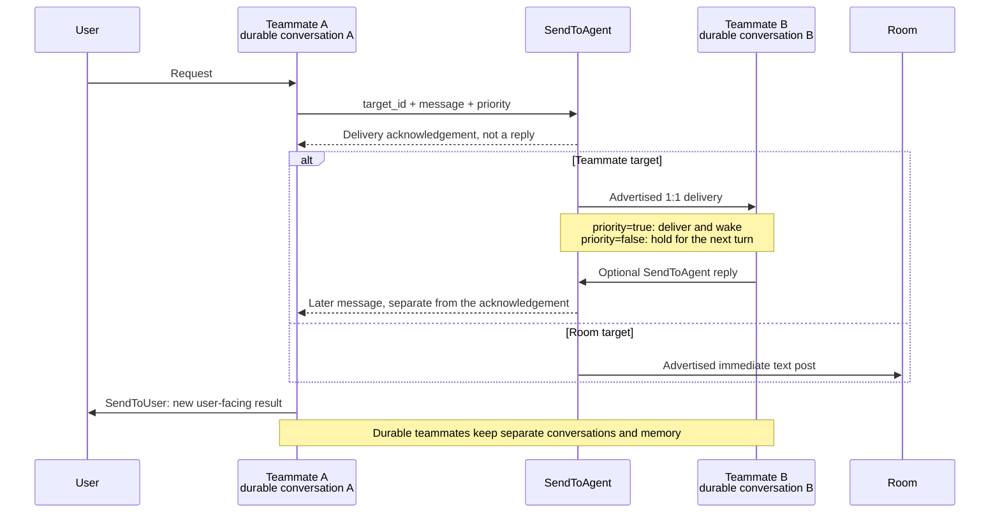
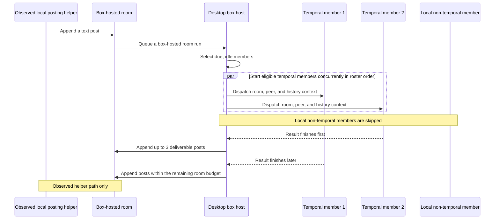

# Grok Bot 0.71.2 agent teams: 100 questions / Grok Bot 0.71.2 助手团队：100 问

Grok Bot 0.71.2 teams let product engineers combine durable teammates, asynchronous handoffs, and rooms. This guide explains what persists, what a send acknowledgement means, when members run, and which limits and failure modes matter when designing workflows. It focuses on product behavior and integration contracts rather than bundle internals.

Grok Bot 0.71.2 助手团队让产品工程师可以组合持久助手、异步交接和群聊房间。本指南说明哪些状态会保留、发送回执代表什么、成员何时运行，以及设计工作流程时需要考虑的上限和失败情况，重点关注产品行为和集成约定，而不是代码包内部实现。

## Scope and confidence / 范围与置信说明

`box` means the local desktop host; `temporal` means backend-executed work. A box-hosted room can contain temporal members. The reviewed material covers executable desktop and box-hosted paths together with requests sent to backend execution, but not the backend room implementation or the production `SendToAgent` implementation. Cloud orchestration, production routing and wake behavior, live feature gates, and server persistence therefore cannot be assumed. A local profile or transcript may be a mirror, and the presence of a code path does not prove that a live caller reaches it.

`box` 指本机桌面宿主，`temporal` 指由后端执行的工作；box 宿主房间可以包含 temporal 成员。审查材料覆盖可执行的桌面和 box 宿主路径，以及发往后端执行的请求，但不包含后端房间实现和生产环境的 `SendToAgent` 实现。因此，不能据此认定云端编排、生产路由和唤醒行为、实际功能开关或服务器持久化方式。本地资料或会话记录可能只是镜像；某条代码路径存在，也不能证明生产环境有实际调用方会进入该路径。

The guide uses four plain confidence labels:

本指南使用以下四种置信表述：

- **Observed host behavior / 已观察的宿主行为:** The executable desktop or box-hosted path performs this behavior. / 可执行的桌面或 box 宿主路径会执行该行为。
- **Advertised contract / 工具声明的约定:** A tool schema, description, acknowledgement, or prompt states this intent; that statement alone does not prove runtime enforcement. / 工具结构、说明、回执或提示词表达了该约定，但声明本身不能证明运行时会执行它。
- **Backend request contract / 后端请求约定:** Structured data crosses to backend execution, while the server implementation remains unavailable. / 结构化数据会传入后端执行流程，但服务器实现不可见。
- **Not established / 尚未确认:** The reviewed material cannot decide the production, cloud, rollout, or server-side behavior in question. / 现有材料无法判断相关生产、云端、功能发布或服务器端行为。

## Two behavior diagrams / 两个行为图示

### Diagram 1. Messaging contract: acknowledgement versus later reply / 图 1：消息约定——回执与稍后回复

Each `SendToAgent` call targets one teammate or room and requires `priority`. The advertised 1:1 contract says `true` delivers immediately and wakes the recipient, while `false` holds the message for the next turn; a reply, if any, arrives separately rather than inside the sender’s turn. An acknowledgement means acceptance for delivery, not reading, a reply, or a guaranteed wake. `SendToUser` is reserved for new user-facing results. This is an advertised-contract diagram, not proof of production routing or wake enforcement.

每次 `SendToAgent` 调用只面向一个助手或房间，并且必须提供 `priority`。工具声明的一对一约定是：`true` 立即投递并唤醒接收方，`false` 将消息保留到下一轮；如果对方回复，回复会另行到达，而不是包含在发送方当前轮次中。回执只表示接受投递，不表示对方已读、已经回复或一定会被唤醒。`SendToUser` 仅用于新的用户可见结果。本图展示的是工具声明的约定，不能证明生产路由或唤醒行为会照此执行。

### Diagram 2. Observed box-hosted room flow / 图 2：已观察到的 box 宿主房间流程

This diagram is limited to the observed local posting-helper path into a box-hosted room. It does not establish production `SendToAgent` routing, server user-message fan-out, or cloud architecture; direct user-turn execution on this box path is rejected. All eligible temporal members start concurrently in roster order, local non-temporal members are skipped, and returned posts are stored in completion order.

本图只说明已观察到的本地发布辅助路径如何进入 box 宿主房间，不能据此确认生产环境的 `SendToAgent` 路由、服务器分发用户消息的方式或云端架构；这条 box 路径也拒绝直接执行用户轮次。所有符合条件的 temporal 成员会按名单顺序并发启动，本地非 temporal 成员会被跳过，返回的可发布消息则按实际完成顺序写入房间。

## Limits / 上限

Use these as path-specific design limits, not universal cloud guarantees. The ten-post budget and three-wave threshold belong to an admission trigger; because the generic inbound reset is not connected on the inspected host path, both effectively apply per run there.

以下数值是特定路径上的设计上限，不是所有云端场景的统一保证。十条发言预算和三波阈值均按接收消息的触发周期计算；由于检查到的宿主路径没有接入通用的来信重置逻辑，这两项在该路径上实际按每次运行计算。

| Limit / 上限 | Value / 数值 | Scope and qualification / 范围与条件 |
|---|---:|---|
| Agent members / 助手成员 | Up to 6 / 最多 6 个 | Demonstrated at local and server-room creation; server enforcement during later membership updates is not established. / 已在本地和服务器房间创建路径体现；之后更新成员时服务器如何执行上限尚未确认。 |
| Room history / 房间历史 | Last 24 messages / 最近 24 条 | Applies to the observed formatting and backend-request path, not a universal cloud limit. / 适用于已观察到的格式化和后端请求路径，不是所有云端场景的统一上限。 |
| Text handling / 文本处理 | 8,000 characters / 8,000 字符 | Applies to teammate text and to room-history text and reply quotes on their respective paths; not a universal rich-post or cloud limit. / 分别适用于助手消息文本以及房间历史正文和回复引用，不是所有富内容或云端场景的统一上限。 |
| Room posting budget / 房间发言预算 | 10 per trigger; up to 3 per settled member dispatch / 每个触发周期 10 条；每次成员派发完成后最多 3 条 | Ten is room-wide, not per member; each member dispatch is also limited by the room’s remaining budget. / 十条是整个房间的预算，不是每个成员各十条；每次成员派发还受房间剩余预算限制。 |
| Ordinary room waves / 普通房间波次 | Three-wave threshold / 三波阈值 | The first three waves can admit all due members; afterward, ordinary eligibility is limited to owed catch-up. Catch-up starts may be non-forced and increase the wave count, forced starts are separate, and three is not a hard cap on non-forced waves. / 前三波可接纳所有到期成员，之后普通启动仅允许需要补看的成员参加。补看启动可以是非强制启动并继续增加波次；强制启动走单独路径，三波不是所有非强制波次的硬上限。 |
| Failed-turn redelivery / 失败轮次重新投递 | 2 redeliveries; at most 3 total attempts / 重新投递 2 次；含首次最多 3 次 | Applies to consecutive failed turns whose result was not shown; a shown result resets the failure count. / 适用于连续失败且结果未展示的轮次；一旦有结果展示，失败计数就会清零。 |

## A. Teammates, messages, and memory / A. 助手、消息与记忆

### 1. What is an agent team in this product? / 产品中的助手团队是什么？

**Answer.** A team is a roster of durable assistants, each with its own conversation, persona, memory, and asynchronous messaging. Profiles can bind an assistant to a server and select `box` or `temporal` execution; the roster also supports Team Bots and sectioned discovery. Shared configuration disables Team Bot discovery by default, but that setting does not establish the effective desktop rollout or server-side ownership.

**回答。** 团队是一份持久助手名单，每个助手都有自己的会话、人设、记忆和异步消息能力。助手资料可以绑定服务器，并选择 `box` 或 `temporal` 执行方式；名单还支持 Team Bot 和分区发现。共享配置默认关闭 Team Bot 发现，但该默认值不能确定桌面端实际是否开放，也不能说明服务器内部的归属规则。

### 2. Do two teammates share a conversation when they message each other? / 两个助手互发消息时会共用会话吗？

**Answer.** No. A and B keep separate conversations and model calls; `SendToAgent` sends a message between them rather than merging their context. The tool requires `priority`: its advertised contract says `true` delivers immediately and wakes B, `false` holds the message for B’s next turn, and a group post is immediate. The production send implementation is unavailable, and the observed local path appends messages for either value without showing a holding store or wake call, so production wake and hold behavior is not established.

**回答。** 不会。A 和 B 保留各自的会话和模型调用，`SendToAgent` 只在双方之间传递消息，不会合并上下文。该工具要求提供 `priority`：工具声明的约定是 `true` 立即投递并唤醒 B，`false` 将消息保留到 B 的下一轮，群聊消息则立即发布。生产环境的发送实现不可见，已观察到的本地路径对两种取值都只是追加消息，没有展示保留队列或唤醒调用，因此生产环境的唤醒和保留行为尚未确认。

### 3. What does a successful `SendToAgent` call guarantee? / `SendToAgent` 调用成功能保证什么？

**Answer.** It returns a delivery acknowledgement—either the implementation’s result string or `sent.ack`—not B’s answer. The call does not wait for B to run, and the tool contract forbids polling for a reply in the same turn. Treat acknowledgement as acceptance for delivery, not proof that B read the message, replied, or was guaranteed to wake; any reply must arrive separately.

**回答。** 调用返回的是投递回执，可能是实现给出的字符串，也可能是 `sent.ack`，而不是 B 的回答。调用不会等待 B 运行，工具约定也不允许在同一轮中轮询回复。回执只表示接受投递，不能证明 B 已读、已经回复或一定会被唤醒；如有回复，必须另行到达。

### 4. How does a later reply reach the sender? / 稍后的回复如何到达发送方？

**Answer.** The advertised contract delivers B’s reply as a later message: a priority reply wakes a hidden turn, while an informational reply waits for the next turn. Incoming teammate messages are marked `[agent]`, and the tool can resolve and forward an optional `task_id`. Production receipt and task routing are not established; the observed local receive path appends a user-role transcript entry, but its live caller and any later wake are unconfirmed.

**回答。** 工具声明的约定是把 B 的回复作为稍后的消息投递：priority 回复会唤醒一个隐藏轮次，普通信息回复则等待下一轮。传入的助手消息带有 `[agent]` 标记，工具还可以解析并转发可选的 `task_id`。生产环境的接收和任务路由尚未确认；已观察到的本地接收路径只会追加一条 user 角色的会话记录，其实际调用方和后续是否唤醒都没有确认。

### 5. How should a teammate interpret `[agent]` messages? / 助手应如何理解 `[agent]` 消息？

**Answer.** `[agent]` tells the model that the message came from another assistant, not from the user. Bundled guidance says to reply with `SendToAgent` only when useful, avoid acknowledgement loops, and reserve `SendToUser` for new user-facing results. It describes priority messages as user-visible and held messages as hidden; these are model instructions, not evidence that the unresolved delivery path enforces those rules.

**回答。** `[agent]` 告诉模型消息来自另一个助手，而不是用户。内置指引要求只在回复有用时使用 `SendToAgent`，避免反复互发确认，并把 `SendToUser` 留给新的用户可见结果。指引还把 priority 消息描述为用户可见、保留消息描述为不可见；这些只是对模型的指令，不能证明尚未确认的投递路径会执行这些规则。

### 6. Do private chats and rooms share one history? / 私聊和房间是否共用同一份历史？

**Answer.** Treat them as distinct contexts within one unified conversation, not as one undifferentiated transcript. Bundled guidance identifies room turns with group tags and untagged user messages as private DMs; it also allows one’s own unified private history to inform room work unless the user excluded it. The observed host request carries structured room history, but server history assembly and physical transcript storage are not established.

**回答。** 应把它们理解为同一会话中的不同上下文，而不是一份不加区分的记录。内置指引用群聊标记识别房间轮次，把没有该标记的用户消息视为私聊；除非用户排除，自己的统一私聊历史也可以用于房间工作。已观察到的宿主请求会携带结构化房间历史，但服务器如何组装历史以及实际如何存储会话记录尚未确认。

### 7. Who owns a teammate’s persona and memory during room work? / 助手在房间工作时，人设和记忆归谁所有？

**Answer.** The durable teammate identity owns its profile; joining a room does not replace that persona. On the observed box-hosted path, temporal members receive room, member, peer, and message context, while local non-temporal members are skipped and show no result. Memory can be scoped to a user, an assistant, a user–assistant pair, or a conversation, with team-audience rules and scoped storage targets.

**回答。** 持久助手身份拥有自己的资料，加入房间不会替换其既有人设。在已观察到的 box 宿主路径上，temporal 成员会收到房间、成员、其他助手和消息上下文，本地非 temporal 成员则会被跳过且不展示结果。记忆可以按用户、助手、用户与助手、会话等范围保存，并有团队受众规则和相应的按范围划分的存储目标。

### 8. Can one teammate read another teammate’s private chat? / 一个助手能读取另一个助手与用户的私聊吗？

**Answer.** Not through the supplied messaging or room context. A 1:1 send carries the supplied message, and a temporal room request carries room history and peer identities, not Alice’s private DMs; bundled guidance also forbids seeking a teammate’s private chats, memory, or files. Team-shared memory requires a separate explicit scope. These are context and prompt boundaries, not an OS-level block on every file-reading tool, and actual server privacy enforcement is not established.

**回答。** 通过系统提供的消息和房间上下文不能读取。一对一发送只携带本次提供的消息，temporal 房间请求只携带房间历史和其他助手身份，不包含 Alice 的私聊；内置指引也禁止主动查找其他助手的私聊、记忆或文件。团队共享记忆需要单独的明确范围。这些只是上下文和提示词边界，不代表所有文件读取工具都有操作系统级隔离，服务器实际如何执行隐私限制也尚未确认。

### 9. When does a message start another turn? / 消息何时会开始新一轮？

**Answer.** A turn is one assistant run, including its tool calls and stop; `SendToAgent` does not run B’s reply inside A’s turn. Although `priority` advertises wake-now versus next-turn behavior, production triggering is not established. The observed local receive methods only append transcript entries, and the direct local box-turn path rejects execution, so do not design around a guaranteed peer-message wake.

**回答。** 一轮是一次助手运行，包括其中的工具调用和结束过程；`SendToAgent` 不会在 A 的当前轮次中运行 B 的回复。虽然 `priority` 声明了立即唤醒或等待下一轮的行为，但生产环境实际如何触发尚未确认。已观察到的本地接收方法只追加会话记录，直接执行本地 box 轮次的路径会拒绝执行，因此不要把工作流程建立在助手消息一定会唤醒对方这一假设上。

### 10. When should I use a teammate instead of a Task-style subagent? / 何时应使用助手，而不是 Task 式子助手？

**Answer.** Use a teammate for a durable collaborator with its own conversation and mailbox; its reply arrives later as a separate message. Use a Task-style subagent for a child task whose final result returns to its parent as a nested tool result. The child’s work can continue after the parent’s turn ends.

**回答。** 如果需要拥有自己会话和收件箱的持久协作者，应使用助手；它的回复会稍后作为单独消息到达。如果需要由父助手启动子任务，并把最终结果作为嵌套工具结果返回给父助手，应使用 Task 式子助手。父助手结束当前轮次后，子任务仍可以继续工作。

## B. Persistence, membership, and administration / B. 持久化、成员与管理

### 11. What makes a teammate persistent? / 什么让助手具备持久状态？

**Answer.** A durable profile, a separate session, and scoped memory make a teammate persistent. The desktop roster keeps a local profile and optional room membership record for each teammate and opens a per-agent session; profiles can also carry server binding and execution metadata. These local files may be mirrors rather than authoritative state, so their presence does not prove local execution, and live storage overrides or cloud mirroring boundaries are not established.

**回答。** 持久资料、独立会话和按范围保存的记忆共同构成助手的持久状态。桌面名单为每个助手保存本地资料和可选的房间成员记录，并打开该助手独立的会话；资料还可以包含服务器绑定和执行方式信息。这些本地文件可能只是镜像，而不是权威状态，因此不能据此证明在本地执行；实际生效的存储覆盖方式和云端镜像边界也尚未确认。

### 12. How does the product distinguish a teammate from a room? / 产品如何区分普通助手和房间？

**Answer.** On the desktop, a room is recognized by a readable room configuration containing at least one valid member ID; an ordinary teammate has no such room membership configuration. A temporal profile prevents local orchestration but does not prevent the desktop from recognizing the room. Treat identification and execution hosting as separate decisions.

**回答。** 在桌面端，可读取且至少包含一个有效成员 ID 的房间配置会被识别为房间；普通助手没有这种房间成员配置。temporal 资料会阻止本地编排，但不会妨碍桌面端识别房间。因此，房间身份识别和实际执行位置是两个独立判断。

### 13. What room membership state is stored locally? / 本地会保存哪些房间成员状态？

**Answer.** The supported desktop room configuration stores only a format version and the member IDs. Extra properties are ignored when read and removed if the configuration is rewritten, so do not rely on them as durable local state. Server-backed rooms are managed through backend requests, and their server-side records are not visible.

**回答。** 桌面端支持的房间配置只保存格式版本和成员 ID。额外属性在读取时会被忽略，重写配置时会被删除，因此不要把这些属性当作可靠的本地持久状态。服务器房间通过后端请求管理，其服务器端记录不可见。

### 14. How many agent members can a room have? / 一个房间最多可以有多少个助手成员？

**Answer.** Demonstrated local and server-room creation paths deduplicate member IDs and allow at most six agent members. Local creation silently drops IDs missing from the roster; server-room creation instead preflights non-temporal members and rejects a missing or invalid local profile. The visible membership-update client does not truncate the list, so server enforcement of the six-member limit during later updates is not established.

**回答。** 已观察到的本地和服务器房间创建路径都会对成员 ID 去重，并最多保留 6 个助手成员。本地创建会静默丢弃名单中不存在的 ID；服务器房间创建则会预检非 temporal 成员，本地资料缺失或无效时会拒绝创建。可见的成员更新客户端不会截断名单，因此之后更新成员时服务器如何执行 6 个成员的上限尚未确认。

### 15. Can a room contain another room as a member? / 房间可以把另一个房间设为成员吗？

**Answer.** Not on the observed local management paths: creation and update reject nested rooms. If an existing stored configuration contains a room ID as a member, resolution skips that entry and logs a warning rather than running the nested room recursively. The desktop backend client does not establish whether a server applies the same validation.

**回答。** 在已观察到的本地管理路径上不可以：创建和更新都会拒绝嵌套房间。如果已有存储配置把房间 ID 写成成员，解析时会跳过该项并记录警告，而不会递归运行这个房间。桌面端的后端客户端无法证明服务器是否会执行同样的校验。

### 16. What happens if I create another room with the same members? / 创建成员完全相同的新房间会发生什么？

**Answer.** The observed creation flows do not search for an existing room with the same member set. Local creation makes a new assistant and marks it as a room; the server-room client requests a fresh random UUID and requires the response to confirm that same ID. Repeated member IDs within the new roster are deduplicated, but server-side room deduplication is not visible, and a different returned room ID fails this client’s confirmation.

**回答。** 已观察到的创建流程不会查找成员集合相同的现有房间。本地创建会生成一个新助手并把它标记为房间；服务器房间客户端会请求使用新的随机 UUID，并要求响应确认同一个 ID。新名单中的重复成员 ID 会被去重，但服务器是否会对房间本身去重不可见；如果返回不同的房间 ID，该客户端的确认检查会失败。

### 17. Can a teammate delete another teammate through a model tool? / 助手可以通过模型工具删除另一个助手吗？

**Answer.** No delete-agent tool is registered in the inspected model-tool set. Model-facing management supports operations such as `CreateAgent` and `UpdateAgent`, while `CreateAgent` directs the user to delete assistants from the sidebar. The host also exposes deletion for UI or host use, but that capability is not registered as a model tool.

**回答。** 检查到的模型工具集中没有注册删除助手的工具。面向模型的管理功能包括 `CreateAgent` 和 `UpdateAgent` 等操作，而 `CreateAgent` 会引导用户从侧边栏删除助手。宿主也向界面或宿主自身提供删除能力，但没有把它注册为模型工具。

### 18. How do I rename or update a teammate? / 如何重命名或更新助手？

**Answer.** An assistant updates itself with `UpdateProfile`; supplied profile fields are applied with `target:"profile"` and `action:"set"`, and settings can be updated separately. Rename another assistant with patch-style `UpdateAgent`: blank name or description values are ignored, and an empty patch returns “Nothing to update”. Actual tool availability depends on runtime dependencies, and lower-level server validation is not visible.

**回答。** 助手通过 `UpdateProfile` 更新自己；传入的资料字段会按 `target:"profile"` 和 `action:"set"` 应用，设置项可以单独更新。重命名其他助手使用补丁式的 `UpdateAgent`：空白名称或描述会被忽略，没有有效字段时返回 “Nothing to update”。实际提供哪些工具取决于运行时依赖，服务器底层的进一步校验不可见。

### 19. How many teammates and rooms can the model discover from the roster? / 模型可以通过名单发现多少助手和房间？

**Answer.** Roster renderers can list up to 40 addresses, with layout differences. The unsectioned layout lists up to 40 other addresses plus up to 40 detailed groups; sectioned mode shares 40 slots across roster categories and keeps a separate detailed-group list, while other variants shorten the roster or move it into user information. Shared runner and evaluation baselines disable roster and Team Bot discovery by default unless explicitly overridden, but these defaults do not establish the effective desktop rollout.

**回答。** 名单渲染器最多可以列出 40 个地址，不同布局有所差异。未分区布局最多列出 40 个其他地址，并另外列出最多 40 个详细群聊；分区布局让各类名单共享 40 个位置，同时保留单独的详细群聊列表，其他变体会精简名单或把它放入用户信息。共享运行配置和评测基线默认关闭名单及 Team Bot 发现，除非显式覆盖；这些默认值不能确定桌面端实际开放情况。

### 20. What can the model do when the roster is incomplete? / 名单信息不足时，模型可以如何查找？

**Answer.** When local roster access is available, the instructions tell the model to use `Shell` to inspect the relevant teammate profile or room record as the freshest source; several roster layouts include this fallback. The `SendToAgent` description names `ListAgents` and `ListGroups`, but no corresponding tool registrations were found in the reviewed material. The registered management tools include `ListSections`, `CreateAgent`, and `UpdateAgent`; the absence of `ListAgents` and `ListGroups` does not rule out separately supplied server-only tools.

**回答。** 如果宿主提供本地名单访问能力，指引会要求模型使用 `Shell` 查看相关助手资料或房间记录，把它作为最新的查找来源；多种名单布局都包含这条补充路径。`SendToAgent` 的说明提到 `ListAgents` 和 `ListGroups`，但审查材料中没有找到对应的工具注册。已注册的管理工具包括 `ListSections`、`CreateAgent` 和 `UpdateAgent`；没有找到 `ListAgents` 和 `ListGroups` 的注册，并不排除其他运行环境单独提供服务器专用工具。

## C. Messaging tools and input validation / C. 消息工具与输入校验

### 21. Which tool should I use to message the user or a teammate? / 应该使用哪个工具联系用户或助手？

**Answer.** Use `SendToUser` for messages to the user; `SendMessage` is an execution alias, not a separately offered tool. The advertised local group-chat contract says `SendToUser` posts to the room by default, while `to:"dm"` sends private text to the user's 1:1 chat. Use `SendToAgent` to contact another assistant or a group. This room/DM routing is a tool contract; the reviewed artifacts do not independently verify the production server behavior behind it.

**回答。** 向用户发消息时使用 `SendToUser`；`SendMessage` 只是执行别名，不会作为另一款工具单独提供。工具说明约定，在本地群聊轮次中，`SendToUser` 默认发到房间，设置 `to:"dm"` 则向用户的一对一聊天发送私人文本；联系其他助手或群聊使用 `SendToAgent`。这些路由规则属于工具声明的约定，现有材料没有独立验证背后的生产服务端行为。

### 22. Which parameters should I use with `SendToAgent`? / 调用 `SendToAgent` 时应使用哪些参数？

**Answer.** `SendToAgent` requires `target_id`, `message`, and boolean `priority`; `images` and `task_id` are optional. Each image requires a `file://` or `https://` URL and may include `alt`. Several legacy parameter aliases remain accepted for compatibility, and `task_id` can direct a reply to a task thread.

**回答。** `SendToAgent` 的必填参数是 `target_id`、`message` 和布尔值 `priority`，选填参数是 `images` 和 `task_id`。每张图片必须使用 `file://` 或 `https://` 地址，可以附带 `alt`；工具仍兼容几个旧参数别名，`task_id` 可以把回复指定到某个任务串。

### 23. What happens if I target the sender itself? / 如果把发送者自己设为目标，会怎样？

**Answer.** `SendToAgent` rejects self-targeting. Its actionable error is `You can't message yourself with SendToAgent. Use SendToUser to talk to the user, or pick a different target id.` A separate observed local send path performs the same check with different wording, so handle the rejection rather than depending on one universal error string.

**回答。** `SendToAgent` 会拒绝把发送者自己设为目标。错误文案为 `You can't message yourself with SendToAgent. Use SendToUser to talk to the user, or pick a different target id.` 观察到的本地发送路径另有同样检查，但措辞不同，因此集成应处理拒绝结果，不要依赖统一错误文案。

### 24. How is an empty message rejected? / 空消息会如何被拒绝？

**Answer.** Whitespace is trimmed from `message`, and an empty result is rejected during parameter validation before execution. Observed local and remote send paths also defensively return `Message was empty; nothing was sent.`, but that helper acknowledgement is not the result of an ordinary invalid tool call. Treat blank text as a validation error, not a successfully delivered no-op.

**回答。** `message` 会先去除两端空白，结果为空时在参数校验阶段被拒绝，不会进入执行。观察到的本地和远程发送路径也会防御性地返回 `Message was empty; nothing was sent.`，但这不是普通无效工具调用的返回结果。集成应把空白消息视为校验错误，而不是已成功投递的空操作。

### 25. What error should I handle for an unknown target? / 目标不存在时应处理什么错误？

**Answer.** On the observed local path, an unknown recipient returns `No agent found with id <id>.` A remote send returns the acknowledgement supplied by its delivery result, while remote inbound handling reports `target_not_found` for a missing target. Do not assume the local wording is the exact acknowledgement returned by a production remote send.

**回答。** 观察到的本地路径在目标不存在时返回 `No agent found with id <id>.`。远程发送使用投递结果给出的确认语，远程接收处理则把缺失目标报告为 `target_not_found`。不要把本地文案当作生产远程发送一定会返回的确切确认语。

### 26. How is a deleted teammate different from an unknown target? / 已删除的助手与不存在的目标有何区别？

**Answer.** On the observed local path, a deleted recipient is detected before roster lookup and returns `That agent no longer exists.` Remote inbound handling reports the same `target_not_found` outcome for deleted and unknown assistants, so that result cannot distinguish the two cases. The exact production remote-send acknowledgement remains unverified.

**回答。** 观察到的本地路径会先识别已删除的接收者，再查名单，并返回 `That agent no longer exists.`。远程接收处理对已删除和不存在的助手都报告 `target_not_found`，因此该结果无法区分这两种情况。生产远程发送的确切确认语仍未得到验证。

### 27. Can I send to another user's shared room? / 能否向其他用户的共享房间发送消息？

**Answer.** Delivery to another user's shared room is not established because the production router is not included in the reviewed artifacts. The observed local path performs roster lookup and group handling without a rejection specific to a shared chat hosted by another user, and group posting checks membership. Remote inbound handling also has group-specific outcomes, but these paths do not prove end-to-end production delivery.

**回答。** 现有材料没有包含生产路由，因此无法确认能否向其他用户托管的共享房间投递消息。观察到的本地路径会查名单并进入群聊处理，没有专门针对此类共享聊天的拒绝逻辑；向群聊发帖时会检查成员身份。远程接收处理也有群聊相关结果，但这些路径都不能证明生产环境可以完成端到端投递。

### 28. How long can a teammate message be? / 发给助手的消息最长可以是多少？

**Answer.** Observed local and remote-peer send paths truncate teammate message text at 8,000 characters, although the tool schema declares no maximum. A separate backend-executed room-history path also limits message text and reply quotes to 8,000 characters. Treat these as path-specific handling limits, not a universal rich-post limit or a guarantee for every server-hosted route.

**回答。** 观察到的本地及远程助手发送路径会把消息正文截断到 8,000 字符，但工具参数定义没有声明最大长度。另一条后端执行的房间历史路径也会把消息正文和回复引用限制为 8,000 字符。这些只是特定路径的处理限制，不能当作所有富文本帖子或服务器托管路由的统一上限。

### 29. Which delivery paths support images? / 哪些投递路径支持图片？

**Answer.** Image support depends on the delivery path. The tool advertises images for 1:1 messages, and the observed local inbound path can store them in history. The advertised contract excludes images from group delivery, which the observed local path handles by discarding them with a warning; observed remote-peer sends are text-only. The artifacts do not establish image behavior on uninspected production routes or whether and how images reach the model.

**回答。** 图片能否送达取决于投递路径。工具说明声明一对一消息支持图片，观察到的本地接收路径也能把图片写入历史。工具约定群聊投递不包含图片，观察到的本地路径会丢弃图片并附加警告；观察到的远程助手发送也只包含文字。现有材料无法确认未审查生产路径的图片行为，也没有展示图片是否以及如何交给模型。

### 30. Can I contact multiple assistants in one turn? / 能否在一轮中联系多个助手？

**Answer.** One `SendToAgent` call has one recipient: validation rejects `target_ids` or `targets` when no single `target_id` is supplied. Multiple separate calls are possible, and the reviewed artifacts show no per-turn recipient counter. A separate prompt instruction requires explicit user approval before contacting multiple assistants. The schema check is executable validation; the approval requirement is not demonstrated as a runtime gate.

**回答。** 每次 `SendToAgent` 调用只能有一个接收者：没有提供单一 `target_id` 而传入 `target_ids` 或 `targets` 时，参数校验会拒绝调用。可以连续发起多次调用，现有材料没有展示每轮接收者计数器。另有提示词要求，联系多个助手前必须得到用户明确同意。参数检查是可执行校验，而同意要求并未被证明是运行时强制限制。

## D. 1:1 history, visibility, and replies / D. 一对一历史、可见性与回复

### 31. What does the sender's history record after a send? / 发送后，发送方历史会记录什么？

**Answer.** On the observed local path, an outbound send adds an assistant-authored entry to the sender's history with the recipient identity, text, timestamp, and optional images. It requires a live sender session and returns without writing if none exists. The entry goes to the active history when that session is selected, otherwise to that session's own stored history. Local delivery records this outbound entry only after the recipient's inbound write is accepted.

**回答。** 观察到的本地路径会在发送方历史中添加一条助手角色记录，包含接收者身份、正文、时间和可选图片。写入需要可用的发送方会话；没有会话时直接返回，不写历史。该会话若正被选中，就写入当前历史，否则写入这个会话自己的存储。本地投递会先确认接收方的来信写入成功，再记录发送方的发出记录。

### 32. What appears in the recipient's history before a response? / 接收方回复前，其历史中会写入什么？

**Answer.** On the observed local receive path, the recipient's history immediately gains a user-role entry identifying the sending teammate, with text, timestamp, and optional images, before the model runs. This write is not conditioned on whether the message is visible to the user. A separate prompt instruction says priority messages are visible while held informational messages are hidden. The artifacts do not show how that visibility policy connects to the active delivery pipeline.

**回答。** 观察到的本地接收路径会在模型运行前，立即向接收方历史写入一条用户角色记录，标识发送助手并保存正文、时间和可选图片。是否向用户展示并不影响这次历史写入。另有提示词规定优先消息对用户可见，暂缓的信息性消息则隐藏。现有材料没有展示这套可见性规则如何接入实际使用的投递流程。

### 33. How does history identify the other assistant? / 历史记录如何标识另一位助手？

**Answer.** History entries identify the other assistant and whether the message was received or sent. This preserves the conversation partner and direction in the observed local history, but it does not establish a separately maintained partner set or another relationship store.

**回答。** 历史记录会标识另一位助手，并区分消息是收到还是发出。这些信息足以在观察到的本地历史中保留对话对象和方向，但不能证明系统另维护独立的伙伴集合或其他关系存储。

### 34. Can I rely on a specific 1:1 queue or wake mechanism? / 能否依赖特定的一对一队列或唤醒机制？

**Answer.** No. The reviewed artifacts do not connect `SendToAgent` to a specific 1:1 queue or prove that informational messages are held in the generic agent queue. The visible local prompt path rejects server-hosted turns and is retired on the local desktop-host path, while the production send implementation is not visible. Do not infer 1:1 scheduling from group delivery or from the existence of a generic scheduler.

**回答。** 不能。现有材料没有把 `SendToAgent` 接到某个一对一队列，也不能证明信息性消息会暂存在通用助手队列中。可见的本地提示执行路径拒绝服务器托管回合，在本地桌面宿主路径上则已停用；生产发送实现不可见。不要根据群聊投递或通用调度器的存在推断一对一消息的调度方式。

### 35. Can I rely on a hidden prompt to wake a teammate? / 能否依赖隐藏提示唤醒助手？

**Answer.** No hidden 1:1 wake-up mechanism is established for integrations. The host can recognize hidden-prompt markers, but the reviewed artifacts show no 1:1 runner invocation using a hidden turn, so marker recognition alone does not prove an active local wake path. Do not build around a marker string or assume a particular wake visibility behavior.

**回答。** 现有材料没有确立可供集成依赖的隐藏一对一唤醒机制。宿主能够识别隐藏提示标记，但没有展示使用隐藏回合的一对一运行调用，因此标记识别本身不能证明本地唤醒路径正在工作。不要围绕某个标记字符串设计集成，也不要假定唤醒时采用特定可见性行为。

### 36. When may a teammate stay silent after receiving a message? / 助手收到消息后，何时可以不回复？

**Answer.** The prompt allows a teammate to stay silent when a peer message leaves nothing useful to add. This is a reply instruction, not demonstrated runtime enforcement: the observed local receive path does not show a silence-control mechanism, and remote or server enforcement is not visible. The artifacts also do not establish whether a later reminder can interrupt that silence.

**回答。** 提示词允许助手在同伴消息没有值得补充的内容时保持沉默。这是回复指引，不是已验证的运行时强制行为：观察到的本地接收路径没有展示沉默控制机制，远程或服务端如何执行也不可见。现有材料还无法确认后续提醒是否会打断这种沉默。

### 37. How should a teammate handle a pure FYI? / 助手应如何处理纯知会消息？

**Answer.** A pure FYI needs no reply acknowledging receipt; reply only when asked or when there is something useful to add. The `SendToAgent` description advertises that `priority=false` starts no turn and instead becomes context at the recipient's next turn. These are prompt reply instructions and an advertised delivery contract, not evidence of the underlying holding or wake implementation.

**回答。** 纯知会消息不需要再回复“收到”；只有被提问或确有有用内容可补充时才回复。`SendToAgent` 的说明约定，`priority=false` 不会启动新回合，而会作为接收方下一轮的上下文。前者是提示词中的回复要求，后者是工具声明的投递约定，两者都不能证明底层暂存或唤醒实现。

### 38. Can I wait for a teammate's reply in the same turn? / 能否在同一轮中等待助手回复？

**Answer.** No. `SendToAgent` is fire-and-forget: the call returns a delivery acknowledgement, not the teammate's reply, and its description forbids waiting or polling within the same turn. The advertised contract says a priority reply wakes the sender later, while an informational reply waits until the sender's next turn. The holding and wake implementations were not located, so those timings are not independently verified production behavior.

**回答。** 不能。`SendToAgent` 采用发出后不等待的方式：调用返回投递确认，而不是助手回复，工具说明也禁止在同一轮中等待或轮询。其约定称，优先回复会在此后唤醒发送方，信息性回复则等到发送方下一轮再出现。由于未找到暂存和唤醒实现，这些时序尚未被独立验证为生产行为。

### 39. How do local and remote send acknowledgements differ? / 本地与远程发送确认有何区别？

**Answer.** On the observed local path, a normal-send acknowledgement says the message was sent and that any reply will arrive later as an asynchronous message. Remote sends return the acknowledgement supplied by their delivery result, so the exact wording can differ. Do not depend on one acknowledgement string across local and remote paths.

**回答。** 观察到的本地路径中，普通发送确认会说明消息已发送，如有回复，将在稍后作为异步消息到达。远程发送返回投递结果提供的确认语，因此具体措辞可能不同。不要依赖本地与远程路径使用同一句确认文案。

### 40. What does a priority acknowledgement actually promise? / 优先发送确认实际承诺了什么？

**Answer.** On the observed local path, a priority acknowledgement says the message jumps the queue and interrupts routine or background work; if the recipient is handling the user or another assistant, delivery follows that turn. Replies remain asynchronous. For remote peers, the observed send path reports a normal send and says priority is unsupported. These are acknowledgement statements, not verified scheduling guarantees, because the interruption implementation is not shown.

**回答。** 观察到的本地路径中，优先发送确认称消息会插队并打断例行或后台工作；如果接收方正在处理用户或另一位助手，则在该回合结束后投递。回复仍是异步的。对于远程助手，观察到的发送路径会报告按普通消息发送，并说明不支持优先级。这些只是确认语所述行为；由于没有展示打断实现，不能把它们当作已验证的调度保证。

## E. Message priority and delivery recovery / E. 消息优先级与投递恢复

### 41. What does `priority` mean when sending a message? / 发送消息时，`priority` 表示什么？

**Answer.** `priority: true` requests an immediate recipient wake; `priority: false` leaves the message for a later turn without waking the recipient. This is the advertised tool contract: the reviewed local receive method only appends each message to the transcript and does not schedule a wake. The artifacts do not show the server storage or ordering needed to implement that contract.

**回答。** `priority: true` 表示请求立即唤醒接收方；`priority: false` 表示把消息留到后续轮次，不主动唤醒。这是工具声明的约定；已审查的本地收件方法只是把每条消息追加到聊天记录，并不安排唤醒。现有材料没有展示服务端实现这项约定所需的存储和排序。

### 42. Which running work can a priority message interrupt? / 优先消息可以中断哪些正在运行的工作？

**Answer.** The send acknowledgement limits priority interruption to routine or background work; it excludes user turns and turns handling another agent's message. Treat this as the advertised boundary, not proof of runtime enforcement. The local receive path only appends the message, so it cannot establish when the server actually interrupts active work.

**回答。** 发送确认文本称，优先消息只会中断常规或后台工作，不会中断用户轮次或正在处理其他助手消息的轮次。应把这理解为声明的边界，而不是已经验证的运行时强制执行。本地收件路径只追加消息，无法据此确认服务端实际何时中断活动任务。

### 43. When must a priority message wait? / 优先消息在什么情况下必须等待？

**Answer.** The acknowledgement says a priority message waits while the recipient is handling a user turn or another agent's message. Do not use `priority` to overtake those protected turns. The reviewed paths describe this delivery contract but do not show how the server coordinates waiting messages with active user or agent work.

**回答。** 确认文本称，接收方正在处理用户轮次或其他助手的消息时，优先消息必须等待，不能用 `priority` 越过这些受保护的轮次。已审查的路径说明了这项投递约定，但没有展示服务端如何协调等待中的消息与正在进行的用户或助手工作。

### 44. Does `priority` change room-post delivery? / `priority` 会改变房间发言的投递方式吗？

**Answer.** In a `box`-hosted room (hosted by the local desktop app), either `priority` value posts immediately, with no additional delivery or interruption effect from the flag. The post still starts a newer room turn and can supersede pending `temporal` (backend-executed) member turns from the preceding turn. That supersession is ordinary room behavior, not a priority feature. Server-hosted room behavior is not established.

**回答。** 在 `box`（本地桌面宿主）托管的房间中，`priority` 取任意值都会立即发言，该标志不会额外改变投递方式或增加中断效果。发言仍会开启更新的房间轮次，并可能替换上一轮中等待完成的 `temporal`（由后端执行）成员轮次。这种替换是房间的普通行为，不是优先消息特有的功能；服务器托管房间的行为尚未确立。

### 45. Can I rely on a record of priority-message interruption? / 可以依赖优先消息的中断记录吗？

**Answer.** Not from the reviewed behavior. The observed host tracks pending `temporal` member turns and cancels them when newer room work supersedes the previous turn; that bookkeeping records room supersession, not steering by a priority direct message. The artifacts contain no server-side steering records, so they do not establish what is recorded when such a message interrupts a room member.

**回答。** 现有行为不能提供这种保证。观察到的宿主会跟踪等待完成的 `temporal` 成员轮次，并在新房间工作替换上一轮时取消它们；这些记录对应房间轮次替换，不是优先私聊消息造成的中断。材料中没有服务端的中断记录，因此无法确认这类消息中断房间成员时会记录什么。

### 46. What happens when a priority message arrives during batch processing? / 批处理期间收到优先消息会怎样？

**Answer.** The reviewed local receive path appends each message immediately. It exposes no inbound batch loop, between-message priority check, or remaining batch that is marked and merged back into a queue, so do not design around such reordering. The advertised wake-or-hold contract does not specify how a server inserts a priority message into a batch already being processed.

**回答。** 已审查的本地收件路径会立即追加每条消息。该路径没有展示收件批处理循环、消息之间的优先检查，也没有需要标记并合并回队列的剩余批次，因此不要基于这类重排设计流程。工具声明的唤醒或保留约定，并未说明服务端如何把优先消息插入正在处理的批次。

### 47. Can I rely on a specific inbound merge order? / 可以依赖固定的收件合并顺序吗？

**Answer.** No. The local receive path appends messages directly to the transcript and does not implement inbound-message merging. Local run-task scheduling is a separate concern and does not define the order in which messages are merged. The reviewed artifacts expose no server-side inbound merge rule.

**回答。** 不能。本地收件路径直接把消息追加到聊天记录，没有实现收件消息合并。本地运行任务的调度是另一件事，不能用来定义消息的合并顺序。现有材料也没有展示服务端的收件合并规则。

### 48. How are duplicate inbound messages handled? / 系统如何处理重复的收件消息？

**Answer.** The observed receive paths prevent duplicate transport entries in different ways: remote-peer receiving uses in-memory message IDs and in-flight records, while cloud-agent receiving uses deterministic entry IDs and skips an ID that already exists. The common transcript append does not check whether a message has been displayed. These mechanisms prevent duplicate transport entries; they do not prove on-screen visibility.

**回答。** 观察到的收件路径通过不同方式防止重复的传输条目：远程助手收件使用内存中的消息 ID 和投递中记录，cloud-agent 收件使用确定的条目 ID，并跳过已存在的 ID。通用聊天记录追加逻辑不检查消息是否已经显示。这些机制防止传输产生重复条目，但不能证明消息已显示在屏幕上。

### 49. Do room retries also apply to 1:1 peer wakes? / 房间重试也适用于一对一助手唤醒吗？

**Answer.** No. After a failed room turn, the observed delivery path restores the prior room-delivery position and allows at most two consecutive redeliveries: three dispatches at most, including the initial one. A shown result resets the failure count. This room policy does not requeue a 1:1 peer wake, and the reviewed paths expose no peer-wake retry rule or server-side equivalent.

**回答。** 不适用。房间轮次失败后，观察到的投递路径会恢复先前的房间投递位置，最多连续重投两次，即包括首次派发在内最多三次。结果展示后，失败计数会重置。这套房间策略不会把一对一助手唤醒重新排队；已审查的路径也没有展示助手唤醒的重试规则或服务端对应机制。

### 50. What happens to an aborted 1:1 peer wake? / 一对一助手唤醒中止后会怎样？

**Answer.** The reviewed artifacts do not establish whether it is requeued or dropped. The local remote-receive path validates, deduplicates, and appends messages without starting a local model run, so it contains no abort-recovery decision for a peer wake. Do not substitute the room redelivery policy; server-side peer-wake abort handling and retries are not exposed.

**回答。** 现有材料无法确定中止后应重新排队还是丢弃。本地远程收件路径只校验、去重并追加消息，不启动本地模型轮次，因此其中没有助手唤醒中止后的恢复决策。不能套用房间重投策略；服务端如何处理助手唤醒中止以及是否重试，均未展示。

## F. Task order and interruption / F. 任务顺序与中断

### 51. When local work is queued, what runs first? / 本地工作排队时，什么先运行？

**Answer.** When the observed generic local scheduler is enabled, queued user work runs first, then agent work, then background work. With that scheduler disabled, work is serialized separately for each agent without applying this priority order. This is a local scheduling rule only; it does not establish server execution or message ordering.

**回答。** 观察到的通用本地调度器启用时，排队任务按用户工作、助手工作、后台工作的顺序运行。调度器禁用时，工作按助手分别串行执行，不应用这套优先顺序。这只是本地调度规则，不能据此确立服务端的执行顺序或消息顺序。

### 52. Will local scheduling stop a turn that is already running? / 本地调度会停止正在运行的轮次吗？

**Answer.** Ordinarily, no: the scheduler waits while another turn is active. After a user task has waited 120 seconds, a watchdog marks the active phase interrupted and allows a 30-second grace period before releasing queue ownership and moving on. Any later settlement is tracked separately. Releasing the queue does not prove that the underlying work has stopped.

**回答。** 通常不会；已有轮次处于活动状态时，调度器会等待。用户任务等待 120 秒后，看门狗会把活动阶段标记为中断，再给予 30 秒宽限期，随后释放队列占用并继续处理。之后到达的结算会被单独跟踪。释放队列并不等于底层工作已经停止。

### 53. Does a new 1:1 user message interrupt active work? / 新的一对一用户消息会中断正在运行的任务吗？

**Answer.** A new 1:1 user message cannot be assumed to interrupt active work. `temporal` user sends use a backend send path, and a separate interruption capability exists, but neither proves that every send interrupts a run. The inspected box-local send path refuses execution and its interruption path reports no active run, so these paths do not reveal the server's behavior.

**回答。** 不能默认新的一对一用户消息会中断活动任务。`temporal` 用户消息通过后端发送路径处理，虽然另有独立的中断能力，但两者都不能证明每次发送都会中断运行。已检查的 box 本地发送路径拒绝执行，中断路径则报告没有活动轮次，因此这些路径没有揭示服务端的实际行为。

### 54. Can local user-first ordering prioritize room-member work? / 本地用户优先顺序能调整房间成员任务的优先级吗？

**Answer.** Not based on the observed room path. The generic scheduler contains a preference involving non-member user work, but the host does not enqueue room members as competing local tasks: it skips local non-`temporal` members and dispatches `temporal` members directly to the backend. The demonstrated user-priority room example is a form-response wake. This generic rule therefore does not define room-member execution order.

**回答。** 不能根据观察到的房间路径得出这种结论。通用调度器确实包含一项偏向非成员用户工作的规则，但宿主不会把房间成员作为相互竞争的本地任务排队：本地非 `temporal` 成员会被跳过，`temporal` 成员直接派发到后端。实际展示的用户优先房间示例是表单响应唤醒。因此，这项通用规则不定义房间成员的执行顺序。

### 55. Does local ordering decide whether a peer wake or automation runs first? / 本地顺序能决定助手唤醒和自动化任务谁先运行吗？

**Answer.** No actual peer-versus-automation ordering is demonstrated. Although the generic scheduler checks agent work before background work, the host does not route local peer wakes through those queues. Local automation refuses `box` execution and `temporal` automation uses a separate path, so the reviewed artifacts do not show these two kinds of work competing through the local scheduler.

**回答。** 现有材料没有展示助手唤醒与自动化任务的实际先后关系。通用调度器虽然先检查助手工作，再检查后台工作，但宿主不会把本地助手唤醒送入这些队列。本地自动化拒绝在 `box` 中执行，`temporal` 自动化使用独立路径，因此没有证据表明这两类工作会通过本地调度器竞争执行顺序。

### 56. Can local ordering predict server ordering for user and peer messages? / 本地顺序能预测服务端对用户消息和助手消息的处理先后吗？

**Answer.** No. The generic local scheduler prefers user work over agent work, but ordinary 1:1 user turns and peer wakes do not enter that local path. One wired example gives a user-priority form-response wake precedence over an agent-work room post; it is not a general arbitration rule. Local scheduling therefore does not establish how the server sequences user and peer messages.

**回答。** 不能。通用本地调度器优先处理用户工作，再处理助手工作，但普通一对一用户轮次和助手唤醒不会进入这条本地路径。一个已接入的示例中，用户优先的表单响应唤醒先于作为助手工作的房间发言，但这不是通用仲裁规则。因此，本地调度不能确立服务端如何排列用户消息与助手消息的处理顺序。

### 57. What happens when a newer room post supersedes older work? / 新的房间发言替换旧工作时会发生什么？

**Answer.** On the observed `box`-hosted path, a new room post advances the current room turn and cancels pending `temporal` member turns from the preceding turn. The orchestrator continues only while its captured turn is still current and the room has not been deleted. Stale member results are suppressed. Cancellation and suppression do not prove that remote execution has stopped.

**回答。** 在观察到的 `box` 宿主路径中，新的房间发言会推进当前房间轮次，并取消上一轮中等待完成的 `temporal` 成员轮次。只有记录的轮次仍是当前轮次且房间未被删除时，编排流程才会继续。过期的成员结果会被阻止生效。取消和抑制结果都不能证明远程执行已经停止。

### 58. Does a person's ordinary room message start a new local room turn? / 用户的普通房间消息会启动新的本地房间轮次吗？

**Answer.** An ordinary local send does not start a `box` room turn on the reviewed path. A form-response wake is different: it marks a newer turn and queues user work, but it is not a plain composer message. `temporal` room sends go to the backend, and the artifacts do not expose server message acceptance or newer-work handling.

**回答。** 在已审查的路径中，普通本地发送不会启动 `box` 房间轮次。表单响应唤醒则不同：它会标记更新的轮次并将用户工作排队，但它不是普通输入框消息。`temporal` 房间消息会发往后端；现有材料没有展示服务端如何接收消息或处理新旧工作替换。

### 59. What happens when an agent posts to a `box`-hosted room? / 助手在 `box` 宿主房间发言时会发生什么？

**Answer.** The observed host appends the post, advances to a newer room turn, and queues that room turn as agent work. Members do not inherit a local queue category: local non-`temporal` members are skipped, while `temporal` members are dispatched directly to the backend. Advancing the turn also cancels pending `temporal` member turns from the preceding turn. This describes the box-hosted path, not server-hosted rooms.

**回答。** 观察到的宿主会写入发言、推进到更新的房间轮次，并把该房间轮次作为助手工作排队。成员不会继承某个本地队列类别：本地非 `temporal` 成员会被跳过，`temporal` 成员直接派发到后端。推进轮次还会取消上一轮中等待完成的 `temporal` 成员轮次。这些行为仅描述 box 宿主路径，不能推广到服务器托管房间。

### 60. Which stale work and results does supersession block? / 新工作替换旧工作时，会阻止哪些过期行为？

**Answer.** On the inspected host path, stale work cannot continue, retry, or publish member results, and pending `temporal` member turns are cancelled. Do not assume that new inbound messages can join the current run. These safeguards do not prove that backend execution has stopped.

**回答。** 在受检宿主路径上，过期工作不能继续运行、重试或发布成员结果，等待完成的 `temporal` 成员轮次也会被取消。不要假定新的入站消息可以加入当前运行。这些保护措施不能证明后端执行已经停止。

## G. How rooms run and respond / G. 房间如何运行与回应

### 61. How does a box-hosted room choose and run members? / box 宿主房间如何选择并运行成员？

**Answer.** In a box-hosted room—one run by the local desktop host—eligible temporal members, whose work executes on the backend, start concurrently. Local non-temporal members are skipped on this path and produce no shown result. The host tracks each member outcome while coordinating the run; this behavior does not establish how server-hosted rooms choose members.

**回答。** box 宿主房间由本地桌面宿主运行，其中符合运行条件的 temporal 成员会并发启动，其工作在后端执行。本地非 temporal 成员在这条路径上会被跳过，不会产生已展示结果。宿主在协调本次运行时跟踪各成员的结果；这些行为不能用于推定服务端宿主房间如何选择成员。

### 62. How many ordinary waves can one room run include? / 一次房间运行可以包含多少个普通波次？

**Answer.** The first three waves can admit all due members. After that, ordinary eligibility is limited to members still owed a catch-up for messages they missed and have not yet received. Catch-up starts can be non-forced and increase the wave count, so three is not a cap on every non-forced wave; forced starts are separate and do not increment it. An inbound-admission reset is available in the underlying runner, but the inspected host connection does not use it.

**回答。** 前 3 个波次可以接纳所有符合投递条件的成员。此后，普通资格仅限于仍需要补看错过消息、且尚未获得补看机会的成员。补看启动可以是非强制启动，也会增加波次计数，因此 3 不是所有非强制波次的硬上限；强制启动单独处理，不增加该计数。底层运行器支持在接纳入站消息时重置计数，但受检宿主连接没有使用这项重置。

### 63. How many posts can one room run publish? / 一次房间运行最多能发布多少条发言？

**Answer.** On the inspected host path, one run publishes at most 10 deliverable result posts across all members: the budget is per admission trigger, effectively per run, not per member. Silent results are filtered before counting. Members already running still finish after the budget is exhausted, but their excess posts are dropped. The available inbound-admission reset is not connected on this path, so a later inbound post should not be assumed to start a new budget.

**回答。** 在受检宿主路径上，一次运行的所有成员合计最多发布 10 条可投递结果：额度按接纳触发计算，实际上也就是按本次运行计算，而不是按成员计算。沉默结果会先被过滤，不计入额度。额度用完后，已经运行的成员仍会完成，但超出的发言会被丢弃。这条路径没有接入可用的入站消息接纳重置，因此不应假定后续入站消息会开启新的额度。

### 64. How many posts can one member publish in a single dispatch? / 一个成员在单次派发中最多能发布多少条发言？

**Answer.** One settled member dispatch keeps at most three deliverable posts. The host filters out non-deliverable results first, then keeps the first three survivors. The room's remaining 10-post budget can reduce that number further. Supported rich posts count alongside ordinary text posts.

**回答。** 每次完成结算的成员派发最多保留 3 条可投递发言。宿主先过滤不可投递的结果，再保留过滤后的前 3 条。房间剩余的 10 条总额度还可能进一步减少实际保留数量。受支持的富内容发言与普通文本发言一样计入上限。

### 65. When does a member result count as a visible room post? / 什么样的成员结果才算可见的房间发言？

**Answer.** A result counts as a room post only if it is deliverable. Empty text and pass-only text are silence, but the host can strip a leading parenthesized `(pass)` and retain the substantive answer that follows. Supported rich posts also count as speech and consume the applicable posting budgets.

**回答。** 只有可投递的结果才算房间发言。空文本和仅表示 pass 的文本都属于沉默；如果实际回答前带有括号形式的开头 `(pass)`，宿主可以去掉该标记并保留后续回答。受支持的富内容也算发言，并占用相应的发言额度。

### 66. When can a room run stop before exhausting its budgets? / 房间运行会在哪些情况下提前停止，即使额度尚未用完？

**Answer.** A run stops when no eligible work remains, no members resolve, or a newer room post supersedes the current work. Failures and the separate safety cap of 36 dispatches across the whole run can also prevent new starts. A quiet wave has no special stop check, but silence creates no new admissions; missing, invalid, or nested member IDs are skipped. The inspected host connection also does not continue held work returned for later processing.

**回答。** 没有符合条件的工作、没有解析出成员，或者新的房间发言取代当前工作时，本次运行会停止。失败以及整个运行累计 36 次派发的独立安全上限，也会阻止新的启动。系统没有针对“整波无人发言”的专门停止检查，但沉默不会产生新的接纳；缺失、无效或嵌套的成员 ID 会被跳过。受检宿主连接也不会继续处理返回的待续工作。

### 67. What determines the order in which members speak? / 成员的发言顺序由什么决定？

**Answer.** Eligible members start concurrently in roster order, without waiting for earlier members to finish. Members already working are excluded from new starts. Results settle and publish in completion order, so roster order determines startup, not the final speaking order.

**回答。** 符合条件的成员会按名单顺序并发启动，不等待排在前面的成员完成。已经在运行的成员不会被重复启动。结果按完成顺序结算并发布，因此名单顺序决定启动顺序，而不是最终发言顺序。

### 68. Who can respond when a user @-mentions one member? / 用户 @ 一个成员时，谁可以回应？

**Answer.** For a user message admitted on the inspected host path, an exact member mention creates a named audience, and replying to a member also adds that member to the audience. Neither a mention nor admission guarantees that the member will speak. The artifacts do not include user-originated cloud-room dispatch, so they cannot establish whom a production cloud room wakes.

**回答。** 在受检宿主路径中，已进入处理流程的用户消息如果精确 @ 某个成员，就会形成指定受众；回复某个成员也会把该成员加入受众。无论是被点名还是获得运行资格，都不保证成员一定发言。现有材料没有包含用户主动发往云端房间的派发路径，因此无法确定线上云端房间实际会唤醒谁。

### 69. Who can respond when nobody is mentioned? / 没有点名任何成员时，谁可以回应？

**Answer.** With no named target, a message has an open audience on the inspected host path. An open user message admits every resolved member, while an open member message admits every resolved member except its author. Thus an unaddressed user message gives every resolved member an opportunity to run, not a promise of a reply.

**回答。** 在受检宿主路径中，没有指定目标的消息属于开放受众。开放的用户消息会接纳所有已解析成员，开放的成员消息则会接纳除作者外的所有已解析成员。因此，未点名的用户消息会让所有已解析成员都有机会运行，但不保证他们都会回复。

### 70. Which mentions address the whole room? / 哪些点名方式会面向全体成员？

**Answer.** Standalone `@everyone` and `@all`, matched case-insensitively, address the whole room. Matches embedded inside longer words do not count. Either whole-room mention overrides named targets and makes the audience everyone.

**回答。** 单独出现的 `@everyone` 和 `@all` 都表示面向全体成员，匹配时不区分大小写。嵌入更长单词中的相同文本不算匹配。这两种全体点名中的任何一种都会覆盖具名目标，把受众设为全体成员。

### 71. Do addresses in member posts trigger further work? / 成员发言中的点名会触发后续工作吗？

**Answer.** The host evaluates addressing on each newly admitted message, including member posts. Member messages support `@` mentions, bare-name addressing, and reply targets; user messages support `@` mentions and replies to members. A new member post can immediately admit later work, subject to the run's eligibility rules and caps.

**回答。** 宿主会评估每条新接纳消息中的点名，包括成员发言。成员消息支持 `@`、直接写名字和回复目标；用户消息支持 `@` 和回复成员。新的成员发言可以立即接纳后续工作，但仍受本次运行的资格规则和各项上限约束。

### 72. Which member-name forms are recognized? / 系统能识别哪些成员名称形式？

**Answer.** For `@` mentions, the host accepts the full name, the full name with spaces removed, or the first word. Member-originated messages also recognize bare names: a bare full name needs at least two words, and a bare first word needs at least three characters and cannot be a reserved generic word. Bare-name matching does not apply to user messages.

**回答。** 使用 `@` 时，宿主支持全名、去掉空格的全名和名字的第一个单词。成员发送的消息还支持不带 `@` 直接写名字：全名至少要有两个单词；首词至少要有 3 个字符，并且不能是保留的通用词。用户消息不使用这种直接写名字的匹配方式。

### 73. What room history does a box-hosted member receive? / box 宿主房间中的成员会收到哪些房间历史？

**Answer.** For a temporal member in a box-hosted room, the unseen-message window begins after the host's record of messages already shown to that member; without that record, it begins after the member's latest own room message. The member's own lines are excluded from this unseen set. The prepared context and backend request retain the last 24 messages on this observed path, not as a universal cloud-room limit. Local non-temporal members are skipped.

**回答。** 对于 box 宿主房间中的 temporal 成员，未读消息窗口从宿主记录的已向该成员展示的位置之后开始；如果没有这项记录，则从该成员最近一条自己的房间消息之后开始。该成员自己的消息不进入这个未读集合。在这条受检路径上，为成员准备的上下文和后端请求只保留最后 24 条消息，但这不是所有云端房间通用的上限。本地非 temporal 成员会被跳过。

### 74. What room history is established for shared-room members? / 共享房间成员的历史记录范围是否明确？

**Answer.** No fixed history window is established for shared-room members. Saved room configuration does not preserve the shared-room member list or room-link metadata, and the box-hosted runner excludes temporal rooms. Because server-side history selection is not included, the 24-message window observed elsewhere cannot be assumed for shared rooms.

**回答。** 共享房间成员使用何种固定历史窗口，现有材料无法确认。保存的房间配置不会保留共享房间的成员名单或房间关联元数据，box 宿主运行器也排除了 temporal 房间。由于材料没有包含服务端的历史选择逻辑，不能把其他路径观察到的 24 条窗口直接套用到共享房间。

### 75. Can integrations rely on an exact room-identification label? / 集成方能否依赖成员看到固定格式的房间标识？

**Answer.** Integrations should not depend on a temporal member seeing an exact room-identification label. The local host can prepare a label with the room name and, when present, peer names, but the temporal path does not forward that prepared text. The artifacts therefore do not establish what label, if any, the member ultimately receives.

**回答。** 集成方不应依赖 temporal 成员看到某种固定格式的房间标识。本地宿主可以准备包含房间名称以及其他成员名称（如果有）的标识，但 temporal 路径不会转发这段预先组装的文本。因此，现有材料无法确认成员最终是否会收到该标识，也无法确认其具体形式。

### 76. What context and guidance are prepared for a member turn? / 系统会为成员轮次准备哪些上下文和指引？

**Answer.** The host prepares room identification and context, recent history, `SendToUser` guidance, and optional winding-down copy for a member turn. The temporal path sends structured fields instead of that assembled prompt. The final member system prompt and its privacy wording are not included, so the prepared wording cannot be assumed to reach the member verbatim.

**回答。** 宿主会为成员轮次准备房间标识与上下文、近期历史、`SendToUser` 使用指引，以及可选的收尾提示。temporal 路径发送的是结构化字段，而不是这段组装好的提示词。现有材料没有包含成员最终收到的系统提示词及其隐私表述，因此不能假定宿主准备的原文会逐字传给成员。

### 77. What happens when member execution fails? / 成员执行失败时会发生什么？

**Answer.** On the host path, delegate exceptions and error, timeout, or skipped outcomes produce no shown result. A cancelled result is treated as a stopped member turn for host settlement; this does not prove that backend execution has stopped. A rejected host member turn can also record a room-level failure. The backend member execution process is not included, so its internal exception behavior is not established.

**回答。** 在宿主路径上，代理调用异常以及错误、超时或跳过结果都不会产生已展示结果。宿主在结算时会把取消结果视为已停止的成员轮次，但这不能证明后端执行已经停止。宿主的成员轮次本身如果以错误结束，也可能记录为房间级失败。现有材料没有包含后端成员执行过程，因此无法确认其内部异常处理行为。

### 78. How many dispatch attempts can a member turn receive? / 一个成员轮次最多可以获得多少次派发尝试？

**Answer.** After an initial dispatch produces no shown result, the host permits at most two redeliveries, for at most three dispatches including the initial attempt. The room must remain current, and the whole-run dispatch cap still applies. A stopped turn is not rearmed, while a shown result resets the failure count.

**回答。** 首次派发没有产生已展示结果后，宿主最多允许再重投 2 次，即包括首次尝试在内最多派发 3 次。重投时房间必须仍然有效，并且整个运行的派发上限仍然适用。已停止的轮次不会重新启用；一旦出现已展示结果，失败计数就会清零。

### 79. Does a retry include a special explanation for the member? / 重投时会向成员附加专门说明吗？

**Answer.** The inspected host adds no dedicated redelivery note. It preserves forced-turn data and rebuilds the ordinary member context without adding a direct-message interruption or private-work explanation. That assembled context is not forwarded on the temporal path, and the artifacts do not establish whether the server adds a separate redelivery note.

**回答。** 受检宿主不会添加专门的重投说明。它会保留强制轮次携带的数据并重建普通成员上下文，但不会加入私聊打断或私有工作说明。temporal 路径不会转发这段组装好的上下文，现有材料也无法确认服务端是否会另外提供重投说明。

### 80. Does `(pass)` filtering apply to live previews as well as final posts? / `(pass)` 过滤同时适用于实时预览和最终发言吗？

**Answer.** Final temporal results are filtered at settlement: silence is removed, and a leading `(pass)` can be stripped while preserving the answer after it. Local non-temporal members are skipped, and this host path does not run a local streaming preview. Consequently, final-result filtering does not establish that live previews suppress `(pass)`.

**回答。** temporal 最终结果会在结算时过滤：沉默会被移除，开头的 `(pass)` 也可以被去掉，同时保留后续回答。本地非 temporal 成员会被跳过，而且这条宿主路径不运行本地流式预览。因此，最终结果的过滤行为不能证明实时预览也会隐藏 `(pass)`。

## H. Visible room output, privacy, and participation / H. 可见房间输出、隐私与参与

### 81. Where does a room member execute, and how does it publish? / 房间成员在哪里执行，又如何发布内容？

**Answer.** The `box` host is the local desktop host, while `temporal` means backend-executed work. In the observed room path, the host dispatches only temporal members; local members are skipped, and reverse local execution is unavailable. `SendToUser` is the visible-output tool, with `SendMessage` accepted as an execution alias. The actual backend toolkit is not shown.

**回答。** `box` 宿主是本地桌面宿主，`temporal` 表示由后端执行工作。在观察到的房间路径中，宿主只派发 temporal 成员；本地成员会被跳过，反向在本地执行的路径也不可用。`SendToUser` 是发布可见内容的工具，`SendMessage` 是执行别名。后端实际提供的工具集未展示。

### 82. What can a member publish to the visible room record? / 成员可以向可见房间记录发布哪些内容？

**Answer.** The visible room record receives the member's final deliverable posts, not its tool calls or tool traces. Results may use rich posts or compatibility strings; supported rich types include attachments, widgets, and cards. The host keeps at most three posts per settled member dispatch, subject to the room's remaining ten-post budget for that admission trigger, and attributes them to the member. Server-side filtering is not established.

**回答。** 可见房间记录保存成员最终返回且可投递的发言，不保存工具调用或工具轨迹。结果可以使用富内容发言或兼容字符串；支持的富内容包括附件、小组件和卡片。宿主在每次成员派发结算后最多保留 3 条，并受该次接纳触发剩余的房间 10 条总额度约束，作者记为该成员。服务端是否另行过滤尚未确定。

### 83. Can room work continue while the room is off-screen? / 房间未显示在屏幕上时，工作还能继续吗？

**Answer.** Yes. The observed host tracks the working member independently of the visible session and stores final posts even when the room is off-screen; this backend path opens no local streaming preview. The artifacts do not show when the client renders “typing,” so they do not establish whether that indicator appears off-screen.

**回答。** 可以。观察到的宿主会独立于当前显示的会话跟踪正在工作的成员，即使房间未显示在屏幕上，也会保存最终发言；此后端路径不会打开本地流式预览。现有材料未展示客户端何时渲染“正在输入”，因此无法确认该指示在房间离屏时是否出现。

### 84. Are room posts copied into a member's private chat? / 房间发言会复制到成员的私聊中吗？

**Answer.** The host sends the selected member a structured window of new room messages and does not write other members' private transcripts. The backend contract says each member uses its own unified conversation, but server-side prompt assembly and transcript writes are absent from the artifacts. They therefore cannot establish whether room posts are inserted into the member's private chat as user-role messages.

**回答。** 宿主会向选中的成员发送结构化的新房间消息窗口，不会写入其他成员的私聊记录。后端约定说明每个成员使用自己的统一会话，但现有材料没有包含服务端如何组装提示词或写入会话记录。因此，无法确认房间发言是否会以用户角色消息写入该成员的私聊。

### 85. What private context may a member use in a room? / 成员在房间中可以使用哪些私人上下文？

**Answer.** Bundled guidance treats a member's use of its own unified private history as expected unless the user excludes it, but forbids seeking teammates' private chats, memories, or files. Separate `SendToAgent` guidance prohibits verbatim relay of private or unfiltered user content. The host adds no blanket ban on private context; actual backend prompt assembly and privacy enforcement are not shown, so these instructions do not prove server enforcement.

**回答。** 包内说明将成员使用自己的统一私聊历史视为正常行为，除非用户明确排除这段上下文；同时禁止主动查找队友的私聊、记忆或文件。独立的 `SendToAgent` 说明还禁止逐字转述用户的私人或未过滤内容。宿主没有追加针对私人上下文的全面禁令；后端实际提示词组装和隐私执行机制未展示，因此这些说明不能证明服务端会强制执行。

### 86. Can a member add a reaction to a room message? / 成员可以对房间消息添加表情回应吗？

**Answer.** The observed backend result path cannot publish a reaction because its result contract has no reaction field. A separate model-facing `ReactToMessage` tool exists elsewhere, and its helper does not block self-reactions, but no room transport connects those helpers to member results. Cloud-member reaction behavior is therefore not established.

**回答。** 观察到的后端结果路径不能发布表情回应，因为结果结构中没有回应字段。包内其他位置提供了面向模型的 `ReactToMessage` 工具，其辅助逻辑也不会阻止自我回应，但没有房间传输路径把这些能力连接到成员结果。因此，云端成员能否添加表情回应尚未确定。

### 87. What does a silent member turn mean? / 成员轮次保持沉默意味着什么？

**Answer.** Silence is represented in the room result protocol; it does not mean the member turn was hidden. A delivered turn with no posts is reported as silent, and a successful empty result is settled without a failed-turn retry. The observed host adds no hidden-turn setting, and generic hidden-text markers only classify text. Server-side hidden semantics are not established.

**回答。** 房间结果协议可以表示沉默，这不等于成员轮次被隐藏。已投递但没有发言的轮次会报告为沉默，成功的空结果会直接结算，不进入失败重试。观察到的宿主没有添加轮次隐藏设置，通用隐藏文本标记也只用于文本分类。服务端的隐藏语义尚未确定。

### 88. Does a user-started room create a local queue for each member? / 用户发起房间工作时，会为每个成员创建本地队列吗？

**Answer.** Not on the observed host path. The observed user-triggered wake schedules one room-level run as user-originated work, then dispatches members for backend execution rather than creating separate local member queues. The artifacts do not show ordinary typed user messages entering this local path, or server-hosted fan-out.

**回答。** 在观察到的宿主路径中不会。观察到的用户触发唤醒会安排一个用户来源的房间级运行，再把成员派发到后端执行，而不是为每个成员创建本地队列。现有材料没有展示普通文字消息如何进入这条本地路径，也没有展示服务端房间如何分发工作。

### 89. Can a direct message interrupt work triggered by a teammate post? / 私聊消息能打断由队友发言触发的工作吗？

**Answer.** Not through a local member session on the observed path. A teammate post schedules an agent-originated room-level run, and the host requests backend-executed member turns without starting local member sessions, leaving no local session for a direct message to interrupt. Whether the backend work itself can be interrupted is not established.

**回答。** 在观察到的路径中，不能通过本地成员会话来打断。队友发言会安排一个助手来源的房间级运行，宿主随后请求后端执行成员轮次，而不启动本地成员会话，因此没有可供私聊消息打断的本地会话。后端工作本身能否被打断尚未确定。

### 90. Can a teammate post to a room it has not joined? / 助手可以向自己未加入的房间发言吗？

**Answer.** On the observed local-room path, no: the host checks membership and rejects a non-member. Empty text and `(pass)` return before publishing or starting room work, with `(pass)` acknowledged as staying silent. These checks do not establish membership or silence handling in server-hosted rooms.

**回答。** 在观察到的本地房间路径中，不可以：宿主会检查成员身份并拒绝非成员。空文本和 `(pass)` 会在发布或启动房间工作前直接返回，其中 `(pass)` 的回执表示保持沉默。这些本地检查不能证明服务端托管房间的成员校验或沉默处理方式。

## I. Remote rooms: identity, boundaries, and timeouts / I. 远程房间：身份、边界与超时

### 91. How are remote rooms and members identified? / 如何标识远程房间和成员？

**Answer.** On the observed host path, members keep their normal agent identities, and a backend request identifies the room by its ID, name, and description. The local room configuration stores a normalized member list and requires at least one member; it does not maintain a separate remote-member list or legacy shared-room identifier. This path adds no separate cross-user delegation mechanism, and compatibility with external data using that identifier is not established.

**回答。** 在观察到的宿主路径中，成员沿用普通助手身份，后端请求通过房间 ID、名称和描述标识房间。本地房间配置保存规范化成员名单，并要求至少有一名成员；它不维护独立的远程成员名单，也不保存旧式共享房间标识。这条路径没有额外的跨用户委派机制；对于使用该标识的外部数据，其兼容性尚未确定。

### 92. Does the host add special policies for shared rooms? / 宿主会为共享房间添加专门规则吗？

**Answer.** The observed host adds no separate shared-room policy and does not select one through a legacy configuration field. Bundled generic guidance describes a full toolkit, rich output, and use of the member's own unified history, but its inclusion in the backend prompt is not established. The policies applied to server-hosted multi-person rooms remain unknown.

**回答。** 观察到的宿主不会添加独立的共享房间规则，也不会根据旧式配置字段选择规则。包内通用说明描述了完整工具包、富内容输出和成员使用自己的统一历史，但无法确认后端提示词是否包含这些说明。服务端托管的多人房间实际采用哪些规则仍未确定。

### 93. What content crosses the boundary between member work and the room? / 哪些内容会跨越成员工作与房间之间的边界？

**Answer.** Member outcomes and deliverable posts cross the room-result boundary, including supported rich artifacts such as attachments, widgets, and cards; tool calls and tool traces do not. On this host path, inbound history is a text projection of at most the last 24 messages. Each message body and each reply quote has its own 8,000-character cap, not one shared by the whole window; these are not universal cloud-history or rich-post limits. Backend tool execution and server-side sanitization are not shown.

**回答。** 成员结果和可投递发言会跨越房间结果边界，包括附件、小组件和卡片等受支持的富内容；工具调用和工具轨迹不会跨越。在这条宿主路径上，输入历史以文本形式呈现，最多包含最后 24 条消息。每段消息正文和每条回复引用分别限制为 8,000 字符，整个窗口不共用这一额度；这些也不是通用的云端历史或富内容上限。后端工具执行和服务端内容清理逻辑未展示。

### 94. How does a backend-executed member receive a room turn? / 后端执行的成员如何获得房间轮次？

**Answer.** The host uses the member's normal agent identity and requests backend execution for a `temporal` member, without a separate remote ID or remote-member list. The request includes room metadata, peers, recent messages, whether the room is winding down, a deadline, and a unique dispatch token. After acceptance or a duplicate acknowledgement, the host waits and passes the outcome into room settlement only when the token and room match; the backend workflow itself is not shown.

**回答。** 宿主使用成员的普通助手身份，为 `temporal` 成员请求后端执行，不需要独立的远程 ID 或远程成员名单。请求包含房间信息、其他成员、近期消息、房间是否正在收尾、截止时间和唯一派发令牌。请求被接受或返回重复确认后，宿主会等待结果，只有令牌和房间都匹配才把结果交给房间结算；后端具体工作流未展示。

### 95. Which timeouts apply to a backend-executed room turn? / 后端执行的房间轮次有哪些超时？

**Answer.** The three main stages are a 20-second dispatch-request timeout, a requested 300-second member deadline, and a host result wait of up to 600 seconds after acceptance or a duplicate acknowledgement. A host wait timeout settles locally and triggers a best-effort cancellation request, also with a 20-second timeout; this does not prove remote execution stopped. When the room advances to newer work or is deleted, the host explicitly requests cancellation; a dispatch-request error does not. HTTP defaults and server-side enforcement are not established.

**回答。** 三个主要阶段分别是：派发请求超时 20 秒、请求携带的成员截止时间 300 秒，以及请求被接受或返回重复确认后宿主等待结果最多 600 秒。宿主等待超时会先在本地结束等待，再尽力发送取消请求，该请求的超时也是 20 秒；这不能证明远程执行已经停止。当房间推进到更新的工作状态或被删除时，宿主会显式请求取消；派发请求出错则不会。HTTP 默认值和服务端是否执行这些限制尚未确定。

### 96. Can `SendToAgent` target a remote room ID? / `SendToAgent` 能以远程房间 ID 为目标吗？

**Answer.** That remains unknown: local configuration has no separate remote-room identifier, and the production `SendToAgent` implementation is not visible. The located local-room route enforces membership and rejects direct `(pass)` before posting. A separate remote-peer route checks only empty text and self-sends before delegated delivery, without those local membership or silence checks; the local-only orchestration path also rejects rooms marked for backend execution. None of these paths establishes server-hosted targeting, membership, or silence behavior.

**回答。** 目前无法确定：本地配置没有独立的远程房间标识，生产环境的 `SendToAgent` 实现也未展示。已定位的本地房间路径会检查成员身份，并在发布前拒绝直接的 `(pass)`。另一个远程同伴路径只检查空文本和自发消息，再交由投递实现处理，不执行上述本地成员或沉默检查；纯本地编排路径也会拒绝标记为后端执行的房间。这些路径都不能证明服务端托管房间的目标路由、成员校验或沉默行为。

## J. Choosing the right collaboration pattern / J. 选择合适的协作方式

### 97. Why do `CreateAgent` and `SendToAgent` behave differently across workflows? / 为什么 `CreateAgent` 和 `SendToAgent` 在不同工作流中的行为不同？

**Answer.** Do not treat these shared names as one contract. The Project coordinator prompt describes `CreateAgent` as starting an asynchronous worker by default, with `subagent_type` for a blocking local inline helper; that field is absent from the serialized arguments, so the live schema is unverified. Coordinator `SendToAgent` steers a running worker only when follow-up steering is enabled, and queues messages for an idle worker. For teammates, `CreateAgent` creates a roster assistant, while `SendToAgent` targets one agent or group and returns a delivery acknowledgement; `CloudAgent` is separate.

**回答。** 不要把这些同名工具视为同一套约定。Project 协调器提示词将 `CreateAgent` 描述为默认启动异步 worker，`subagent_type` 则用于会阻塞等待结果的本地内联助手；序列化参数没有该字段，因此实际动态 schema 尚未确认。协调器的 `SendToAgent` 仅在启用跟进 steer 时向运行中的 worker 注入消息，worker 空闲时则排队。对 Grok Bot 助手而言，`CreateAgent` 创建名单中的助手，`SendToAgent` 向一个助手或群组发送并返回投递确认；`CloudAgent` 是独立 API。

### 98. When does a follow-up queue, steer, or interrupt work? / 跟进消息何时排队、引导或中断工作？

**Answer.** Do not map every follow-up to teammate `priority`. Project coordinator steering is gated, and an idle worker receives a queued follow-up. When reply modes are enabled, temporal `CloudAgent reply` offers queue, steer, and interrupt: steer preserves in-flight work, while interrupt discards it. The shared gate defaults to off, and actual box availability and live gate values are unverified. `MessageSubagent` interrupts a background child’s current step, injects guidance, and resumes with context preserved; teammate `priority` instead advertises wake-versus-hold, with no special group interruption.

**回答。** 不要把所有跟进消息都等同于助手的 `priority`。Project 协调器的 steer 受开关控制，worker 空闲时会收到排队的跟进消息。回复模式开关启用后，temporal 的 `CloudAgent reply` 提供 queue、steer 和 interrupt：steer 保留正在进行的工作，interrupt 则丢弃这些工作。共享开关默认关闭，box 是否实际提供这些模式以及线上开关值均未确认。`MessageSubagent` 会打断后台子代理的当前步骤，注入指导并保留上下文继续运行；助手的 `priority` 只按约定区分叫醒和暂存，不会让群消息获得特殊中断能力。

### 99. Should I use a Task subagent or a durable teammate? / 应使用 Task 子代理还是持久助手？

**Answer.** Use a Task subagent for a parent’s delegated work, and a teammate when you need a durable identity and its own conversation. A Grok Bot Task subagent runs in the background with separate context and returns its final result to the parent, which may finish its own turn first. The Project coordinator prompt instead describes typed subagents as blocking local inline helpers and Project workers as independent asynchronous agents. A temporal room member is a durable teammate taking a room turn, not a Task child; a local profile or transcript mirror does not prove local execution.

**回答。** 需要由父代理委派工作时使用 Task 子代理；需要持久身份和独立会话时使用助手。Grok Bot 的 Task 子代理在后台运行，拥有独立上下文，最终结果返回父代理，而父代理可以先结束自己的轮次。Project 协调器提示词则把指定类型的子代理描述为会阻塞等待结果的本地内联助手，并把 Project worker 描述为独立的异步代理。temporal 房间成员是正在执行房间轮次的持久助手，不是 Task 子代理；本地资料或会话镜像不能证明它在本地执行。

### 100. Which chat assumptions should I check before integrating? / 集成前需要核对哪些常见聊天假设？

**Answer.** Use this checklist: plain assistant text is not room speech and silence needs no `(pass)`; use `SendToUser` for visible output, with `SendMessage` accepted as an execution alias and used as the Project coordinator default. Teammate `SendToAgent` takes one target and acknowledges acceptance for delivery, not reading, a reply, or a guaranteed wake. The tool advertises `priority` as wake-versus-hold, not steering or group interruption, and immediate group posting without `SendToAgent` images; production wake enforcement and server-room routing remain unverified. For observed box-hosted rooms, a newer post can supersede an earlier room turn, but do not infer server behavior: local non-temporal members are skipped, due temporal members start concurrently with their own unified conversations, caps apply to a dispatch or admission cycle rather than all to one member turn, the direct box user-send path is unavailable, and local queue order is not a server guarantee.

**回答。** 请核对以下误解：普通助手文本不算房间发言，沉默也不需要 `(pass)`；可见消息使用 `SendToUser`，`SendMessage` 是执行别名，也是 Project 协调器的默认名称。助手的 `SendToAgent` 每次只接受一个目标，返回的是接受投递的确认，不代表对方已读、回复或必然被唤醒。工具声明的约定是，`priority` 表示唤醒或暂存，不是 steer，也不会让群消息获得特殊中断能力；群发言立即发布且不携带 `SendToAgent` 图片。生产环境的唤醒执行和服务器房间路由尚未确认。对已观察的 box 宿主房间，新发言可能取代较早的房间轮次，但不能据此推断服务端行为：本地非 temporal 成员会跳过，符合条件的 temporal 成员使用各自统一会话并发启动，各项上限作用于一次派发或准入周期，而非都属于一个成员轮次；box 的直接用户发送路径不可用，本地队列顺序也不是服务端保证。

## Worked example: one box-hosted room post / 示例：box 宿主房间中的一次发言

This example follows the observed box-hosted path only; it is not an end-to-end production `SendToAgent` trace or a server-hosted room example. Alice and Bob are temporal members of Standup, and Bob posts `@Alice ship the note` with `priority:false`.

本示例只遵循已观察到的 box 宿主路径，不是生产环境 `SendToAgent` 的端到端链路，也不是服务端托管房间示例。Alice 和 Bob 是 Standup 房间的 temporal 成员，Bob 以 `priority:false` 发布 `@Alice ship the note`。

1. The room appends Bob’s post immediately; either priority value would still post immediately. The member-authored mention makes Alice eligible for a turn and excludes Bob as the author.\
   房间立即写入 Bob 的发言；无论 priority 取哪个值，这条群聊路径都会立即发布。成员消息中的点名使 Alice 符合启动轮次的条件，Bob 则因是作者而被排除。

2. The new post supersedes older pending temporal turns. The host requests their cancellation, but this does not prove that remote execution has stopped.\
   新发言取代此前等待完成的 temporal 轮次。宿主会请求取消这些轮次，但这不能证明远程执行已经停止。

3. The host requests Alice’s temporal turn with room context, peers, new messages, and whether the room is winding down. Alice’s backend execution is not visible; a silent outcome needs no `(pass)` text.\
   宿主请求 Alice 执行 temporal 轮次，并传入房间上下文、其他成员、新消息以及房间是否正在收尾。现有材料没有展示 Alice 的后端执行过程；沉默结果不需要包含 `(pass)` 文本。

4. The host filters Alice’s returned posts and appends at most three deliverable posts from that dispatch. Those posts can trigger later delivery-driven waves; the run ends after active and returned work has been processed and no forced or eligible turns remain.\
   宿主过滤 Alice 返回的消息，并把本次派发中最多三条可发布消息写入房间记录。这些发言可能触发后续按投递状态启动的波次；已启动和已返回的工作都处理完毕，且没有强制启动或符合条件的轮次时，本次运行结束。

## Unresolved behavior to verify before integration / 集成前仍需验证的行为

Do not extrapolate the observed box-hosted path to server-hosted rooms. The artifacts do not establish server orchestration, user-message fan-out, temporal workflow scheduling, server transcript persistence, production `SendToAgent` routing, or when held one-to-one informational messages are delivered.

不要将已观察到的 box 宿主路径推广到服务端托管房间。现有材料无法确认服务端编排、用户消息分发、temporal 工作流调度、服务端房间记录持久化、生产环境 `SendToAgent` 路由，以及一对一信息性消息暂存后何时投递。

Live feature availability and the backend worker lifecycle also remain unverified. Coordinator steering depends on its follow-up gate; the CloudAgent reply-mode gate defaults to off, but box availability and live values are unknown; and `subagent_type` is documented in the prompt but absent from serialized `CreateAgent` arguments.

线上功能是否可用以及后端 worker 生命周期也尚未确认。协调器 steer 取决于跟进消息开关；CloudAgent 回复模式开关默认关闭，但 box 是否提供这些模式以及线上开关值仍未知；`subagent_type` 虽见于提示词说明，却不在序列化的 `CreateAgent` 参数中。

## Evidence notes / 实现依据

This appendix is for readers who need implementation traceability. The main guide does not require it. References identify the reviewed bundle behavior, tool contracts, prompt instructions, or backend request contracts; they do not turn an advertised contract into proof of server enforcement.

本附录供需要追溯实现依据的读者使用，阅读正文时不必查阅。引用分别对应代码包行为、工具约定、提示词要求或后端请求约定；工具或提示词中的说明不等于服务端已经强制执行。

### Review basis / 核查材料

The guide is based on static analysis of the local Grok Bot 0.71.2 desktop artifact and host bundle `fcbae14`. The extracted `host-main.cjs` and `sand-eval-runner.cjs` match the corresponding files in the original bundle. macOS accepted the disk-image checksum. This is not a runtime trace or a public API stability guarantee.

本文依据本机 Grok Bot 0.71.2 桌面安装材料和宿主代码包 `fcbae14` 进行静态分析。解压出的 `host-main.cjs` 和 `sand-eval-runner.cjs` 与原始代码包中的对应文件一致，macOS 的安装包校验已通过。本文不是运行时跟踪报告，也不构成公共 API 的稳定性承诺。

| Artifact / 材料 | Version or path / 版本或路径 | SHA-256 |
|---|---|---|
| Desktop disk image / 桌面安装包 | `/Users/bowen/code/grok-bot-0.71.2/Grok_Bot_0.71.2.dmg` | `a6e586f4f9857dc97fcae600d443a31a8e9b6f6e9e67f1e1d103135e77d260ad` |
| Original host bundle / 原始宿主代码包 | `/Users/bowen/code/grok-bot-0.71.2/sand-host-bundle-fcbae14.tgz` | `069ddd0c8fddb364983b0e5acf7fed027a96e1df27cdc5c1b9e545d650d90536` |
| Readable host bundle / 可读宿主代码 | `/Users/bowen/code/grok-bot-0.71.2/host-fcbae14/sand-host/host-main.cjs` | `d9dcf2550d6e033fc752852dffc044d34622edfbe9a7421476199761c0ce0946` |
| Readable eval runner / 可读评测运行器 | `/Users/bowen/code/grok-bot-0.71.2/host-fcbae14/sand-host/sand-eval-runner.cjs` | `5d951bc76d9747e0c37c494c4bfd82d787f2d81742ead2627e26d36e3b0ef54c` |

A reference such as `host-main.cjs:491251-491264` or `sand-eval-runner.cjs:536997-536998` points to the matching readable file above. The bundle's original module-path comments help navigation, but the bundled implementation is the primary evidence.

`host-main.cjs:491251-491264` 或 `sand-eval-runner.cjs:536997-536998` 这样的引用对应上表中的可读文件。代码包中的原始模块路径注释可用于定位，判断行为时以代码包中的实际实现为准。

### Evidence by section / 分题依据

### A. Teammates, messages, and memory / A. 助手、消息与记忆

| Questions | Evidence type | Behavior supported | Source references |
|---|---|---|---|
| Q1, Q7 | Profile schema, executable host behavior, and source default | Durable profiles, separate contexts, `box`/`temporal` metadata, scoped memory, local non-temporal skip, and the Team Bot discovery default. / 持久资料、独立上下文、执行方式、按范围保存的记忆、本地非 temporal 跳过及发现默认值。 | sand-eval-runner.cjs:536939-536957; host-main.cjs:490823-490866; host-main.cjs:752329-752382; host-main.cjs:738642-738701; host-main.cjs:708332-708384; host-main.cjs:771533-771595 |
| Q2-Q3 | Tool contract and executable host behavior | Separate conversations, required `priority`, advertised wake/hold/group behavior, and acknowledgement-only send (`sent.ack`); local append behavior does not verify production wake or hold. / 独立会话、priority 约定、仅确认投递的回执；本地追加行为不能证明生产唤醒或保留。 | host-main.cjs:757322-757364; host-main.cjs:769145-769174; host-main.cjs:734418-734472; host-main.cjs:734473-734506; host-main.cjs:734586-734632; host-main.cjs:757397-757430 |
| Q4-Q5 | Tool contract, prompt instruction, and executable host behavior | Later `[agent]` replies, optional `task_id` forwarding, local transcript append with unconfirmed caller/wake, and anti-loop/`SendToUser` guidance. / 稍后的助手回复、任务标识转发、本地记录追加，以及避免确认循环和用户使用边界。 | host-main.cjs:754438-754440; host-main.cjs:757352-757359; host-main.cjs:757402-757419; host-main.cjs:769145-769174; host-main.cjs:734507-734577; host-main.cjs:734586-734632 |
| Q6, Q8 | Prompt instruction, executable host behavior, and backend request contract | Unified conversation with tagged room context; own private history may inform room work unless excluded; supplied context excludes teammates’ private state and team memory has a separate scope. / 统一会话中的分上下文、可使用自己的私聊历史、上下文不包含队友私有状态，以及独立的团队记忆范围。 | host-main.cjs:753871-753875; host-main.cjs:738652-738681; host-main.cjs:734411-734472; host-main.cjs:708345-708384; host-main.cjs:753871-753880; host-main.cjs:771577-771591 |
| Q9-Q10 | Tool contract and executable host behavior | A send does not run the recipient in the sender’s turn; production wake is unresolved, direct local box user turns are rejected, and teammates differ from child tasks in identity and result delivery. / 发送不在当前轮次运行接收方、生产唤醒未确认、本地 box 用户轮次被拒绝，以及助手与子任务的区别。 | host-main.cjs:757358-757364; host-main.cjs:769145-769174; host-main.cjs:734586-734632; host-main.cjs:740170-740191; host-main.cjs:763474-763539; host-main.cjs:741807-741816 |

### B. Persistence, membership, and administration / B. 持久化、成员与管理

| Questions | Evidence type | Behavior supported | Source references |
|---|---|---|---|
| Q11 | Executable host behavior and profile/memory schema | Durable desktop profile, optional room record, per-agent session, server/execution metadata, and scoped memory; local files may be mirrors and live storage boundaries remain unresolved. / 本地持久资料、可选房间记录、独立会话和按范围保存的记忆；本地镜像及实际存储边界。 | sand-eval-runner.cjs:536997-536998; host-main.cjs:430845-430914; host-main.cjs:494893-494910; host-main.cjs:718197-718208; host-main.cjs:490823-490866; host-main.cjs:785617-785646 |
| Q12-Q13 | Executable host behavior and backend request contract | Room recognition needs readable configuration with a valid member; temporal profiles disable local orchestration only; supported local state is version plus member IDs, while server records are unseen. / 房间识别、temporal 对本地编排的限制、本地成员状态及不可见的服务器记录。 | host-main.cjs:491453-491490; host-main.cjs:738503-738513; host-main.cjs:491441-491488; host-main.cjs:714806-714883 |
| Q14-Q16 | Executable host behavior and backend request contract | Creation deduplicates IDs and caps six members; local/server validation differs; nested rooms are rejected or skipped locally; observed clients request fresh rooms rather than same-member deduplication, and update enforcement is unseen. / 创建去重与六人上限、不同校验、嵌套房间处理、同成员房间创建及成员更新边界。 | host-main.cjs:738441-738453; host-main.cjs:714806-714829; host-main.cjs:495358-495379; host-main.cjs:714862-714883; host-main.cjs:491265-491278; host-main.cjs:738441-738449; host-main.cjs:738582-738605; host-main.cjs:738416-738454; host-main.cjs:714806-714840 |
| Q17-Q18 | Tool contract and executable host behavior | No model delete tool; sidebar/host deletion is separate; self-update uses `UpdateProfile`, peer patch uses `UpdateAgent`, blank patches return “Nothing to update”, and runtime/server validation remains bounded. / 模型无删除工具、自身与他人更新的工具分工、空补丁行为及运行时和服务器校验边界。 | host-main.cjs:757458-757473; host-main.cjs:772014-772026; host-main.cjs:492628-492631; host-main.cjs:771823-771879; host-main.cjs:771973-771983; host-main.cjs:772088-772169; host-main.cjs:757475-757502 |
| Q19 | Executable roster rendering and source defaults | Forty-address roster layouts, separate detailed-group lists, sectioned variants, and disabled shared/evaluation defaults with explicit overrides; desktop rollout remains unresolved. / 40 个地址的不同名单布局、独立详细群聊列表、共享和评测默认关闭及桌面发布边界。 | sand-eval-runner.cjs:536959-536995; sand-eval-runner.cjs:537032-537143; sand-eval-runner.cjs:553277-553327; sand-eval-runner.cjs:596590-596629; sand-eval-runner.cjs:596737-596778; host-main.cjs:752329-752382 |
| Q20 | Prompt instruction and executable tool registration | `Shell` fallback reads fresh local profile/room records; `ListAgents` and `ListGroups` are described but not registered; `ListSections`, `CreateAgent`, and `UpdateAgent` are registered, without excluding server-only tools. / 本地补充查找、两个仅见说明的工具、三个已注册管理工具及服务器专用工具边界。 | sand-eval-runner.cjs:536997-536998; sand-eval-runner.cjs:537065-537088; host-main.cjs:757334-757360; host-main.cjs:772014-772026 |

### C. Messaging tools and input validation / C. 消息工具与输入校验

| Questions | Evidence type | Behavior supported | Source references |
|---|---|---|---|
| Q21-Q22 | Tool contract and executable host behavior | `SendToUser` is canonical and `SendMessage` is an execution alias; room/DM routing is advertised, with production server routing unverified. `SendToAgent` requires `target_id`, `message`, and boolean `priority`; `images` and `task_id` are optional, with URL forms, `alt`, legacy aliases, and task-thread replies specified. / 工具规范与可执行行为；路由声明不等于已验证的服务端行为。 | host-main.cjs:761331-761368, host-main.cjs:761127-761127, host-main.cjs:757358-757360, host-main.cjs:757277-757285, host-main.cjs:757322-757357, host-main.cjs:757392-757419 |
| Q23-Q26 | Tool contract and executable host behavior | Schema validation rejects self-targets and empty trimmed text; local helpers have separate defensive checks and exact errors. Local lookup distinguishes unknown and deleted targets, while remote inbound maps both to `target_not_found`; the exact production remote-send acknowledgement is not established. / 本地校验和错误文案不能直接推广为生产远程发送行为。 | host-main.cjs:757397-757401, host-main.cjs:734418-734423, host-main.cjs:757334-757340, host-main.cjs:734418-734420, host-main.cjs:734473-734476, host-main.cjs:734427-734430, host-main.cjs:734473-734480, host-main.cjs:734507-734515, host-main.cjs:734424-734430 |
| Q27 | Executable host behavior | Local roster/group handling has no rejection specific to another user's shared chat and checks group membership; remote inbound has group outcomes. The production router is absent, so end-to-end delivery is not established. / 本地与远程接收路径不能证明生产路由可投递。 | host-main.cjs:734427-734444, host-main.cjs:734544-734567, host-main.cjs:738370-738374 |
| Q28 | Tool contract and executable host behavior | The schema declares no maximum; local and remote-peer helpers clamp at 8,000 characters, and the temporal room-history path limits text and reply quotes to 8,000. These are path-specific limits, not a universal rich-post limit. / 8,000 字符是特定路径限制，不是统一上限。 | host-main.cjs:734314-734317, host-main.cjs:734418-734420, host-main.cjs:734473-734476, host-main.cjs:708282-708305 |
| Q29 | Tool contract and executable host behavior | One-to-one image support is advertised and local inbound can store images; group posts discard images with a warning and remote-peer messages are text-only. Model-side image delivery is not shown. / 图片能力取决于路径，模型侧交付未确立。 | host-main.cjs:757370-757384, host-main.cjs:734432-734438, host-main.cjs:734494-734505, host-main.cjs:734611-734620 |
| Q30 | Tool contract, executable host behavior, and prompt instruction | Validation requires one `target_id` and rejects multi-target aliases when it is absent; separate calls are possible and no per-turn recipient counter is shown. A separate prompt requires explicit user approval before contacting multiple agents, but that approval gate is not verified runtime enforcement. / 单接收者校验与多助手联系前须获同意是两层不同约束。 | host-main.cjs:757277-757305, host-main.cjs:757361-757361 |

### D. 1:1 history, visibility, and replies / D. 一对一历史、可见性与回复

| Questions | Evidence type | Behavior supported | Source references |
|---|---|---|---|
| Q31-Q33 | Executable host behavior and prompt instruction | Local outbound history requires a live sender session, uses active or session storage according to selection, and follows accepted recipient inbound writing; inbound history is immediate and not visibility-gated. The prompt separately states priority visibility and held-informational hiding without shown pipeline linkage. Partner/direction metadata does not prove a separate relationship store. / 本地历史写入、可见性提示与关系存储推断必须区分。 | host-main.cjs:734450-734470, host-main.cjs:734664-734691, host-main.cjs:734586-734632, host-main.cjs:754438-754440, host-main.cjs:734606-734632, host-main.cjs:734664-734692 |
| Q34-Q35 | Executable host behavior and source default | No shown wiring establishes a 1:1 `lane`/`source`, `pendingAgent` holding, or a group-to-1:1 inference; `SendPipeline.sendPrompt` rejects server-hosted turns and throws `SandBoxHarnessRetiredError` on the box path, while the `host.sendToAgentImpl` supplier is absent. Marker readers accept `[GROK_BOT_HIDDEN_PROMPT]` and `[SAND_HIDDEN_PROMPT]`, with a gate selecting the former and the latter as default, but no 1:1 `hidden:true` invocation is shown. / 队列、生产发送实现与隐藏唤醒路径均未确立。 | host-main.cjs:740157-740191, host-main.cjs:739617-739680, host-main.cjs:769145-769174, host-main.cjs:738396-738405, host-main.cjs:460821-460830, host-main.cjs:491142-491165 |
| Q36-Q37 | Prompt instruction, tool contract, and executable host behavior | The prompt permits peer-message silence and no FYI acknowledgement; the local path has no `isSilenceAllowed` mechanism and `SendPipeline.sendPrompt` refuses box-hosted turns, with remote/server enforcement and reminder interruption unknown. The tool advertises `priority=false` as no immediate turn and next-turn context, but holding/wake implementation is not established. / 回复指引和投递声明不能当作已验证的服务端执行机制。 | host-main.cjs:734586-734632, host-main.cjs:740157-740191, host-main.cjs:754438-754440, host-main.cjs:757322-757322, host-main.cjs:769145-769174 |
| Q38 | Tool contract | `SendToAgent` is advertised as fire-and-forget and forbids same-turn waiting or polling; priority replies wake later and informational replies wait for the next turn under that contract. The holding and wake implementations were not located. / 异步回复与后续交付是工具约定，底层实现未找到。 | host-main.cjs:757358-757360, host-main.cjs:769145-769174 |
| Q39 | Executable host behavior | The local normal-send acknowledgement is `Sent to <name>. This is asynchronous — if they reply, it'll arrive later as a new message that wakes you; don't wait on it now.` Remote sends return injected `result.ack`, so integrations should not depend on one exact acknowledgement string across paths. / 本地与远程确认语的来源不同，不应依赖统一文案。 | host-main.cjs:734471-734471, host-main.cjs:734478-734505 |
| Q40 | Executable host behavior | The local priority acknowledgement claims queue jumping and interruption of routine/background work, waits behind a user/agent turn, and keeps replies asynchronous. Remote-peer handling reports a normal send with priority unsupported; the interruption implementation is not shown. / 优先确认语描述的行为不是已验证的调度保证。 | host-main.cjs:734471-734471, host-main.cjs:734500-734505 |

### E. Message priority and delivery recovery / E. 消息优先级与投递恢复

| Questions | Evidence type | Behavior supported | Source references |
|---|---|---|---|
| Q41-Q43, Q46 | Tool contract and executable host behavior; server coordination not established | Advertised immediate-wake/hold and protected-turn waiting semantics; local receive appends without scheduling a wake or demonstrating batch reordering / 工具声明唤醒、保留与等待语义；本地路径只追加消息，不能证明服务端协调或实际中断 | host-main.cjs:734418-734471, host-main.cjs:734450-734471, host-main.cjs:734464-734471, host-main.cjs:734450-734456, host-main.cjs:734507-734576, host-main.cjs:734586-734632, host-main.cjs:740170-740191, host-main.cjs:757334-757358, host-main.cjs:757340-757358 |
| Q44-Q45 | Executable host behavior; server-hosted room behavior and steering records not established | Both priority values post immediately in a box-hosted room without a separate priority effect; newer room work cancels pending temporal turns, but that bookkeeping is not priority-direct-message steering records / 优先标志不改变 box 房间投递；房间替换记录不等于优先私聊中断记录 | host-main.cjs:734432-734443, host-main.cjs:738382-738405, host-main.cjs:738503-738510, host-main.cjs:740193-740200, host-main.cjs:708332-708350, host-main.cjs:708431-708437, host-main.cjs:738682-738692 |
| Q47-Q48 | Executable host behavior; server merge behavior not established | Direct transcript append and run-task scheduling do not define inbound merge order; transport-specific ID deduplication is not display tracking / 本地追加与任务调度不构成合并顺序；传输去重不代表消息已显示 | host-main.cjs:734586-734632, host-main.cjs:739633-739679, host-main.cjs:739754-739765, host-main.cjs:734404-734409, host-main.cjs:734515-734632, host-main.cjs:734633-734663 |
| Q49-Q50 | Executable host behavior; peer-wake retry behavior not established | Failed room turns restore the prior delivery position and allow two consecutive redeliveries (three dispatches total), with a shown result resetting failures; no equivalent 1:1 peer-wake requeue/drop rule is exposed / 房间失败最多重投两次，展示结果会重置失败计数；不能推得一对一唤醒的中止恢复规则 | host-main.cjs:734507-734605, host-main.cjs:737739-737755, host-main.cjs:737748-737755, host-main.cjs:491251-491264 |

### F. Task order and interruption / F. 任务顺序与中断

| Questions | Evidence type | Behavior supported | Source references |
|---|---|---|---|
| Q51-Q53 | Executable host behavior and backend request contract; server interruption not established | Generic local order is user, agent, background, with per-agent serialization when disabled; the user-task watchdog uses 120 seconds plus a 30-second grace period and releases queue ownership without proving work stopped; send-time server interruption remains unknown / 本地顺序及看门狗行为不等于远程停止或发送时中断 | host-main.cjs:739754-739765, host-main.cjs:739905-739912, host-main.cjs:739956-739973, host-main.cjs:739754-739757, host-main.cjs:739834-739900, host-main.cjs:740170-740191, host-main.cjs:492603-492615, host-main.cjs:710256-710315, host-main.cjs:710335-710348 |
| Q54-Q56 | Executable host behavior; production ordering not established | Generic user/agent/background preferences are not demonstrated host arbitration for room members, peer wakes, or automation; the form-wake/room-post example is local and cannot establish server ordering / 通用调度偏好未接入这些实际竞争场景，局部示例不能证明服务端顺序 | host-main.cjs:739619-739623, host-main.cjs:738642-738681, host-main.cjs:740697-740710, host-main.cjs:739759-739765, host-main.cjs:734296-734298, host-main.cjs:492758-492770, host-main.cjs:734586-734605, host-main.cjs:738398-738405 |
| Q57-Q60 | Executable host behavior and backend request contract; remote stopping not established | Generic current-turn checks gate continuation, optional inbound acceptance, and retry; host paths cancel pending temporal turns and suppress stale results without wiring optional inbound callbacks. Ordinary composer sends and server handling are not inferred; cancellation does not prove remote execution stopped / 通用编排检查须与宿主取消、结果抑制区分；不能推得服务端远程停止行为 | host-main.cjs:738552-738571, host-main.cjs:740165-740203, host-main.cjs:708431-708437, host-main.cjs:740170-740191, host-main.cjs:740697-740710, host-main.cjs:710256-710315, host-main.cjs:738340-738409, host-main.cjs:738503-738570, host-main.cjs:738642-738702, host-main.cjs:740193-740200, host-main.cjs:737407-737417, host-main.cjs:737466-737544, host-main.cjs:738663-738700 |

### G. How rooms run and respond / G. 房间如何运行与回应

| Questions | Evidence type | Behavior supported | Source references |
|---|---|---|---|
| Q61, Q67 | Executable host behavior | Eligible temporal members start concurrently in roster order; local non-temporal members are skipped; active members are not started twice; completion order controls settlement and publishing / 符合条件的 temporal 成员按名单顺序并发启动，本地非 temporal 成员跳过，完成顺序决定结算与发布顺序 | host-main.cjs:737384-737387, host-main.cjs:738503-738571, host-main.cjs:738642-738681, host-main.cjs:737464-737493, host-main.cjs:737536-737556 |
| Q62-Q64 | Executable host behavior | The first three waves admit all due members; later ordinary eligibility is owed catch-up, while forced starts do not increment the wave count. The host allows 10 posts per admission trigger, effectively per inspected run, and three per settled member dispatch subject to the remaining budget; silence is filtered, rich posts count, running work finishes, and excess posts drop. The inbound-admission resets are not connected / 前 3 波可接纳全部到期成员，之后普通资格限于补看；每次受检运行合计 10 条、每次成员派发 3 条，入站重置未接入 | host-main.cjs:737400-737422, host-main.cjs:737464-737530, host-main.cjs:738552-738571, host-main.cjs:737400-737416, host-main.cjs:737526-737559, host-main.cjs:738552-738571, host-main.cjs:491253-491264, host-main.cjs:737545-737551, host-main.cjs:737613-737621 |
| Q65, Q80 | Executable host behavior | Deliverability filtering excludes empty and pass-only silence, can strip a leading parenthesized `(pass)`, and retains supported rich posts; final temporal results are filtered at settlement, but this path has no local streaming preview / 最终过滤会排除沉默并可去掉开头 `(pass)`，受支持富内容计入发言；该路径不能证明实时预览行为 | host-main.cjs:491371-491384, host-main.cjs:708203-708215, host-main.cjs:708415-708428, host-main.cjs:737613-737621, host-main.cjs:738642-738650, host-main.cjs:737545-737550, host-main.cjs:708203-708215 |
| Q66 | Executable host behavior | A run stops without eligible work, resolved members, or a current epoch; failures and the separate 36-dispatch whole-run cap prevent starts. Silence has no special quiet-wave stop, invalid or nested member IDs are skipped, and the host connection ignores held work / 无合格工作、无解析成员或轮次被取代时停止；独立上限为整个运行 36 次派发，沉默无专门停波检查，待续工作被忽略 | host-main.cjs:737389-737416, host-main.cjs:737464-737524, host-main.cjs:738532-738539, host-main.cjs:738582-738604 |
| Q68 | Executable host behavior; production cloud dispatch not established | Exact user mentions and member replies create named audiences, but admission does not guarantee speech. User-originated cloud-room dispatch is absent, so production wake behavior is not established / 精确点名与回复形成指定受众，但不保证发言；用户发起的云端房间派发及线上唤醒行为未确定 | host-main.cjs:491361-491370, host-main.cjs:737696-737711, host-main.cjs:740157-740191 |
| Q69-Q72 | Executable host behavior | Open user lines admit every resolved member and open member lines exclude only their author. `@everyone` and `@all` are case-insensitive whole-token overrides; member lines also support bare names and replies, with the stated name-length and reserved-word rules, while user bare names do not match / 开放用户消息接纳全部已解析成员；全体点名覆盖具名目标，成员消息支持直接写名字与回复，用户消息不支持直接写名字匹配 | host-main.cjs:491350-491370, host-main.cjs:737702-737710, host-main.cjs:491287-491317, host-main.cjs:491361-491369, host-main.cjs:491350-491369, host-main.cjs:737549-737556, host-main.cjs:737696-737711, host-main.cjs:491279-491359, host-main.cjs:491361-491369 |
| Q73-Q74 | Executable host behavior and backend request contract; shared-room server behavior not established | The observed box-hosted path selects unseen messages, excludes own lines, and retains the last 24 messages in the prepared context and request; local non-temporal members skip. Stored shared-room configuration omits membership/link metadata, and server history selection is absent, so no shared-room 24-message guarantee follows / 受检 box 路径选择未读消息并保留最后 24 条；共享房间的服务端历史选择未提供，不能推定同样的 24 条窗口 | host-main.cjs:737719-737730, host-main.cjs:737793-737800, host-main.cjs:708297-708305, host-main.cjs:738642-738681, host-main.cjs:491453-491473, host-main.cjs:738503-738510, host-main.cjs:738642-738681 |
| Q75-Q76 | Executable host behavior, prompt instruction, and backend request contract; final member prompt not established | The host builds `[Group chat: "<name>" - with Alice, Bob]` and a turn prompt containing room context, history, `SendToUser` guidance, and optional winding-down copy; detection accepts two hidden-prompt prefixes. The temporal request discards the prepared prompt and sends structured fields, leaving the final system prompt, visible label, and privacy wording unestablished / 宿主构造群聊标识与轮次提示词，temporal 请求改为结构化字段；最终系统提示词、可见标识及隐私表述未确定 | host-main.cjs:491142-491177, host-main.cjs:491404-491433, host-main.cjs:738652-738681, host-main.cjs:491408-491433, host-main.cjs:738652-738681 |
| Q77-Q79 | Executable host behavior and backend request contract; backend loop and redelivery note not established | Host delegate exceptions and error/timeout/skipped outcomes become `not_shown`, cancellation becomes `stopped`, and a rejected member turn can record room failure. After an unshown initial dispatch, at most two redeliveries allow three total dispatches under room-currency and dispatch-cap checks; stopped turns do not rearm and shown results reset failures. The host preserves forced-turn data without a dedicated retry note, while temporal drops the assembled context and server retry messaging is unknown / 宿主区分未展示与停止；最多重投 2 次、合计派发 3 次，展示后清零失败计数；宿主无专门重投说明，服务端行为未确定 | host-main.cjs:737444-737455, host-main.cjs:737497-737524, host-main.cjs:738682-738699, host-main.cjs:491253-491257, host-main.cjs:737536-737559, host-main.cjs:737739-737754, host-main.cjs:737418-737443, host-main.cjs:737542-737543, host-main.cjs:738652-738681 |

### H. Visible room output, privacy, and participation / H. 可见房间输出、隐私与参与

| Questions | Evidence type | Behavior supported | Source references |
|---|---|---|---|
| Q81, Q83 | Tool contract and executable host behavior | Temporal-only dispatch, unavailable reverse local execution, and the advertised `SendToUser`/`SendMessage` output names are supported. Working-member state and final storage continue off-screen without a local preview; client typing rendering is not shown / 仅 temporal 派发、输出工具名称及离屏状态与存储有依据，客户端输入提示未知。 | host-main.cjs:738606-738650, host-main.cjs:493057-493061, host-main.cjs:761355-761368, host-main.cjs:738669-738700, host-main.cjs:738709-738746, host-main.cjs:740053-740074 |
| Q82 | Backend result contract and executable host behavior | The result contract carries strings and rich attachments, widgets, and cards but no tool traces. Host filtering, the three-post per-member cap, the ten-post trigger budget, and member authorship are executable; server filtering is not shown / 富内容与工具轨迹的区别、宿主过滤和预算有依据，服务端过滤未知。 | host-main.cjs:489695-489704, host-main.cjs:707993-708124, host-main.cjs:737536-737559, host-main.cjs:737613-737621, host-main.cjs:738727-738746 |
| Q84-Q85 | Backend request contract, prompt instruction, and executable host behavior | Structured history and the member's own unified conversation are contractual; the host does not write other members' private transcripts. Guidance permits own history unless the user excludes it and forbids seeking teammate-private state or verbatim private relay; server prompt/transcript assembly is not shown / 自己的历史与队友隐私须区分，服务端提示词和记录写入未知。 | host-main.cjs:738652-738681, host-main.cjs:738727-738746, host-main.cjs:708297-708305, host-main.cjs:213963-213967, host-main.cjs:753871-753880, host-main.cjs:757358-757361 |
| Q86-Q87 | Result contract, tool contract, and executable host behavior | The result contract has no reaction field; `ReactToMessage` tooling lacks an author self-check but has no shown room transport. Silence reporting and empty-result settlement are executable, while server hidden semantics are not shown / 表情回应传输与服务端隐藏语义未知，沉默结果处理有依据。 | host-main.cjs:489687-489704, host-main.cjs:765565-765603, host-main.cjs:783146-783166, host-main.cjs:738321-738330, host-main.cjs:738642-738650, host-main.cjs:738691-738692, host-main.cjs:491142-491177 |
| Q88-Q89 | Executable host behavior and backend request contract | Observed user-form and agent-post triggers schedule room-level work, while member dispatch creates no local member runner. Ordinary typed local user entry, server fan-out, and temporal interruption are not shown / 房间级触发有依据，普通本地输入、服务端分发与远程打断未知。 | host-main.cjs:740697-740710, host-main.cjs:738642-738692, host-main.cjs:708345-708385, host-main.cjs:738396-738405, host-main.cjs:738552-738566, host-main.cjs:738642-738650 |
| Q90 | Executable host behavior | Local posting rejects non-members and returns empty or `(pass)` input before publication or a room run; server-hosted checks are not established / 本地成员检查与沉默提前返回有依据，服务端行为未知。 | host-main.cjs:738340-738415 |

### I. Remote rooms: identity, boundaries, and timeouts / I. 远程房间：身份、边界与超时

| Questions | Evidence type | Behavior supported | Source references |
|---|---|---|---|
| Q91-Q92 | Executable host behavior, backend request contract, and prompt instruction | Normal agent identities, normalized local membership, and room metadata are visible, without legacy shared/remote fields or cross-user delegation. No host-added shared-room policy is visible, and generic toolkit/history guidance does not establish server policy / 本地身份与房间元数据有依据，旧字段兼容和服务端规则未知。 | host-main.cjs:491436-491490, host-main.cjs:708354-708385, host-main.cjs:738652-738681, host-main.cjs:491453-491487, host-main.cjs:753871-753880 |
| Q93 | Backend request/result contract and executable host behavior | Rich result posts cross the host boundary but tool calls and traces do not. The request history retains at most 24 entries and independently clamps each body and reply quote to 8,000 characters; server execution and sanitization are not shown / 富内容、工具轨迹及 24 条与 8,000 字符路径限制有依据，服务端清理未知。 | host-main.cjs:489695-489704, host-main.cjs:707993-708124, host-main.cjs:708282-708305 |
| Q94-Q95 | Backend request contract and executable host behavior | Dispatch carries normal agent identity, room metadata, and a nonce; accepted/duplicate responses wait for matching outcomes. The 20-second dispatch, 300-second requested deadline, and 600-second host wait are distinct. Advance/deletion request cancellation, dispatch errors do not, and remote stop is not proven / 三种计时阶段及令牌与房间匹配有依据，推进或删除会请求取消，远程是否停止未知。 | host-main.cjs:738606-738650, host-main.cjs:708345-708437, host-main.cjs:708312-708314, host-main.cjs:708341-708342, host-main.cjs:708383-708412, host-main.cjs:740193-740200, host-main.cjs:733756-733760 |
| Q96 | Tool contract and executable host behavior | The production `SendToAgent` supplier is unidentified. Located local routing enforces membership and `(pass)`, the separate remote-peer method checks empty/self only, and local-only orchestration rejects temporal-profile rooms; server-hosted targeting is not established / 本地与远程同伴路径检查不同，服务端房间路由未知。 | host-main.cjs:491436-491490, host-main.cjs:757366-757368, host-main.cjs:769145-769174, host-main.cjs:734418-734505, host-main.cjs:738343-738405, host-main.cjs:738503-738510 |

### J. Choosing the right collaboration pattern / J. 选择合适的协作方式

| Questions | Evidence type | Behavior supported | Source references |
|---|---|---|---|
| Q97 | Prompt instruction and tool contracts | The Project coordinator prompt distinguishes asynchronous workers from a documented blocking inline-helper option, but the serialized arguments omit `subagent_type`; coordinator worker messaging differs from teammate roster creation and one-target delivery acknowledgement. `CloudAgent` is separate. | host-main.cjs:641071-641098, host-main.cjs:26738-26760, host-main.cjs:757322-757364, host-main.cjs:757434-757473, host-main.cjs:770120-770170, host-main.cjs:770270-770277 |
| Q98 | Prompt instruction, tool contract, executable gate read, and source comment/default | Coordinator steering is gated and idle workers queue follow-ups; temporal `CloudAgent reply` advertises queue/steer/interrupt when enabled, with steer preserving and interrupt discarding in-flight work. `MessageSubagent` interrupts and resumes a child with context; teammate `priority` is wake-versus-hold, not interruption. The shared gate defaults to false, while concrete box composition and live values remain unverified. | host-main.cjs:641071-641088, host-main.cjs:752356-752372, host-main.cjs:770120-770136, host-main.cjs:778682-778686, host-main.cjs:780906-780912, host-main.cjs:781092-781113, host-main.cjs:757322-757359 |
| Q99 | Prompt instruction and executable host behavior | Grok Bot Task children run in the background with separate context and return a final result to the parent; Project typed subagents are prompt-described blocking inline helpers, unlike asynchronous Project workers. Durable teammates have their own conversations, and temporal room members take teammate turns rather than becoming Task children; a local profile or mirror does not prove local execution. | host-main.cjs:641079-641098, host-main.cjs:741807-741816, host-main.cjs:763474-763539, host-main.cjs:485310-485355, host-main.cjs:213964-213967 |
| Q100 | Tool contracts, prompt instruction, and executable host behavior | Visible-send naming, room-speech rules, one-target delivery acknowledgement, wake-versus-hold priority, immediate group posts without direct-send images, supersession by newer posts, concurrent due temporal members, per-dispatch/trigger caps, temporal-only box execution with unified conversations, unavailable direct box user-send, and the lack of a server scheduling guarantee. | host-main.cjs:756705-756818, host-main.cjs:640928-640930, host-main.cjs:491371-491433, host-main.cjs:757277-757364, host-main.cjs:734432-734443, host-main.cjs:737383-737561, host-main.cjs:738642-738692, host-main.cjs:740157-740200 |
| Worked example / 示例 | Executable host behavior and backend request contract | Supports the observed box-hosted room-post sequence: immediate posting, supersession and cancellation, mention-based eligibility, temporal dispatch context, silent outcomes, at most three deliverable posts per dispatch, and later delivery-driven waves. It does not establish a production `SendToAgent` link or the backend execution inside the member turn. | host-main.cjs:734432-734443, host-main.cjs:738388-738408, host-main.cjs:738642-738751, host-main.cjs:737536-737556, host-main.cjs:769145-769174 |
