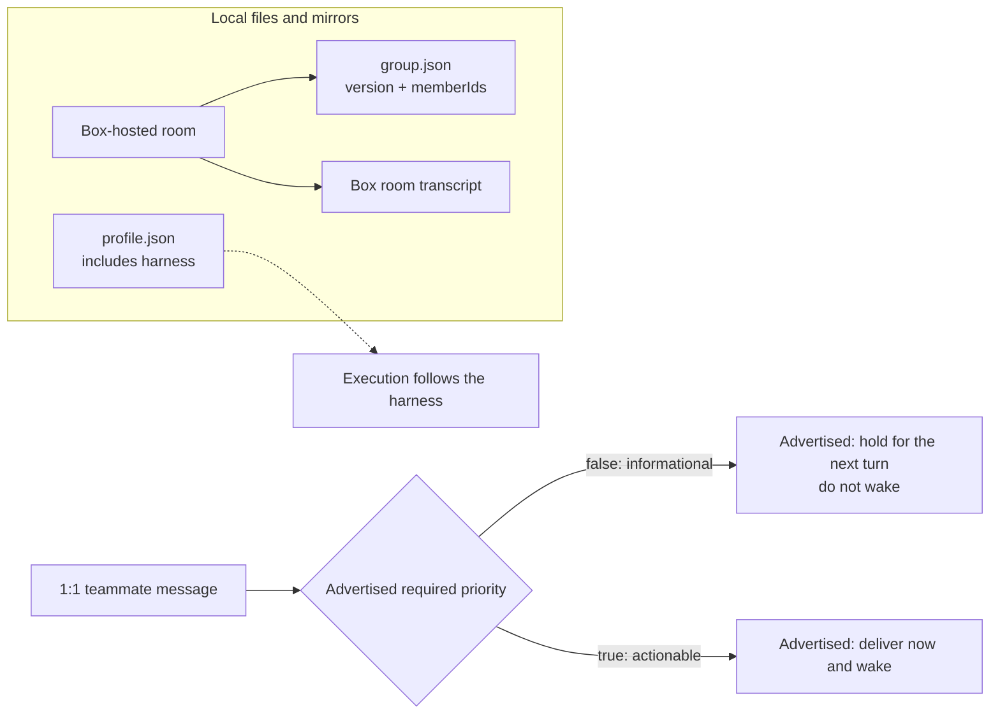
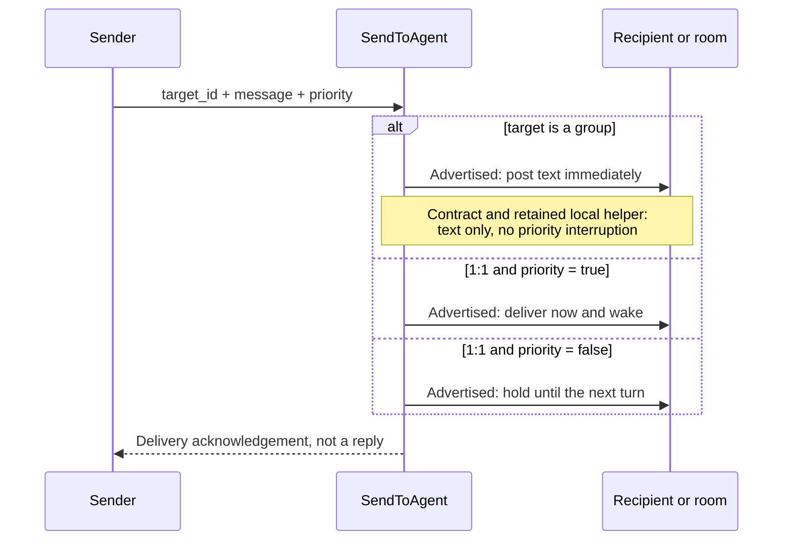
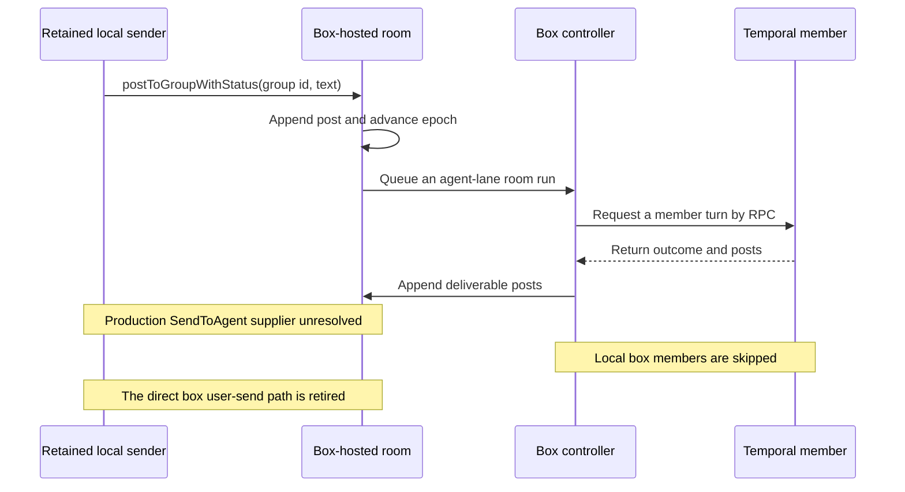
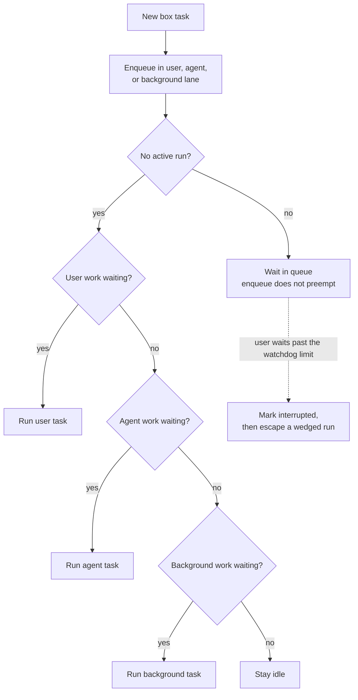
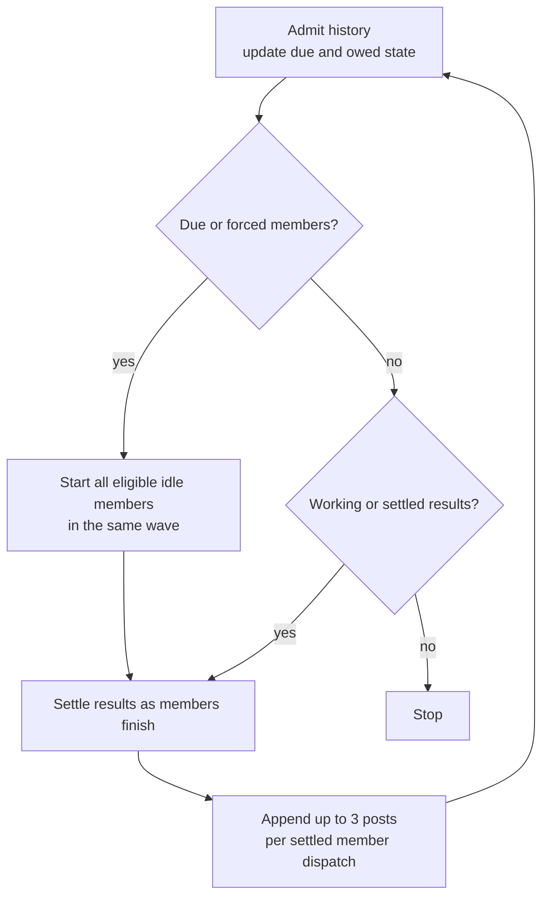

# Grok Bot agent teams: 100 questions / Grok Bot agent teams：100 问

This guide reviews the teammate and group-room behavior in the local Grok Bot 0.71.2 artifacts. It replaces the earlier study of the 0.18 reconstruction. Each answer states the behavior that the available code supports.

本文依据本机的 Grok Bot 0.71.2 安装材料，重新核查助手和群聊房间的行为，替代此前针对 0.18 重建版的研究。每个答案只写现有代码能够支持的行为。

## Evidence and scope / 证据与范围

The desktop artifact is `Grok_Bot_0.71.2.dmg`. The host bundle is `fcbae14`. The extracted `host-main.cjs` and `sand-eval-runner.cjs` have the same SHA-256 digests as the files in the original bundle. macOS also accepted the disk image checksum.

桌面安装包是 `Grok_Bot_0.71.2.dmg`，宿主代码包是 `fcbae14`。解压出的 `host-main.cjs` 和 `sand-eval-runner.cjs` 与原始代码包中的对应文件具有相同的 SHA-256 摘要，macOS 的安装包校验也已通过。

| Artifact / 材料 | Version or path / 版本或路径 | SHA-256 |
|---|---|---|
| Desktop disk image / 桌面安装包 | `/Users/bowen/code/grok-bot-0.71.2/Grok_Bot_0.71.2.dmg` | `a6e586f4f9857dc97fcae600d443a31a8e9b6f6e9e67f1e1d103135e77d260ad` |
| Original host bundle / 原始宿主代码包 | `/Users/bowen/code/grok-bot-0.71.2/sand-host-bundle-fcbae14.tgz` | `069ddd0c8fddb364983b0e5acf7fed027a96e1df27cdc5c1b9e545d650d90536` |
| Readable host bundle / 可读宿主代码 | `/Users/bowen/code/grok-bot-0.71.2/host-fcbae14/sand-host/host-main.cjs` | `d9dcf2550d6e033fc752852dffc044d34622edfbe9a7421476199761c0ce0946` |
| Readable eval runner / 可读评测运行器 | `/Users/bowen/code/grok-bot-0.71.2/host-fcbae14/sand-host/sand-eval-runner.cjs` | `5d951bc76d9747e0c37c494c4bfd82d787f2d81742ead2627e26d36e3b0ef54c` |

A reference such as `host-main.cjs:491251-491264` or `sand-eval-runner.cjs:536997-536998` points to the matching readable file in this table. The bundles keep original module-path comments. These comments help identify the intended source module, but the bundled implementation is the primary evidence.

`host-main.cjs:491251-491264` 或 `sand-eval-runner.cjs:536997-536998` 这样的引用，对应表中的相应可读文件。代码包保留了原始模块路径注释，可以用来辨认模块；不过，判断行为时以代码包中的实际实现为准。

The artifacts do not contain the server implementation for cloud rooms. This guide does not infer server scheduling, delivery, or privacy behavior from client prompts. An answer marked `Not observable` identifies this boundary.

这些材料不包含云端房间的服务器实现。本文不会根据客户端提示词推测服务器的调度、投递或隐私行为。标为“现有材料无法确认”的答案，会说明这条证据边界。

The bundle can contain current and legacy paths. The presence of a function does not prove that the current product calls it. The answers distinguish these paths when the difference changes behavior.

代码包可能同时包含现行路径和旧版遗留路径。某个函数仍然存在，不代表当前产品还会调用它。只要这种区别会影响行为，答案就会分别说明。

## How to read the answers / 如何阅读答案

`Changed` means that the new behavior differs from the 0.18 answer. `Unchanged` means that the main rule still holds. `Retired` means that the old mechanism no longer applies to the current path. `Not observable` means that the available artifacts cannot decide the question.

“有变化”表示新版行为不同于 0.18 的答案；“保持不变”表示主要规则仍然成立；“已失效”表示旧机制不再适用于当前路径；“现有材料无法确认”表示现有材料不足以回答该问题。

The English text uses the ASD-STE100 writing rules that apply to descriptive technical text. It uses short declarative sentences, active voice, and consistent terms. Code identifiers keep their original spelling. This is a writing-style application, not a formal certification.

英文采用 ASD-STE100 中适用于技术描述的写作规则，使用简短的陈述句、主动语态和一致术语，代码标识符保持原样。这是写作规则的应用，不代表正式认证。

The Chinese text follows a plain technical-documentation style. It gives the conclusion first, uses common words, and separates code enforcement from prompt instructions. The English and Chinese answers carry the same technical meaning, but they are not word-for-word translations.

中文采用清楚、直接的技术文档写法：先给结论，使用常用词，并区分代码约束和提示词要求。中英文答案的技术含义一致，但不逐字互译。

## Diagrams / 图示

### Diagram 1. Local state and the delivery contract / 图 1：本地状态与投递约定

Local files can be profiles or mirrors. Their presence does not prove local execution. The `harness` value selects the box or temporal route. A local room config contains only `version` and `memberIds`. In the advertised 1:1 contract, actionable mail wakes the recipient, while informational mail is held without a wake. The located code does not show the server store that implements this contract. Evidence: host-main.cjs:485310-485355, host-main.cjs:491436-491490, host-main.cjs:757322-757359, host-main.cjs:769145-769174.

本地文件可能只是资料或镜像，不能据此判断执行位置。`harness` 决定使用 box 还是 temporal 路径。本地房间配置只包含 `version` 和 `memberIds`。按照当前一对一投递约定，需要处理的消息会叫醒接收者，纯信息消息则暂存到下一轮，不主动叫醒。已定位的代码没有展示实现这套约定的服务端存储。依据：host-main.cjs:485310-485355, host-main.cjs:491436-491490, host-main.cjs:757322-757359, host-main.cjs:769145-769174。

### Diagram 2. An agent sends to another agent or a room / 图 2：助手向另一个助手或房间发消息

Each call has one target, and `priority` is required even for a group. The diagram shows the advertised SendToAgent contract. The retained local helper also implements immediate text-only group posts and no special priority interruption. The production supplier is unresolved, so the diagram does not establish which implementation a current call reaches. A new post on the retained path still advances the epoch and cancels earlier pending temporal member turns. The remote-peer path sends text only and reports priority as unsupported. Evidence: host-main.cjs:734432-734505, host-main.cjs:738394-738405, host-main.cjs:740193-740200, host-main.cjs:757277-757364, host-main.cjs:769145-769174.

每次调用只能有一个目标，即使目标是群，`priority` 也必须填写。本图展示的是 SendToAgent 说明中的约定。保留下来的本地辅助函数也会立即发布纯文本群消息，并且不让 priority 产生特殊中断。生产环境的实现供应方尚未定位，因此本图不能证明当前调用实际进入哪套实现。在这条保留路径上，新的群消息仍会推进 epoch，并取消上一轮等待完成的 temporal 成员请求。远程助手路径只投递文本，并明确提示不支持 priority。依据：host-main.cjs:734432-734505, host-main.cjs:738394-738405, host-main.cjs:740193-740200, host-main.cjs:757277-757364, host-main.cjs:769145-769174。

### Diagram 3. The retained local path into a box-hosted room / 图 3：保留的本地路径进入 box 宿主房间

This path starts at the retained local `postToGroupWithStatus` helper. It shows what that helper can reach when the target is a box-hosted room; it does not prove that a temporal member's current `SendToAgent` call selects this path. Temporal members execute through RPC, while local box members are skipped. Returned posts are appended to the box room transcript. `SendPipeline.sendPrompt` refuses the old direct box user turn, so this diagram makes no claim about server user-message fan-out. Evidence: host-main.cjs:734432-734443, host-main.cjs:738366-738408, host-main.cjs:738503-738510, host-main.cjs:738642-738751, host-main.cjs:740157-740191, host-main.cjs:769145-769174.

这条路径从保留的本地 `postToGroupWithStatus` 辅助函数开始。它展示该函数的目标是 box 宿主房间时可以进入的流程，但不能证明 temporal 成员当前调用 `SendToAgent` 时会选择这条路径。temporal 成员通过 RPC 执行，本地 box 成员会被记为跳过。返回的发言随后写入 box 房间记录。`SendPipeline.sendPrompt` 已拒绝旧的 box 用户轮次，因此本图不说明服务器如何分发用户消息。依据：host-main.cjs:734432-734443, host-main.cjs:738366-738408, host-main.cjs:738503-738510, host-main.cjs:738642-738751, host-main.cjs:740157-740191, host-main.cjs:769145-769174。

### Diagram 4. Box scheduler lane selection / 图 4：box 调度器的通道选择

The scheduler chooses only when no run is active. New work enters a lane and does not preempt by itself. The watchdog is a separate escape for an active run that stays wedged while user work waits. This is not evidence for ordinary priority-peer interruption or for server scheduling. Evidence: host-main.cjs:739617-739765, host-main.cjs:739834-739900.

只有在当前没有运行任务时，调度器才会选择下一项。新任务进入队列后，不会自行打断正在运行的任务。看门狗是另一条处理路径：用户任务等待超时，而当前运行仍然卡住时，它才会介入。这些代码不能证明普通的优先助手消息会打断运行，也不能说明服务器如何排队。依据：host-main.cjs:739617-739765, host-main.cjs:739834-739900。

### Diagram 5. One observed box-hosted room run / 图 5：一次可观察的 box 宿主房间运行

Audience state decides which idle members are due. The controller starts all eligible members together and settles results in completion order. New posts update delivery state and can create more waves. After three waves, only owed catch-up work remains eligible. These later starts can be non-forced and can increase the wave count; forced work follows a separate path. A sequential rotation and a quiet round are not required. Evidence: host-main.cjs:737383-737561, host-main.cjs:737681-737800.

房间根据消息的接收对象和投递状态，计算哪些空闲成员应当运行。协调器会同时启动所有符合条件的成员，再按实际完成顺序处理结果。新发言会更新投递状态，并可能触发新的波次。三波之后，只有错过消息且尚未补看的成员仍符合启动条件。这些后续启动仍可是非强制启动，并继续增加波次计数；强制任务走另一条路径。整个过程不再要求顺序轮换，也不要求出现一轮全员沉默。依据：host-main.cjs:737383-737561, host-main.cjs:737681-737800。

## Limits / 上限

The generic orchestrator stores the three-wave threshold and ten-post budget per admission trigger. New inbound work resets that state when the optional callbacks are wired. The observed `GroupChatGlue` does not wire those callbacks, so this state is per run on that path. The 36-dispatch safety cap always covers the whole run. The three-post limit applies each time one member dispatch settles. Evidence: host-main.cjs:491251-491264, host-main.cjs:737400-737555, host-main.cjs:738552-738571, host-main.cjs:737613-737621.

通用编排器的三波阈值和十条发言预算属于当前触发状态，接入可选回调后，新消息可以重置这个状态。当前观察到的 `GroupChatGlue` 没有接入这些回调，因此在它的路径上，这些状态按一次运行计算。36 次派发的安全上限始终覆盖整个运行过程。三条发言的限制则在每次成员派发完成时单独计算。依据：host-main.cjs:491251-491264, host-main.cjs:737400-737555, host-main.cjs:738552-738571, host-main.cjs:737613-737621。

| Limit / 上限 | Value / 数值 | Scope / 作用范围 |
|---|---:|---|
| Group members / 群成员数 | 6 | Local group configuration and membership rules / 本地群配置和成员规则 |
| Ordinary waves before catch-up-only eligibility / 转入仅补看模式前的普通波次 | 3 | Threshold, not a hard cap on non-forced waves; per trigger, and per run in the observed glue / 阈值而非非强制波次硬上限；每个触发周期，当前宿主路径按每次运行计算 |
| Room posts / 房间发言 | 10 | Per trigger; per run in the observed glue / 每个触发周期；当前宿主路径按每次运行计算 |
| Posts per settled member dispatch / 每次成员派发完成后的发言 | 3 | Deliverable returned posts / 可发布的返回消息 |
| Prompt and RPC history / 提示和 RPC 中的历史 | 24 messages / 24 条消息 | Current group formatters / 当前群历史格式化代码 |
| Teammate message text / 助手消息文本 | 8,000 characters / 8,000 字符 | `AGENT_MESSAGE_MAX_TEXT_LENGTH` |
| Group message text / 群消息文本 | 8,000 characters / 8,000 字符 | History text and reply quotes; not a universal rich-post limit / 历史正文和回复引用；不是所有富内容的统一上限 |
| Failed-turn rearms / 失败后的重新派发 | 2 | Consecutive not-shown outcomes; a shown outcome resets the count / 连续未展示结果；成功展示后清零 |
| Room dispatch safety cap / 房间派发安全上限 | 36 | `2 × 3 × 6`; covers the whole orchestrator run / 覆盖整个编排运行 |
| Wind-down post threshold / 收尾提示的消息阈值 | ≤ 2 posts left / 剩余不超过 2 条 | The third wave also enables the note / 第三波也会启用收尾提示 |
| Member dispatch RPC timeout / 成员派发 RPC 超时 | 20,000 ms | Timeout on the dispatch RPC / 派发 RPC 调用超时 |
| Member requested deadline / 成员请求截止时间 | 300,000 ms | Deadline included in the member request / 随成员请求发送的截止时间 |
| Member host wait / 成员请求的宿主等待 | 600,000 ms | On timeout, settle locally and cancel upstream / 超时后本地结束，并通知上游取消 |

The three temporal time limits have different jobs: dispatch RPC, requested deadline, and host wait. The 24-message and 8,000-character values describe the observed formatting and messaging glue. These constants do not establish the limits of a server-hosted room. Evidence: host-main.cjs:491256-491260, host-main.cjs:491396-491399, host-main.cjs:708282-708314, host-main.cjs:708332-708438, host-main.cjs:734314-734316.

三个 temporal 时间限制分别负责派发 RPC、请求截止时间和宿主等待。24 条历史和 8,000 字符限制来自当前观察到的格式化及消息衔接代码。这些常量不能证明服务器托管的房间也使用相同上限。依据：host-main.cjs:491256-491260, host-main.cjs:491396-491399, host-main.cjs:708282-708314, host-main.cjs:708332-708438, host-main.cjs:734314-734316。

## A. The root model / A. 基本模型

### 1. What is an agent team in this product? / 产品中的助手团队是什么？

**Answer — Changed.** A team is still a roster of durable assistants with separate chats, personas, memories, and asynchronous messaging. Profiles can bind agents to `serverId` and select `box` or `temporal` harnesses. The roster also supports Team Bots and sectioned discovery, but the shared `teamBotDiscovery` default is false. The old one-user, local-only model is too narrow; effective desktop rollout and server-side ownership remain unobservable. Evidence: sand-eval-runner.cjs:536939-536957, host-main.cjs:490823-490866, host-main.cjs:752329-752382.

**回答——有变化。** 团队仍由一批持久助手组成，各自拥有会话、人设、记忆和异步消息能力。助手资料可以通过 `serverId` 绑定服务器，并选择 `box` 或 `temporal` 执行方式。名单还支持 Team Bot 和分区发现，但共享的 `teamBotDiscovery` 默认值为 false。旧的“单用户、纯本地”模型已经过窄；桌面实际启用状态和服务器内部归属仍无法确认。依据：sand-eval-runner.cjs:536939-536957, host-main.cjs:490823-490866, host-main.cjs:752329-752382。

### 2. When A messages B, do they join one conversation? / A 给 B 发消息时，双方会进入同一个会话吗？

**Answer — Not observable.** A and B remain separate assistants, and the generic tool does not join their model calls. Its schema requires `priority`, and its copy defines true-wake, false-hold, and immediate group posts. Execution forwards priority to an injected `host.sendToAgentImpl`, whose production supplier was not found. The retained local implementation appends both priority values but shows no false-holding store or true-wake invocation. Current production wake behavior, including the old claim that B always wakes later, cannot be established. Evidence: host-main.cjs:757322-757364, host-main.cjs:769145-769174, host-main.cjs:734418-734472, host-main.cjs:734473-734506, host-main.cjs:734586-734632.

**回答——现有材料无法确认。** A 和 B 仍是独立助手，通用工具不会把双方合并到同一次模型调用。工具 schema 要求提供 `priority`，说明文字定义了 true 唤醒、false 保留，以及群聊立即发布。实际执行会把 priority 转给注入的 `host.sendToAgentImpl`，但没有找到它的生产环境供应方。保留的本地实现会写入两种 priority 的消息，却没有展示 false 保留队列或 true 唤醒调用。因此，当前生产环境如何唤醒接收方，以及旧答案所说的“B 总会在之后醒来”，都无法确认。依据：host-main.cjs:757322-757364, host-main.cjs:769145-769174, host-main.cjs:734418-734472, host-main.cjs:734473-734506, host-main.cjs:734586-734632。

### 3. What does `SendToAgent` return to A? / `SendToAgent` 会向 A 返回什么？

**Answer — Unchanged.** `SendToAgent` returns a delivery acknowledgement, not B’s reply. The tool returns the implementation’s string result or `sent.ack`, and any reply must arrive separately. The generic tool forwards the send to `host.sendToAgentImpl`; it does not wait for a recipient run or permit same-turn polling. Evidence: host-main.cjs:757358-757364, host-main.cjs:757397-757430, host-main.cjs:769145-769174.

**回答——保持不变。** `SendToAgent` 返回投递回执，不会返回 B 的回复。工具会返回实现给出的字符串或 `sent.ack`，回复只能之后单独到达。通用工具把发送交给 `host.sendToAgentImpl`，不会等待接收方运行，也不允许在当前轮次轮询回复。依据：host-main.cjs:757358-757364, host-main.cjs:757397-757430, host-main.cjs:769145-769174。

### 4. Where does B’s reply arrive? / B 的回复会到达哪里？

**Answer — Not observable.** The generic tool copy says replies arrive later, with priority replies waking hidden turns and informational replies waiting for the next turn. The roster prompt uses the `[agent]` cue for these messages. The tool can also resolve and forward an optional `task_id`. The concrete production `sendToAgentImpl` is unresolved, so these receive and task-routing semantics are not executable evidence. The retained local receive path appends inbound user-role transcript entries, but its live caller and any later wake are unconfirmed. Evidence: host-main.cjs:754438-754440, host-main.cjs:757352-757359, host-main.cjs:757402-757419, host-main.cjs:769145-769174, host-main.cjs:734507-734577, host-main.cjs:734586-734632.

**回答——现有材料无法确认。** 通用工具的说明称，回复会在之后到达，priority 回复触发隐藏轮次，普通信息回复等待下一轮。名单提示词用 `[agent]` 标记这些消息。工具也能解析并转发可选的 `task_id`。但生产环境的 `sendToAgentImpl` 尚未定位，这些接收和任务路由规则不能当作已验证的执行行为。保留的本地接收路径会追加 user 角色的收件记录，但它的实际调用方和后续唤醒过程都没有确认。依据：host-main.cjs:754438-754440, host-main.cjs:757352-757359, host-main.cjs:757402-757419, host-main.cjs:769145-769174, host-main.cjs:734507-734577, host-main.cjs:734586-734632。

### 5. What does the `[agent]` cue tell the model? / `[agent]` 标记告诉模型什么？

**Answer — Changed.** The current roster prompt says `[agent]` marks another assistant’s message, not user input. It tells the recipient to reply with `SendToAgent` only when useful and to avoid acknowledgement loops. The prompt describes priority messages as user-visible and held messages as hidden; it reserves `SendToUser` for new user-facing results. These are prompt instructions, not proof of the unresolved delivery mechanism. Evidence: host-main.cjs:754438-754440.

**回答——有变化。** 当前名单提示词用 `[agent]` 表示消息来自另一个助手，不是用户输入。提示要求接收方只在确有必要时用 `SendToAgent` 回复，避免反复互发确认。提示还规定 priority 消息对用户可见、保留消息不可见，并只在有新的用户结果时使用 `SendToUser`。这些属于提示词要求，不能证明尚未定位的投递机制已经实现相同行为。依据：host-main.cjs:754438-754440。

### 6. Is the private 1:1 the same history as a group? / 私聊和群聊是否共用同一份记录？

**Answer — Unchanged.** The bundled guidance describes private DMs and group turns as distinct contexts in one unified conversation. It says group turns carry group tags, while untagged user messages are private DMs. This is a documented context contract, not proof of server transcript persistence. The observed host RPC sends structured room history, so actual server history assembly and physical storage remain unobservable. Evidence: host-main.cjs:753871-753875, host-main.cjs:738652-738681.

**回答——保持不变。** 包内指引把私聊和群聊轮次描述为同一统一会话中的不同上下文：群聊轮次带群聊标记，没有该标记的用户消息属于私聊。这是写在提示词里的上下文约定，不能证明服务端如何保存记录。当前宿主 RPC 只发送结构化房间历史，服务端实际如何组装历史，以及记录如何物理存储，仍无法确认。依据：host-main.cjs:753871-753875, host-main.cjs:738652-738681。

### 7. Who owns memory and persona? / 谁拥有记忆和人设？

**Answer — Changed.** The durable agent identity still owns the profile, and a room turn does not replace that profile. In the inspected host controller, temporal members receive room, member, peer, and message context, while non-temporal local members return `skipped` and `not_shown`. Memory is now routed across user, agent, user-bot, and conversation scopes, with team-audience rules and shard or JSONL targets. The old folder-only memory model does not describe the current path. Evidence: host-main.cjs:738642-738701, host-main.cjs:708332-708384, host-main.cjs:771533-771595.

**回答——有变化。** 持久助手的身份仍拥有自己的资料，房间轮次不会替换这份资料。在检查到的宿主编排器中，temporal 成员会收到房间、成员、其他助手和消息上下文，非 temporal 的本地成员则返回 `skipped` 和 `not_shown`。记忆现在还会按用户、助手、用户与助手、会话等范围存储，并区分团队受众以及 shard、JSONL 目标。旧的“记忆都在文件夹里”说法已经不够准确。依据：host-main.cjs:738642-738701, host-main.cjs:708332-708384, host-main.cjs:771533-771595。

### 8. Can Bob read Alice’s private chat with the user? / Bob 能读取 Alice 与用户的私聊吗？

**Answer — Unchanged.** Teammate delivery and group participation do not give Bob Alice’s private transcript. A 1:1 send records the supplied message, and a temporal room request carries room history and peer identities, not private DM history. The bundled room guidance also forbids looking for a teammate’s private chats, memory, or files. Team-shared memory is a separate explicit scope. This evidence establishes a messaging and context boundary, not an OS-level block on every file-reading tool. Evidence: host-main.cjs:734411-734472, host-main.cjs:708345-708384, host-main.cjs:753871-753880, host-main.cjs:771577-771591.

**回答——保持不变。** 助手消息和群聊不会把 Alice 的私聊记录交给 Bob。一对一发送只记录本次提供的消息，temporal 房间请求只携带房间历史和其他助手身份，不包含私聊历史。bundle 中的房间指引也禁止主动去查其他助手的私聊、记忆或文件。团队共享记忆属于另一个明确范围。现有代码确认的是消息和上下文边界，不能据此证明所有文件读取工具都受到操作系统级隔离。依据：host-main.cjs:734411-734472, host-main.cjs:708345-708384, host-main.cjs:753871-753880, host-main.cjs:771577-771591。

### 9. What is inside one turn, and what starts another turn? / 一轮包含什么，什么会开始下一轮？

**Answer — Not observable.** A turn still contains an assistant run, its tools, and a stop; `SendToAgent` does not nest the recipient’s reply inside that run. The generic copy assigns new-turn behavior to `priority`, but the production send supplier is unresolved. The retained local receive methods show transcript appends without a model-run invocation, and the old local box-turn path refuses local turns. The executable rule for which peer messages start new production turns is therefore not established. Evidence: host-main.cjs:757358-757364, host-main.cjs:769145-769174, host-main.cjs:734586-734632, host-main.cjs:740170-740191.

**回答——现有材料无法确认。** 一轮仍包含一次助手运行、工具调用和结束过程，`SendToAgent` 不会把接收方回复嵌进当前运行。通用工具的说明用 `priority` 区分是否开始新轮次，但生产环境的发送实现尚未定位。保留的本地接收方法只展示会话记录追加，没有展示模型运行调用，旧的本地 box 轮次路径还会拒绝本地运行。因此，哪些助手消息会在生产环境触发新一轮，现有代码无法确认。依据：host-main.cjs:757358-757364, host-main.cjs:769145-769174, host-main.cjs:734586-734632, host-main.cjs:740170-740191。

### 10. How is a teammate different from a safari-style subagent? / 助手与 safari 式子助手有什么区别？

**Answer — Changed.** A teammate is a durable assistant with its own conversation and mailbox; its later reply is not a nested tool result. A Task-style subagent is a child whose final result returns to its parent, but the child can continue after the parent’s turn ends. The ownership distinction remains, while the old claim that every subagent is nested inside one parent turn is incomplete. Evidence: host-main.cjs:763474-763539, host-main.cjs:741807-741816, host-main.cjs:757358-757364.

**回答——有变化。** 助手是持久身份，拥有自己的会话和收件箱，它之后发来的回复不是嵌套的工具结果。Task 式子助手是父助手的子任务，最终结果返回给父助手，但父助手可以先结束自己的轮次。两者的归属区别仍然存在，但旧版“子助手都嵌在父助手同一轮里”的说法并不完整。依据：host-main.cjs:763474-763539, host-main.cjs:741807-741816, host-main.cjs:757358-757364。

## B. Identity and files / B. 身份与文件

### 11. Where does an agent live? / 助手存放在哪里？

**Answer — Changed.** In the desktop file-based roster, each agent remains a sibling folder under `agentsRoot`, with `profile.json`, optional `group.json`, and a per-agent session opened through `sessionStore`. `getSandRootDir` accepts an absolute `SAND_DATA_ROOT` override, uses `<SAND_USER_DATA_DIR>/sand-data` when configured, and otherwise selects a variant-specific default. The production `sand` variant uses `~/.grokbot`; `getSandAgentsRootDir` appends `agents`. The session filenames are `store.db` and `conversation-blobs.db`. Profiles can carry server binding and harness metadata, and memory has several scoped targets. Local folders therefore do not prove that all authoritative state is local. Effective live overrides and cloud mirroring boundaries remain unobservable. Evidence: sand-eval-runner.cjs:536997-536998, host-main.cjs:430845-430914, host-main.cjs:494893-494910, host-main.cjs:718197-718208, host-main.cjs:490823-490866, host-main.cjs:785617-785646.

**回答——有变化。** 在桌面的文件名单中，每个助手仍是 `agentsRoot` 下的同级目录，包含 `profile.json`、可选的 `group.json`，并由 `sessionStore` 打开各自会话。`getSandRootDir` 可以使用绝对的 `SAND_DATA_ROOT` 覆盖路径；配置 `SAND_USER_DATA_DIR` 时，根目录是其下的 `sand-data`；否则按运行变体选择默认位置。生产 `sand` 变体使用 `~/.grokbot`，`getSandAgentsRootDir` 再追加 `agents`。会话文件名已能确认是 `store.db` 和 `conversation-blobs.db`。助手资料可以带有服务器绑定和执行方式信息，记忆也有多种存储范围。因此，本地目录不代表所有权威状态都在本地；实际生效的路径覆盖和云端镜像边界仍无法确认。依据：sand-eval-runner.cjs:536997-536998, host-main.cjs:430845-430914, host-main.cjs:494893-494910, host-main.cjs:718197-718208, host-main.cjs:490823-490866, host-main.cjs:785617-785646。

### 12. What identifies an individual agent versus a room? / 如何区分普通助手和房间？

**Answer — Unchanged.** A room directory has a readable, parseable `group.json` with at least one valid normalized member id; `isSandGroupDir` tests this condition. A temporal profile makes `localGroupConfig` return null, which prevents local orchestration but does not stop group identification. Evidence: host-main.cjs:491453-491490, host-main.cjs:738503-738513.

**回答——保持不变。** 房间目录必须含有可读取、可解析的 `group.json`，并且至少有一个有效的规范化成员 id；`isSandGroupDir` 检查的就是这个条件。temporal 资料会让 `localGroupConfig` 返回 null，从而阻止本地编排，但不会影响房间身份识别。依据：host-main.cjs:491453-491490, host-main.cjs:738503-738513。

### 13. What is in `group.json`? / `group.json` 中包含什么？

**Answer — Changed.** The supported desktop local representation now returns and writes only `version` and `memberIds`. The reader ignores other properties, and a rewrite strips them; extra raw JSON properties are not actively rejected. The old `remoteMembers` and `sharedRoomId` fields are retired from this implementation, while server-backed rooms use RPCs. Server-side room records are not observable. Evidence: host-main.cjs:491441-491488, host-main.cjs:714806-714883.

**回答——有变化。** 当前桌面本地实现只读取并写入 `version` 和 `memberIds`。读取器会忽略其他字段，重写时会删除这些字段，但不会主动拒绝含有额外字段的原始 JSON。旧的 `remoteMembers` 和 `sharedRoomId` 已在这套实现中失效，服务器房间则改用 RPC。服务器内部的房间记录无法从现有材料确认。依据：host-main.cjs:491441-491488, host-main.cjs:714806-714883。

### 14. How many members can a group have? / 一个群聊可以有多少成员？

**Answer — Unchanged.** The agent-member limit remains six. Local creation and the server-room client both deduplicate and truncate to six, but they handle unknown members differently. Local creation silently drops ids absent from the roster. Server-room creation preflights non-temporal members and rejects a missing or invalid local profile instead of applying that local filter. The visible `setRoomMembers` client does not truncate, so server-side reseat enforcement is not observable. Evidence: host-main.cjs:738441-738453, host-main.cjs:714806-714829, host-main.cjs:495358-495379, host-main.cjs:714862-714883.

**回答——保持不变。** 助手成员上限仍是 6 个。本地创建和服务器房间客户端都会去重并截断到 6 个，但两者处理未知成员的方式不同。本地创建会静默丢弃不在名单中的 id；服务器房间创建会对非 temporal 成员进行预检，本地资料缺失或无效时会拒绝创建，而不是套用本地的过滤规则。可见的 `setRoomMembers` 客户端没有执行截断，因此无法确认服务器在重排成员时如何强制上限。依据：host-main.cjs:738441-738453, host-main.cjs:714806-714829, host-main.cjs:495358-495379, host-main.cjs:714862-714883。

### 15. Can a group be a member of another group? / 群聊可以成为另一个群聊的成员吗？

**Answer — Unchanged.** The implemented local creation and update paths reject nesting with `SandGroupNestingError`. If a nested id is already stored, member resolution skips it and emits a warning instead of recursively running another room. The desktop RPC client does not reveal whether the server applies identical validation. Evidence: host-main.cjs:491265-491278, host-main.cjs:738441-738449, host-main.cjs:738582-738605.

**回答——保持不变。** 当前本地创建和更新路径会通过 `SandGroupNestingError` 拒绝群聊嵌套。如果存储配置中已经存在嵌套 id，成员解析会跳过它并记录警告，不会递归运行另一个房间。桌面 RPC 客户端没有展示服务器是否执行完全相同的检查。依据：host-main.cjs:491265-491278, host-main.cjs:738441-738449, host-main.cjs:738582-738605。

### 16. What happens if you create a group with the same members as an existing one? / 创建一个成员与现有群聊完全相同的新群，会发生什么？

**Answer — Changed.** The current local path creates a new agent and seals it as a room; it does not search for an existing equal member set. The server-room client requests a fresh random UUID and requires confirmation of that same id. Member-id deduplication still occurs, but it is not room deduplication. Server internals are not visible, although returning another room id would fail this client’s confirmation check. Evidence: host-main.cjs:738416-738454, host-main.cjs:714806-714840.

**回答——有变化。** 当前本地路径会创建一个新助手并把它标记为房间，不会查找成员集合相同的现有房间。服务器房间客户端也会生成新的随机 UUID，并要求服务器确认同一个 id。成员 id 仍会去重，但这不等于房间去重。服务器内部逻辑不可见，不过返回另一个房间 id 将无法通过该客户端的确认检查。依据：host-main.cjs:738416-738454, host-main.cjs:714806-714840。

### 17. Can the model delete a teammate? / 模型可以删除助手吗？

**Answer — Unchanged.** No model-facing delete-agent tool is registered in the inspected tool builder. `CreateAgent` directs the user to delete agents from the sidebar, while the management builder exposes creation and update operations. Host gateway `deleteAgent` and `deleteAgents` operations remain available for UI or host use, not as model tools. Evidence: host-main.cjs:757458-757473, host-main.cjs:772014-772026, host-main.cjs:492628-492631.

**回答——保持不变。** 检查到的模型工具构建器没有注册删除助手的工具。`CreateAgent` 明确引导用户从侧边栏删除助手，管理工具只提供创建和更新等操作。宿主网关仍保留 `deleteAgent` 和 `deleteAgents`，供界面或宿主调用，不会作为模型工具开放。依据：host-main.cjs:757458-757473, host-main.cjs:772014-772026, host-main.cjs:492628-492631。

### 18. How does an agent rename itself, versus renaming someone else? / 助手如何重命名自己，又如何重命名其他助手？

**Answer — Changed.** Self-update now uses `UpdateProfile`, which applies supplied fields with `target:"profile"` and `action:"set"` and can update settings separately. Renaming another agent still uses patch-style `UpdateAgent`, which ignores empty supplied name and description values and returns “Nothing to update” for an empty patch. The current tool builder uses `UpdateProfile` instead of the old self-service `update_state` path; registry presence of `UpdateState` does not prove that path is active. Tool availability remains dependency-gated, and lower server validation is not observable. Evidence: host-main.cjs:771823-771879, host-main.cjs:771973-771983, host-main.cjs:772088-772169, host-main.cjs:757475-757502.

**回答——有变化。** 助手现在通过 `UpdateProfile` 修改自己，传入字段会以 `target:"profile"` 和 `action:"set"` 应用，设置项可以单独保存。重命名其他助手仍使用补丁式的 `UpdateAgent`，空的名称和描述会被忽略，没有有效字段时返回 “Nothing to update”。当前工具构建器用 `UpdateProfile` 替代旧的 `update_state` 自身修改路径；注册表中仍有 `UpdateState`，不能证明旧路径仍然启用。工具是否提供取决于运行依赖，服务器底层的进一步校验无法确认。依据：host-main.cjs:771823-771879, host-main.cjs:771973-771983, host-main.cjs:772088-772169, host-main.cjs:757475-757502。

### 19. How many teammates do the prompt renderers list? / 提示词渲染器会列出多少助手？

**Answer — Changed.** The limit constant remains 40, but the renderers do not follow one fixed system-prompt layout. The unsectioned renderer lists 40 other addresses plus up to 40 detailed groups; sectioned mode shares 40 slots across roster categories while retaining the separate detailed-group list. Other variants trim the prompt or place the roster in a `<teammates>` user-info block. Shared runner defaults set `sendToAgentRoster` and `teamBotDiscovery` false. Their eval baselines are also false unless `evalGateOverrides` explicitly replaces them. Neither defaults nor eval overrides establish the effective desktop rollout. Evidence: sand-eval-runner.cjs:536959-536995, sand-eval-runner.cjs:537032-537143, sand-eval-runner.cjs:553277-553327, sand-eval-runner.cjs:596590-596629, sand-eval-runner.cjs:596737-596778, host-main.cjs:752329-752382.

**回答——有变化。** 数量常量仍是 40，但不同渲染器不再使用固定的系统提示布局。未分区模式列出 40 个其他地址，并另外列出最多 40 个详细群聊；分区模式让各类名单共享 40 个位置，同时保留详细群聊列表。其他模式会精简提示，或把名单放进 `<teammates>` 用户信息块。共享 runner 默认把 `sendToAgentRoster` 和 `teamBotDiscovery` 设为 false。评测基线也默认为 false，但 `evalGateOverrides` 可以显式覆盖这些值。默认值和评测覆盖值都不能证明桌面实际发布状态。依据：sand-eval-runner.cjs:536959-536995, sand-eval-runner.cjs:537032-537143, sand-eval-runner.cjs:553277-553327, sand-eval-runner.cjs:596590-596629, sand-eval-runner.cjs:596737-596778, host-main.cjs:752329-752382。

### 20. How does the model look someone up when the list is not enough? / 名单信息不足时，模型如何查找助手？

**Answer — Unchanged.** When an agents root is available, the documented fallback uses `Shell` to read `<agentsRoot>/<agentId>/profile.json` and `<agentId>/group.json` as the fresh source. Several roster variants share this fallback. `SendToAgent` still mentions `ListAgents` and `ListGroups`, but no corresponding registrations were found in the available artifacts; the management builder registers `ListSections`, `CreateAgent`, and `UpdateAgent` instead. This absence does not exclude separately supplied server-only tools. Evidence: sand-eval-runner.cjs:536997-536998, sand-eval-runner.cjs:537065-537088, host-main.cjs:757334-757360, host-main.cjs:772014-772026.

**回答——保持不变。** 宿主提供 agents 根目录时，文档规定的补充查找方式仍是用 `Shell` 读取 `<agentsRoot>/<agentId>/profile.json` 和 `<agentId>/group.json`，并把它们视为最新来源。多种名单渲染器都保留这条路径。`SendToAgent` 的说明仍提到 `ListAgents` 和 `ListGroups`，但现有材料中没有找到对应注册；管理构建器实际注册的是 `ListSections`、`CreateAgent` 和 `UpdateAgent`。这一结果不能排除其他运行环境单独提供服务器工具。依据：sand-eval-runner.cjs:536997-536998, sand-eval-runner.cjs:537065-537088, host-main.cjs:757334-757360, host-main.cjs:772014-772026。

## C. Tools / C. 工具

### 21. Which tool speaks to the user, and which tool speaks to a teammate? / 哪个工具对用户说话，哪个工具联系助手？

**Answer — Changed.** `SendToUser` is now the canonical Grok Bot tool for the user. `SendMessage` remains a Grok Bot execution alias, not a separately offered tool. The bundled `SendToUser` description says that during a local group-chat turn it posts to the room by default, while `to:"dm"` sends private text to the user's 1:1 chat. `SendToAgent` contacts another agent or a group. The room/DM routing is a documented tool contract, not independently verified server behavior. Evidence: host-main.cjs:761331-761368, host-main.cjs:761127-761127, host-main.cjs:757358-757360.

**回答——有变化。** 现在 Grok Bot 对用户说话使用 `SendToUser`，`SendMessage` 只是执行别名，不会作为独立工具提供。包内 `SendToUser` 的说明约定，在本地群聊轮次中默认发到房间，设置 `to:"dm"` 则向用户的私聊发送私人文本。联系另一个助手或群聊仍使用 `SendToAgent`。房间和私聊之间的路由属于工具说明中的约定，不是对服务端行为的独立验证。依据：host-main.cjs:761331-761368, host-main.cjs:761127-761127, host-main.cjs:757358-757360。

### 22. What arguments does `SendToAgent` take? / `SendToAgent` 接受哪些参数？

**Answer — Changed.** `target_id`, `message`, and boolean `priority` are required. `images` and `task_id` are optional. Each image needs a `file://` or `https://` URL and can have `alt`. The tool also accepts several legacy aliases. The old optional `priority` is now required, and `task_id` can route replies to a task thread. Evidence: host-main.cjs:757277-757285, host-main.cjs:757322-757357, host-main.cjs:757392-757419.

**回答——有变化。** `target_id`、`message` 和布尔值 `priority` 都是必填项，`images` 和 `task_id` 是选填项。图片必须使用 `file://` 或 `https://` 地址，可以附带 `alt`。工具仍兼容几个旧参数别名。主要变化是 `priority` 改为必填，并新增用于指定回复任务串的 `task_id`。依据：host-main.cjs:757277-757285, host-main.cjs:757322-757357, host-main.cjs:757392-757419。

### 23. What happens if the target id is yourself? / 如果目标 id 是自己，会怎样？

**Answer — Changed.** The tool returns `You can't message yourself with SendToAgent. Use SendToUser to talk to the user, or pick a different target id.` The surviving local helper checks the condition again and returns `An agent can't message itself.` The main delta is the new direction to `SendToUser`. Evidence: host-main.cjs:757397-757401, host-main.cjs:734418-734423.

**回答——有变化。** 工具会拒绝给自己发消息，并提示改用 `SendToUser` 联系用户，或者选择其他目标。保留下来的本地辅助函数还会再次检查，并返回 `An agent can't message itself.` 主要变化是提示中的用户工具已经从 `SendMessage` 改为 `SendToUser`。依据：host-main.cjs:757397-757401, host-main.cjs:734418-734423。

### 24. What happens if the message is empty or only whitespace? / 消息为空或只有空白字符时会怎样？

**Answer — Changed.** The tool schema trims `message` and rejects an empty result before execution. The remaining local and remote helpers still return `Message was empty; nothing was sent.` as a defensive check. The old acknowledgement is therefore no longer the normal result of an invalid tool call. Evidence: host-main.cjs:757334-757340, host-main.cjs:734418-734420, host-main.cjs:734473-734476.

**回答——有变化。** 工具会先去除 `message` 两端的空白；结果为空时，参数检查会直接拒绝这次调用。保留下来的本地和远程辅助函数仍设有防御检查，并返回 `Message was empty; nothing was sent.` 因此，旧提示语不再是普通工具调用的常见结果。依据：host-main.cjs:757334-757340, host-main.cjs:734418-734420, host-main.cjs:734473-734476。

### 25. What happens if the id is unknown? / 如果目标 id 不存在，会怎样？

**Answer — Changed.** The remaining local path still returns `No agent found with id <id>.` after checking the roster. Remote sending returns the acknowledgement supplied by its delivery result. Remote inbound maps a missing target to `target_not_found`. The old single answer is now local-only. Evidence: host-main.cjs:734427-734430, host-main.cjs:734473-734480, host-main.cjs:734507-734515.

**回答——有变化。** 保留下来的本地路径仍会先查助手名单，找不到时返回 `No agent found with id <id>.` 远程发送则使用投递结果提供的确认语；远程接收端把找不到目标记为 `target_not_found`。因此，旧答案只适用于本地路径，远程端的具体提示语不在这份材料中。依据：host-main.cjs:734427-734430, host-main.cjs:734473-734480, host-main.cjs:734507-734515。

### 26. What happens if that agent was deleted? / 如果目标助手已经删除，会怎样？

**Answer — Changed.** The local path still checks `isAgentGone` before the roster and returns `That agent no longer exists.` Remote inbound treats a deleted agent and an unknown agent alike as `target_not_found`. The exact local rejection survives, but remote handling is less specific. Evidence: host-main.cjs:734424-734430, host-main.cjs:734507-734515.

**回答——有变化。** 本地路径仍会先检查 `isAgentGone`，再查助手名单；目标已删除时返回 `That agent no longer exists.` 远程接收端不细分这两种情况，目标已删除或不存在都记为 `target_not_found`。本地提示语保留，远程处理则发生了变化。依据：host-main.cjs:734424-734430, host-main.cjs:734507-734515。

### 27. What happens if the id is a shared chat hosted by someone else? / 如果 id 指向别人托管的共享聊天，会怎样？

**Answer — Not observable.** The remaining local sender no longer contains the old special rejection for this case. It uses ordinary roster and group branches, and group posting checks membership. Remote inbound also has group-specific results. These paths do not prove that a current send can reach another user's room, because the production router is not included. Evidence: host-main.cjs:734427-734444, host-main.cjs:734544-734567, host-main.cjs:738370-738374.

**回答——现有材料无法确认。** 保留下来的本地发送函数已经移除了针对这种情况的专门拒绝逻辑，改为走普通的目标查找和群聊分支；发进群聊前仍会检查成员身份。远程接收端也有群聊处理结果。不过，生产路由代码不在材料中，因此不能据此断定现在一定能直接发到其他用户托管的房间。依据：host-main.cjs:734427-734444, host-main.cjs:734544-734567, host-main.cjs:738370-738374。

### 28. How long can a teammate message be? / 发给助手的消息最长可以是多少？

**Answer — Unchanged.** `AGENT_MESSAGE_MAX_TEXT_LENGTH` remains `8000`. The remaining local and remote-peer helpers clamp the message to this limit. A separate temporal room-history path also clamps message text and reply quotes to 8,000 characters. The tool schema itself does not advertise a maximum. Evidence: host-main.cjs:734314-734317, host-main.cjs:734418-734420, host-main.cjs:734473-734476, host-main.cjs:708282-708305.

**回答——保持不变。** `AGENT_MESSAGE_MAX_TEXT_LENGTH` 仍为 `8000`，保留下来的本地和远程助手发送辅助函数都会按这个上限截断消息。另一条 temporal 房间历史路径也会把消息正文和回复引用截到 8,000 字符。工具参数本身没有声明最大值。依据：host-main.cjs:734314-734317, host-main.cjs:734418-734420, host-main.cjs:734473-734476, host-main.cjs:708282-708305。

### 29. Do images arrive for a person and for a group? / 私聊和群聊都会收到图片吗？

**Answer — Changed.** The tool contract still offers 1:1 images, and the remaining local inbound row can store them. Group posts discard images and add a warning. Agents running elsewhere are also text-only, so the old blanket 1:1 claim no longer holds. Current model-side image delivery is not shown. Evidence: host-main.cjs:757370-757384, host-main.cjs:734432-734438, host-main.cjs:734494-734505, host-main.cjs:734611-734620.

**回答——有变化。** 工具仍声明私聊可以携带图片，本地旧接收入口也能把图片写进聊天记录。但群聊会丢弃图片并附上警告，运行在其他位置的助手同样只接收文字。因此，不能再笼统地说所有私聊都会收到图片；当前模型实际如何看到这些图片，材料没有展示。依据：host-main.cjs:757370-757384, host-main.cjs:734432-734438, host-main.cjs:734494-734505, host-main.cjs:734611-734620。

### 30. Is fan-out blocked in code? / 代码会阻止一次联系多个助手吗？

**Answer — Changed.** Array-style fan-out now fails validation when `target_ids` or `targets` is supplied without one `target_id`. The error requires one recipient per call. Separate calls are still possible, and no per-turn recipient counter is shown. The prompt separately requires explicit user approval for multi-agent fan-out. Evidence: host-main.cjs:757277-757305, host-main.cjs:757361-757361.

**回答——有变化。** 如果没有提供单一 `target_id`，而是使用 `target_ids` 或 `targets`，参数检查会直接报错，要求每次只发给一个接收者。但代码没有限制连续调用多次，也没有展示每轮接收者计数器。提示词仍另行要求：联系多个助手前，必须得到用户明确同意。依据：host-main.cjs:757277-757305, host-main.cjs:757361-757361。

## D. The 1:1 mailbox / D. 一对一信箱

### 31. What is written on the sender's transcript? / 发送方的聊天记录会写入什么？

**Answer — Unchanged.** The entry shape is unchanged. The remaining host helper writes an assistant-role entry with `toAgent:{id,name,kind:"agent"}`, the text, the time, and optional images. It first requires a live sender session and returns without writing if none exists. Given a live session, it uses the active transcript when that session is active and that session's database otherwise. Local delivery now accepts the inbound write before recording this outbound entry. Evidence: host-main.cjs:734450-734470, host-main.cjs:734664-734691.

**回答——保持不变。** 记录结构保持不变。保留下来的宿主辅助函数会写入一条助手角色的记录，包含 `toAgent:{id,name,kind:"agent"}`、正文、时间和可选图片。它先要求发送方存在活动会话；找不到时直接返回，不写入发送方记录。存在活动会话时，当前选中的会话写入内存聊天记录，其他活动会话写入各自数据库。变化在于，本地路径会先确认接收方写入成功，再记录发送方的这条记录。依据：host-main.cjs:734450-734470, host-main.cjs:734664-734691。

### 32. What is written on the recipient before the model runs? / 模型运行前，接收方会写入什么？

**Answer — Changed.** The remaining local helper immediately writes a user-role row with `fromAgent`, text, time, and optional images. It no longer uses `isDisplayed` to suppress a redrive. Separately, the harness prompt says priority messages are visible, while held informational messages are not shown. The artifact does not connect these pieces into one current delivery pipeline. Evidence: host-main.cjs:734586-734632, host-main.cjs:754438-754440.

**回答——有变化。** 保留下来的本地辅助函数会立即写入一条用户角色记录，包含 `fromAgent`、正文、时间和可选图片，不再通过 `isDisplayed` 防止重复写入。另一方面，当前提示词说明：优先消息会展示给用户，暂缓的信息性消息则不展示。材料没有把这两部分接成一条完整的现行投递流程，因此不能直接套用旧结论。依据：host-main.cjs:734586-734632, host-main.cjs:754438-754440。

### 33. What is a conversation partner? / 什么是对话伙伴？

**Answer — Retired.** The old reciprocal `addConversationPartner` writes are absent from the current `host-main.cjs`. The surviving transcript rows still contain `fromAgent` and `toAgent` ids. Those ids preserve a relationship in the transcript, but they do not prove a separate partner set or a replacement store. Evidence: host-main.cjs:734606-734632, host-main.cjs:734664-734692.

**回答——已失效。** 当前 `host-main.cjs` 中已经没有旧版双方分别调用 `addConversationPartner` 的写法。保留下来的聊天记录仍包含 `fromAgent` 和 `toAgent`，因此对话关系还能从记录中看出。但这些字段不能证明系统仍维护独立的伙伴集合，也不能证明存在替代存储。依据：host-main.cjs:734606-734632, host-main.cjs:734664-734692。

### 34. Which lane runs the recipient? / 接收方在哪个队列通道中运行？

**Answer — Not observable.** The current 1:1 lane and `source` are not observable. `SendPipeline.sendPrompt` rejects server-hosted turns and then throws `SandBoxHarnessRetiredError` on the remaining box path. The generic scheduler retains three lanes, but no shown code connects current `SendToAgent` to `pendingAgent`. The builder forwards to `host.sendToAgentImpl`, whose supplier is not located; the group lane does not prove 1:1 behavior. Evidence: host-main.cjs:740157-740191, host-main.cjs:739617-739680, host-main.cjs:769145-769174, host-main.cjs:738396-738405.

**回答——现有材料无法确认。** 当前一对一消息使用哪个 `lane` 和 `source`，材料无法确认。`SendPipeline.sendPrompt` 会拒绝服务器托管的执行，其余本地 box 路径也会抛出 `SandBoxHarnessRetiredError`。通用调度器虽保留三类队列，但没有代码证明当前 `SendToAgent` 会使用 `pendingAgent`，更不能把它当作信息性消息的暂存队列。构建器只确认转发给 `host.sendToAgentImpl`，尚未找到该实现的提供者；群聊通道也不能证明一对一行为。依据：host-main.cjs:740157-740191, host-main.cjs:739617-739680, host-main.cjs:769145-769174, host-main.cjs:738396-738405。

### 35. What marks a hidden wake prompt? / 什么标记隐藏的唤醒提示？

**Answer — Changed.** The marker code accepts both `[GROK_BOT_HIDDEN_PROMPT]` and `[SAND_HIDDEN_PROMPT]`. A gate selects the new name; its default keeps the legacy name. The old 1:1 `hidden:true` runner call is absent, so these marker readers do not prove a current local wake path. Evidence: host-main.cjs:460821-460830, host-main.cjs:491142-491165.

**回答——有变化。** 当前标记代码同时识别 `[GROK_BOT_HIDDEN_PROMPT]` 和 `[SAND_HIDDEN_PROMPT]`。功能开关决定是否使用新名称，默认仍使用旧名称。旧版一对一的 `hidden:true` 运行调用已经不在当前路径中，因此这些标记读取逻辑不能证明本地唤醒流程仍然存在。依据：host-main.cjs:460821-460830, host-main.cjs:491142-491165。

### 36. Why is silence allowed on a peer wake? / 为什么收到助手消息后可以保持沉默？

**Answer — Retired.** The old local `isSilenceAllowed` mechanism is retired from the visible path, and `sendPrompt` now refuses local box turns. The harness prompt still says a peer message needs no reply when there is nothing to add. Current remote or server middleware enforcement is not observable. Evidence: host-main.cjs:734586-734632, host-main.cjs:740157-740191, host-main.cjs:754438-754440.

**回答——已失效。** 旧版本地 `isSilenceAllowed` 机制已经从可见路径中移除，`sendPrompt` 也不再执行本地 box 回合。不过，当前提示词仍允许助手在没有什么可补充时不回复。至于远程或服务端的执行层如何保证这种沉默不被提醒机制打断，现有材料无法确认。依据：host-main.cjs:734586-734632, host-main.cjs:740157-740191, host-main.cjs:754438-754440。

### 37. What should the recipient do with a pure FYI? / 收到一条纯知会消息时，接收方应该怎么做？

**Answer — Changed.** The reply policy is unchanged: a pure FYI needs no acknowledgement. Reply only when asked or when there is something useful to add. The advertised delivery contract changes the old description: with `priority=false`, the FYI is described as starting no turn and becoming context at the next turn. This is prompt policy, not a verified holding or wake implementation. Evidence: host-main.cjs:754438-754440, host-main.cjs:757322-757322, host-main.cjs:769145-769174.

**回答——有变化。** 回复规则没有改变：纯知会消息不需要回复“收到”，只有被提问或确实有内容值得补充时才回复。说明文字中的投递约定改变了旧描述：`priority=false` 时，这条消息被描述为不单独启动一轮，而是在下一轮作为上下文出现。这属于提示词约定，尚未找到对应的暂存或唤醒实现。依据：host-main.cjs:754438-754440, host-main.cjs:757322-757322, host-main.cjs:769145-769174。

### 38. Can A poll or wait for B inside the same turn? / A 能在同一轮里等待或轮询 B 的回复吗？

**Answer — Changed.** The tool remains fire-and-forget, and its description forbids waiting or polling. It returns an acknowledgement, not B's reply. The description advertises that a priority reply wakes A later, while an informational reply waits until A's next turn. The holding and wake implementations were not located. The documented contract differs from the old universal-wake rule, but current execution cannot be confirmed from these artifacts. Evidence: host-main.cjs:757358-757360, host-main.cjs:769145-769174.

**回答——有变化。** 工具仍是发出后立即返回，说明文字明确禁止在同一轮等待或轮询。它返回的是投递确认，不是 B 的回复。说明文字约定优先回复会在此后唤醒 A，信息性回复则等到 A 的下一轮再交付。具体的暂存和唤醒实现尚未找到。因此，文档约定确实不同于旧的“一律唤醒”规则，但当前实际执行行为无法由这些材料确认。依据：host-main.cjs:757358-757360, host-main.cjs:769145-769174。

### 39. What does the remaining local normal-send acknowledgement say? / 保留下来的本地普通发送确认语是什么？

**Answer — Unchanged.** The local literal remains: `Sent to <name>. This is asynchronous — if they reply, it'll arrive later as a new message that wakes you; don't wait on it now.` This is not a universal current acknowledgement. Remote sends use the injected `result.ack`, and the new `priority=false` contract holds informational messages. Evidence: host-main.cjs:734471-734471, host-main.cjs:734478-734505, host-main.cjs:757358-757360.

**回答——保持不变。** 本地旧辅助函数的原文仍然是：“已发送给某助手；这是异步消息，如果对方回复，会在以后作为新消息唤醒你；现在不要等待。”但这句确认语不能代表所有现行路径。远程发送使用注入的 `result.ack`，而新的 `priority=false` 规则会暂缓信息性消息，不能再一概理解为立即唤醒。依据：host-main.cjs:734471-734471, host-main.cjs:734478-734505, host-main.cjs:757358-757360。

### 40. What does a priority acknowledgement say? / 优先发送的确认语是什么？

**Answer — Changed.** The remaining local acknowledgement now says priority jumps the queue and interrupts routine or background work. If the recipient is handling the user or another agent, delivery follows that turn instead. The reply remains asynchronous. Remote peers do not support priority and report a normal send; the actual interruption implementation is not visible. Evidence: host-main.cjs:734471-734471, host-main.cjs:734500-734505.

**回答——有变化。** 保留下来的本地辅助函数现在会说明：优先消息会插队，并打断例行任务或后台工作；如果接收方正在处理用户消息或另一条助手消息，就等当前回合结束后再投递。回复仍然是异步的。旧版“打断所有非用户工作”的说法已经改变。远程助手不支持优先投递，会按普通消息发送并附上说明；真正的打断实现不在现有材料中。依据：host-main.cjs:734471-734471, host-main.cjs:734500-734505。

## E. Priority, queue order, and redrive / E. 优先消息、队列顺序与重跑

### 41. Where does a priority inbound sit? / 优先消息存放在哪里？

**Answer — Not observable.** The old local pending-inbound list is gone. The remaining local method appends each message directly to the transcript and does not schedule a wake in that method. The tool contract says `priority: true` wakes now and `false` holds the message for a later turn. The artifacts do not show the server storage or ordering that implements this contract. Evidence: host-main.cjs:734418-734471, host-main.cjs:734586-734632, host-main.cjs:757334-757358.

**回答——现有材料无法确认。** 旧的本地待处理收件列表已经移除。保留下来的本地方法直接把消息写入聊天记录，该方法本身不安排唤醒。工具约定称 `priority: true` 会立即唤醒，`false` 会保留到后续轮次，但现有材料没有展示服务端如何实现存储和排序。依据：host-main.cjs:734418-734471, host-main.cjs:734586-734632, host-main.cjs:757334-757358。

### 42. When does priority interrupt a running turn? / 优先消息何时中断正在运行的轮次？

**Answer — Not observable.** The old local path interrupted every non-user lane, including agent work. The remaining acknowledgement text now limits interruption to routine or background work and excludes user or other-agent work. However, the local method only appends the inbound message. The artifacts cannot prove when the server actually interrupts a running turn. Evidence: host-main.cjs:734450-734471, host-main.cjs:734586-734632, host-main.cjs:757340-757358.

**回答——现有材料无法确认。** 旧的本地路径会中断所有非 `user` 通道，包括其他助手的工作。现有确认文本改为只中断常规或后台工作，并排除用户轮次和其他助手轮次。但本地方法实际上只写入消息，无法据此证明服务端的中断行为。依据：host-main.cjs:734450-734471, host-main.cjs:734586-734632, host-main.cjs:757340-757358。

### 43. When does priority wait? / 优先消息何时等待？

**Answer — Not observable.** The old code waited only for an active user lane. The current acknowledgement text says priority also waits while the recipient handles another agent’s message. The tool contract separately says `priority: false` waits without waking the recipient. These are different current contracts, and the available code does not show how the server resolves active user or agent work. Evidence: host-main.cjs:734464-734471, host-main.cjs:740170-740191, host-main.cjs:757340-757358.

**回答——现有材料无法确认。** 旧代码只在用户轮次运行时等待。现有确认文本称，接收方处理其他助手消息时，优先消息也会等待；工具约定则称 `priority: false` 会等待且不唤醒接收方。这些约定不能替代服务器实现，现有材料无法确认服务器如何协调用户和助手的活动轮次。依据：host-main.cjs:734464-734471, host-main.cjs:740170-740191, host-main.cjs:757340-757358。

### 44. Does priority work on a group post? / 优先标志对群消息有效吗？

**Answer — Changed.** For a box-hosted room, the flag still has no special delivery effect. Both values post immediately, and the room turn uses lane `agent`, source `agent`. However, every post now advances the epoch and cancels pending temporal member turns from the previous room turn. Thus priority adds no interruption, but the old claim that the post did not interrupt members is no longer generally valid. Server-hosted room behavior is not shown. Evidence: host-main.cjs:734432-734443, host-main.cjs:738382-738405, host-main.cjs:738503-738510, host-main.cjs:740193-740200.

**回答——有变化。** 对于 box 宿主房间，优先标志仍不改变投递方式。两个取值都会立即发消息，房间轮次使用 `agent` 通道和 `agent` 来源。但每次发言现在都会推进 epoch，并取消上一房间轮次中等待完成的 temporal 成员轮次。因此，优先标志本身不增加中断，但“这次发言没有中断成员”的旧说法已不再普遍成立。服务器托管房间的行为无法确认。依据：host-main.cjs:734432-734443, host-main.cjs:738382-738405, host-main.cjs:738503-738510, host-main.cjs:740193-740200。

### 45. What is recorded when a group member is steered this way? / 群成员被优先消息中断时会记录什么？

**Answer — Not observable.** `dmPreemptedGroupMemberIds` and `dmPreemptedWakeAgentIds` are retired. The current host tracks pending temporal member turns by nonce and cancels them when the room epoch advances. That records room supersession, not a priority-DM steering event. Server-side steering bookkeeping is unavailable. Evidence: host-main.cjs:708332-708350, host-main.cjs:708431-708437, host-main.cjs:738682-738692, host-main.cjs:740193-740200.

**回答——现有材料无法确认。** `dmPreemptedGroupMemberIds` 和 `dmPreemptedWakeAgentIds` 已经移除。当前宿主按 nonce 跟踪等待完成的 temporal 成员轮次，并在房间 epoch 推进时取消这些轮次。这记录的是房间轮次被替换，不是私聊优先消息造成的中断。服务器如何记录后一种事件，现有材料无法确认。依据：host-main.cjs:708332-708350, host-main.cjs:708431-708437, host-main.cjs:738682-738692, host-main.cjs:740193-740200。

### 46. What happens when priority arrives during an inbound batch? / 处理一批收件时收到优先消息会怎样？

**Answer — Not observable.** The local batch loop and its between-message priority check are gone. The remaining local path appends each message immediately and has no remaining batch to mark or merge. The true/false wake contract does not describe batch insertion on the server. Evidence: host-main.cjs:734450-734456, host-main.cjs:734507-734576, host-main.cjs:734586-734632, host-main.cjs:757340-757358.

**回答——现有材料无法确认。** 本地批处理循环以及消息之间的优先检查已经移除。保留下来的本地路径会立即写入每条消息，不存在需要标记或合并回队列的剩余批次。工具中的唤醒约定没有说明服务端如何把优先消息插入正在处理的批次。依据：host-main.cjs:734450-734456, host-main.cjs:734507-734576, host-main.cjs:734586-734632, host-main.cjs:757340-757358。

### 47. How does the inbound merge order work? / 收件合并顺序是什么？

**Answer — Not observable.** `mergeAgentInboundQueue` and its old four-part ordering are retired. The surviving scheduler appends run tasks to user, agent, or background lanes; that behavior is not an inbound-message merge. The artifacts do not expose a server replacement for the old merge rule. Evidence: host-main.cjs:734586-734632, host-main.cjs:739633-739679, host-main.cjs:739754-739765.

**回答——现有材料无法确认。** `mergeAgentInboundQueue` 及其旧有的四段排序规则已经移除。保留下来的调度器只会把运行任务加入 `user`、`agent` 或 `background` 通道，这不等于收件消息合并。现有材料没有展示服务端是否采用了新的合并规则。依据：host-main.cjs:734586-734632, host-main.cjs:739633-739679, host-main.cjs:739754-739765。

### 48. What happened to `isDisplayed`? / `isDisplayed` 现在怎样了？

**Answer — Retired.** The common append helper no longer checks `isDisplayed` before writing transcript rows. Remote peers instead use in-memory message-id and in-flight deduplication. Cloud-agent inbound uses deterministic entry ids and skips an existing id. These mechanisms prevent duplicate transport entries; they do not mark an already displayed message for peer redrive. Evidence: host-main.cjs:734404-734409, host-main.cjs:734515-734632, host-main.cjs:734633-734663.

**回答——已失效。** 通用的消息追加函数不再检查 `isDisplayed`，而是直接写入聊天记录。远程助手消息改用内存中的消息 id 和投递中记录去重；cloud-agent 收件使用确定的条目 id，并跳过已存在的 id。这些机制防止传输产生重复条目，但不表示优先重跑中的消息已经显示过。依据：host-main.cjs:734404-734409, host-main.cjs:734515-734632, host-main.cjs:734633-734663。

### 49. What happened to `isRedriven`? / `isRedriven` 现在怎样了？

**Answer — Retired.** The one-extra-chance peer-wake rule has no local replacement. `RoomDeliveryRecord.rearmAfterFailedTurn` is a different mechanism: it restores the prior room-delivery position and permits at most `GROUP_MAX_MEMBER_REDELIVERIES = 2` consecutive rearms. This room retry limit does not requeue a preempted 1:1 peer wake. Evidence: host-main.cjs:734507-734605, host-main.cjs:737739-737755, host-main.cjs:491251-491264.

**回答——已失效。** 旧有的“私聊唤醒额外重跑一次”规则没有本地替代实现。`RoomDeliveryRecord.rearmAfterFailedTurn` 是另一套机制：它恢复先前的房间投递位置，并最多允许 `GROUP_MAX_MEMBER_REDELIVERIES = 2` 次连续重投。这个房间重试上限不会把被中断的一对一助手唤醒重新加入队列。依据：host-main.cjs:734507-734605, host-main.cjs:737739-737755, host-main.cjs:491251-491264。

### 50. When is an aborted peer wake requeued or dropped? / 中止的助手唤醒何时重新排队，何时丢弃？

**Answer — Not observable.** The old local predicate based on preemption, agent existence, and `quiescedForUpgrade` is retired. Remote receiving now validates, deduplicates, and appends without starting a local model run. The room’s two-redelivery limit does not answer peer-wake aborts. Server abort handling and retry behavior are unavailable. Evidence: host-main.cjs:734507-734605, host-main.cjs:737748-737755, host-main.cjs:491251-491264.

**回答——现有材料无法确认。** 旧代码根据是否被抢占、助手是否仍存在以及是否为 `quiescedForUpgrade` 决定重排或丢弃，这套本地判断已经移除。远程收件现在只负责校验、去重和写入，不启动本地模型轮次。房间的两次重投上限也不适用于助手唤醒中止。服务端的中止处理和重试行为无法确认。依据：host-main.cjs:734507-734605, host-main.cjs:737748-737755, host-main.cjs:491251-491264。

## F. Lanes and interruption / F. 队列通道与中断

### 51. Name the three lanes in scheduler order. / 调度器取任务时，三个通道的顺序是什么？

**Answer — Unchanged.** With the scheduler enabled, the order is `user`, then `agent`, then `background`. If the run scheduler is disabled, `enqueueExclusiveRun` serializes work through per-agent `runChains` and does not apply lane priority. This describes the local host scheduler, not server ordering. Evidence: host-main.cjs:739754-739765, host-main.cjs:739905-739912, host-main.cjs:739956-739973.

**回答——保持不变。** 调度器启用时，顺序仍是 `user`、`agent`、`background`。如果运行调度器被禁用，`enqueueExclusiveRun` 会改用每个助手各自的 `runChains` 串行执行，不再应用通道优先级。这里描述的是本地宿主调度器，不能据此推断服务端的顺序。依据：host-main.cjs:739754-739765, host-main.cjs:739905-739912, host-main.cjs:739956-739973。

### 52. Does the scheduler preempt a running turn on its own? / 调度器会自行中断正在运行的轮次吗？

**Answer — Changed.** Ordinary `pump` still waits while `queue.active` exists. The watchdog now marks the active phase interrupted after a user waits 120 seconds, then allows a 30-second grace period. It no longer calls `interruptWedgedRun`; escape resolves the queue item, tracks later settlement as a zombie, clears the active slot, and pumps again. This abandons queue ownership without proving that the old work stopped. Evidence: host-main.cjs:739754-739757, host-main.cjs:739834-739900, host-main.cjs:739905-739912.

**回答——有变化。** 普通的 `pump` 仍会在 `queue.active` 存在时等待。用户任务等待 120 秒后，看门狗会把活动阶段标记为中断，再给予 30 秒宽限期。看门狗不再调用 `interruptWedgedRun`；宽限结束时会完成原队列项，把后续结算标记为 zombie，清空活动槽位并继续取任务。这只放弃队列所有权，不能证明旧任务已经停止。依据：host-main.cjs:739754-739757, host-main.cjs:739834-739900, host-main.cjs:739905-739912。

### 53. What happens when the user sends a new 1:1 message during a run? / 运行期间用户发送新的一对一消息会怎样？

**Answer — Not observable.** The old local interrupt-then-enqueue path is retired. `SendPipeline.sendPrompt` refuses box execution, and the local `interruptAgentRun` stub reports no active run. Temporal user sends go through `sendGrokBotUserMessage`; the separate interrupt RPC does not prove that each send interrupts active work. Evidence: host-main.cjs:740170-740191, host-main.cjs:492603-492615, host-main.cjs:710256-710315, host-main.cjs:710335-710348.

**回答——现有材料无法确认。** 旧的本地“先中断、再入队”路径已经移除。`SendPipeline.sendPrompt` 会拒绝 box 执行，本地 `interruptAgentRun` 占位实现也始终报告没有活动轮次。Temporal 用户消息通过 `sendGrokBotUserMessage` 发送；虽然另有中断 RPC，但不能据此证明每次发消息都会中断活动任务。依据：host-main.cjs:740170-740191, host-main.cjs:492603-492615, host-main.cjs:710256-710315, host-main.cjs:710335-710348。

### 54. A direct user task and a group-member task are both in the user lane. Which starts first? / 用户任务和群成员任务都在用户通道，哪个先运行？

**Answer — Retired.** `takeNextUserTask` still prefers a task whose source is not `group-member`. However, no current host producer enqueues that source. Local members are skipped, temporal members use direct RPC, and the confirmed user-lane form wake has source `group`. The old direct-user-versus-borrowed-member race no longer exists locally. Evidence: host-main.cjs:739619-739623, host-main.cjs:738642-738681, host-main.cjs:740697-740710.

**回答——已失效。** `takeNextUserTask` 仍优先选择来源不是 `group-member` 的任务。但当前宿主没有生产这种来源的任务。本地成员会被跳过，temporal 成员直接通过 RPC 执行，已确认的用户通道表单唤醒则使用 `group` 来源。因此，旧的“用户直接消息与群成员轮次竞争”场景在本地已不存在。依据：host-main.cjs:739619-739623, host-main.cjs:738642-738681, host-main.cjs:740697-740710。

### 55. A peer wake and an automation are both waiting. Which runs? / 助手唤醒和自动化任务都在等待，哪个先运行？

**Answer — Retired.** The scheduler still considers `pendingAgent` before `pendingBackground`. However, the current host has no live peer-wake producer for this comparison. Local automation now refuses box execution, while temporal automation uses a separate path. The old “peer wake wins” scenario is no longer wired locally. Evidence: host-main.cjs:739759-739765, host-main.cjs:734296-734298, host-main.cjs:492758-492770.

**回答——已失效。** 调度器仍会先检查 `pendingAgent`，再检查 `pendingBackground`。但当前宿主没有用于这种比较的本地助手唤醒生产路径。本地自动化会拒绝 box 执行，temporal 自动化则走另一条路径。因此，“助手唤醒先运行”的旧场景在本地已不再接通。依据：host-main.cjs:739759-739765, host-main.cjs:734296-734298, host-main.cjs:492758-492770。

### 56. A user message and a peer wake are both waiting. Which runs? / 用户消息和助手唤醒都在等待，哪个先运行？

**Answer — Retired.** The scheduler still gives every pending user task precedence over the agent lane. But ordinary local user turns and local peer wakes no longer supply the old comparison. A currently wired example is a user-lane form wake ahead of an agent-lane room post. Server user-versus-peer arbitration is not shown. Evidence: host-main.cjs:739759-739765, host-main.cjs:734586-734605, host-main.cjs:738398-738405, host-main.cjs:740697-740710.

**回答——已失效。** 调度器仍规定，只要存在用户任务，就不会考虑 `agent` 通道。但普通本地用户轮次和本地助手唤醒已经不能构成旧的比较场景。当前可接通的例子是，用户通道的表单唤醒先于 `agent` 通道的房间发言。服务端如何协调用户消息和助手消息，现有材料没有展示。依据：host-main.cjs:739759-739765, host-main.cjs:734586-734605, host-main.cjs:738398-738405, host-main.cjs:740697-740710。

### 57. What is a turn epoch? / 什么是轮次 epoch？

**Answer — Changed.** `SendPipeline` still keeps a numeric epoch per session id and increments it through `nextTurnEpoch`. The orchestrator continues only while its captured epoch is current and the room is not deleted. The delta is that `nextTurnEpoch` now also cancels pending temporal member turns with reason `room_turn_superseded`. Evidence: host-main.cjs:738552-738571, host-main.cjs:740165-740203, host-main.cjs:708431-708437.

**回答——有变化。** `SendPipeline` 仍按会话 id 保存数值 epoch，并通过 `nextTurnEpoch` 递增。编排器只在捕获的 epoch 仍为当前值且房间未被删除时继续运行。新增行为是，`nextTurnEpoch` 还会以 `room_turn_superseded` 为原因，取消等待完成的 temporal 成员轮次。依据：host-main.cjs:738552-738571, host-main.cjs:740165-740203, host-main.cjs:708431-708437。

### 58. Who bumps the epoch for a person’s group message? / 谁为用户发送的群消息推进 epoch？

**Answer — Not observable.** The old `dispatchMirrorOrGroupSend` path is gone, and ordinary local sends no longer start a box room turn. `wakeFormAuthor` still advances the epoch and enqueues lane `user`, source `group`, but it handles a form response rather than a plain composer message. Temporal room sends use the server RPC, whose acceptance and epoch handling are unavailable. Evidence: host-main.cjs:740170-740191, host-main.cjs:740697-740710, host-main.cjs:710256-710315.

**回答——现有材料无法确认。** 旧的 `dispatchMirrorOrGroupSend` 路径已经移除，普通本地发送也不会再启动 box 房间轮次。`wakeFormAuthor` 仍会推进 epoch，并以 `user` 通道、`group` 来源入队，但它处理的是表单响应，不是普通输入框消息。Temporal 房间消息通过服务器 RPC 发送，服务器如何接收消息和处理 epoch，现有材料无法确认。依据：host-main.cjs:740170-740191, host-main.cjs:740697-740710, host-main.cjs:710256-710315。

### 59. Who bumps the epoch when an agent posts into a group? / 助手在群里发言时，谁推进 epoch？

**Answer — Changed.** `GroupChatGlue.postToGroupWithStatus` now posts the line, advances the epoch, and enqueues the room turn as lane `agent`, source `agent`. Members no longer inherit that lane as `group-member` tasks. Local members are skipped, while temporal members use RPC; the new epoch also cancels the previous room’s pending temporal turns. Evidence: host-main.cjs:738340-738409, host-main.cjs:738503-738570, host-main.cjs:738642-738702, host-main.cjs:740193-740200.

**回答——有变化。** 现在由 `GroupChatGlue.postToGroupWithStatus` 写入发言、推进 epoch，并以 `agent` 通道、`agent` 来源将房间轮次入队。成员不再以 `group-member` 任务继承该通道。本地成员会被跳过，temporal 成员通过 RPC 执行；新的 epoch 还会取消上一房间轮次中等待完成的 temporal 成员轮次。依据：host-main.cjs:738340-738409, host-main.cjs:738503-738570, host-main.cjs:738642-738702, host-main.cjs:740193-740200。

### 60. What does `isCurrent()` stop? / `isCurrent()` 会停止什么？

**Answer — Changed.** It now guards the orchestrator loop, optional inbound acceptance, and failed-turn retry. It also suppresses a stale temporal member result. `nextTurnEpoch` additionally cancels pending temporal member turns. The generic orchestrator supports `takeInbound` and `waitForInbound`, but the host does not wire those callbacks. The host evidence does not prove that upstream cancellation immediately stops server work. Evidence: host-main.cjs:737407-737417, host-main.cjs:737466-737544, host-main.cjs:738552-738571, host-main.cjs:738663-738700, host-main.cjs:740193-740200.

**回答——有变化。** `isCurrent()` 现在控制编排循环、可选的新消息接收以及失败轮次重试，也会阻止过期 temporal 成员结果继续生效。`nextTurnEpoch` 还会进一步取消等待完成的 temporal 成员轮次。通用编排器支持 `takeInbound` 和 `waitForInbound`，但宿主没有接入这两个回调。现有宿主代码也不能证明上游取消会立即停止服务器任务。依据：host-main.cjs:737407-737417, host-main.cjs:737466-737544, host-main.cjs:738552-738571, host-main.cjs:738663-738700, host-main.cjs:740193-740200。

## G. The group controller / G. 群聊协调器

### 61. What object runs one room turn? / 什么对象负责运行一个房间回合？

**Answer — Changed.** `GroupChatOrchestrator` still runs a box-hosted room turn, and `GroupChatGlue.runGroupTurn` constructs it. The new orchestrator uses delivery records and concurrent member promises instead of sequential member turns. The glue calls only temporal members; local non-temporal members return `not_shown` as skipped. Evidence: host-main.cjs:737384-737387, host-main.cjs:738503-738571, host-main.cjs:738642-738681.

**回答——有变化。** `GroupChatOrchestrator` 仍负责 box 宿主房间的回合，并由 `GroupChatGlue.runGroupTurn` 创建。新实现使用投递记录并发运行成员，不再按顺序逐个协调。当前宿主只调用 temporal 成员；本地非 temporal 成员会记为 skipped，并返回 `not_shown`。依据：host-main.cjs:737384-737387, host-main.cjs:738503-738571, host-main.cjs:738642-738681。

### 62. How many ordinary waves can one room turn take? / 一个房间回合可以进行多少个普通唤醒波次？

**Answer — Changed.** The first three waves can start all due members. After that threshold, only owed members that have not received catch-up remain eligible. These later catch-up starts can still be non-forced and can increase the wave count, so three is not a hard cap on all non-forced waves. Forced starts do not increment the count. The post and dispatch caps bound the run instead. Generic inbound admission can reset the counter, but this glue does not wire that input. Evidence: host-main.cjs:737400-737422, host-main.cjs:737464-737530, host-main.cjs:738552-738571.

**回答——有变化。** 前 3 个波次可以启动所有符合投递条件的成员。超过这个阈值后，只有错过新消息且尚未补看的成员还能继续启动。这些后续补看仍可属于非强制启动，也会继续增加波次计数，因此 3 不是所有非强制波次的硬上限。强制启动不增加这个计数，实际运行还受发言数和派发数上限约束。通用编排器允许新消息重置计数，但当前宿主没有接入这个输入。依据：host-main.cjs:737400-737422, host-main.cjs:737464-737530, host-main.cjs:738552-738571。

### 63. How many posts can one room turn publish? / 一个房间回合最多发布多少条发言？

**Answer — Changed.** The host publishes at most 10 deliverable result posts per admission trigger across all members. Silence is filtered before the count. The cap no longer stops a member in mid-turn; running turns finish, and excess posts are dropped. Generic inbound admission resets the counter, but the current host does not wire that path. Evidence: host-main.cjs:737400-737416, host-main.cjs:737526-737559, host-main.cjs:738552-738571.

**回答——有变化。** 每个触发周期中，所有成员合计最多发布 10 条可投递结果，沉默不计入额度。达到上限后，宿主不再中途停止成员；正在运行的回合会完成，超出的发言会被丢弃。通用编排器允许新消息重置计数，但当前宿主没有接入这条路径。依据：host-main.cjs:737400-737416, host-main.cjs:737526-737559, host-main.cjs:738552-738571。

### 64. How many posts can one member publish in one visit? / 一个成员在一次访问中最多发布多少条发言？

**Answer — Changed.** The host keeps three deliverable posts per member outcome, increased from two. Filtering happens first, and the first three survivors are kept. The room’s remaining 10-post budget can reduce this number. Supported rich posts count as well as text. Evidence: host-main.cjs:491253-491264, host-main.cjs:737545-737551, host-main.cjs:737613-737621.

**回答——有变化。** 每个成员结果最多保留 3 条可投递发言，旧上限是 2 条。宿主先过滤沉默等结果，再保留前 3 条。房间剩余的 10 条总额度还可能进一步减少这个数量。除了文本，受支持的富内容发言也计入上限。依据：host-main.cjs:491253-491264, host-main.cjs:737545-737551, host-main.cjs:737613-737621。

### 65. What counts as speech? / 什么算作发言？

**Answer — Changed.** Speech is a post that survives `deliverableGroupPost`. Empty and pass-only text is silence. The filter can strip a leading parenthesized `(pass)` and keep the remaining answer. Supported rich posts also count, so speech is no longer only trimmed `SendMessage` text. Evidence: host-main.cjs:491371-491384, host-main.cjs:708203-708215, host-main.cjs:708415-708428, host-main.cjs:737613-737621.

**回答——有变化。** 只有通过 `deliverableGroupPost` 过滤的内容才算发言。空文本和纯 pass 文本都表示沉默。过滤器还可以去掉开头的括号形式 `(pass)`，保留后面的实际回答。受支持的富内容也算发言，因此发言不再只是清理后的 `SendMessage` 文本。依据：host-main.cjs:491371-491384, host-main.cjs:708203-708215, host-main.cjs:708415-708428, host-main.cjs:737613-737621。

### 66. When does a room turn stop although caps remain? / 额度尚未用完时，房间回合还会在什么时候停止？

**Answer — Changed.** A turn stops when no eligible work remains, no members resolve, or the epoch changes. Failure and the separate 36-dispatch cap can also stop new starts. A quiet wave has no special stop check; silence simply creates no new admissions. Missing, invalid, or nested member ids are skipped. The generic orchestrator can return held work, but this glue ignores that result. Evidence: host-main.cjs:737389-737416, host-main.cjs:737464-737524, host-main.cjs:738532-738539, host-main.cjs:738582-738604.

**回答——有变化。** 没有可运行的工作、没有解析出成员，或者 epoch 已变化时，回合会停止。失败和单独的 36 次派发上限也会阻止新的启动。代码不再专门检查“整波无人发言”；沉默只是不会产生新的唤醒。缺失、无效或嵌套的成员 id 会被跳过。通用编排器可以返回待续工作，但当前宿主会忽略这个结果。依据：host-main.cjs:737389-737416, host-main.cjs:737464-737524, host-main.cjs:738532-738539, host-main.cjs:738582-738604。

### 67. How is speaker order chosen? / 发言顺序如何确定？

**Answer — Changed.** Due members start in roster order, without waiting for earlier members to finish. Members already working are excluded. Completion order controls settlement and posting order. The old `round % length` speaker rotation is no longer used. Evidence: host-main.cjs:737464-737493, host-main.cjs:737536-737556.

**回答——有变化。** 宿主按成员名单顺序启动所有符合唤醒条件的成员，不等待前面的成员完成。已经在运行的成员不会重复启动。实际完成顺序决定结算和发布顺序。旧的 `round % length` 轮换发言方式已不再使用。依据：host-main.cjs:737464-737493, host-main.cjs:737536-737556。

### 68. Who must respond if the user @-mentions one member? / 用户 @ 一个成员时，谁必须回应？

**Answer — Not observable.** The host matcher gives an admitted user line with an exact member mention a named audience. A reply to a member also adds that member. However, the supplied artifacts do not contain user-originated cloud-room dispatch. They cannot establish whom a production cloud room wakes, or guarantee that an admitted member will speak. Evidence: host-main.cjs:491361-491370, host-main.cjs:737696-737711, host-main.cjs:740157-740191.

**回答——现有材料无法确认。** 对已经进入宿主编排器的用户消息，精确 @ 某个成员会形成指定受众；回复某个成员也会把该成员加入受众。不过，现有材料没有包含用户主动发往云端房间的派发路径。因此，无法据此确定线上云端房间实际唤醒谁，也不能保证被唤醒的成员一定发言。依据：host-main.cjs:491361-491370, host-main.cjs:737696-737711, host-main.cjs:740157-740191。

### 69. Who responds if nobody is mentioned? / 没有点名任何成员时，谁会回应？

**Answer — Changed.** In the host orchestrator, a line with no named targets has an open audience. An open user line admits every resolved member; an open member line admits every resolved member except its author. The old whole-room answer therefore applies only to open user lines in this host path. Evidence: host-main.cjs:491350-491370, host-main.cjs:737702-737710.

**回答——有变化。** 在宿主编排器中，没有指定目标的消息属于开放受众。开放的用户消息会接纳所有已解析成员；开放的成员消息则接纳除作者外的所有已解析成员。因此，旧的“整个房间都会回应”只适用于这条宿主路径中的开放用户消息。依据：host-main.cjs:491350-491370, host-main.cjs:737702-737710。

### 70. What counts as mentioning everyone? / 什么算点名全体成员？

**Answer — Unchanged.** `@everyone` and `@all` count as whole tokens. The host check is case-insensitive and rejects matches inside a larger word. Either token takes precedence over named targets and produces an everyone audience. Evidence: host-main.cjs:491287-491317, host-main.cjs:491361-491369.

**回答——保持不变。** 完整词元形式的 `@everyone` 和 `@all` 都表示点名全体。宿主匹配时不区分大小写，也不会在更长的单词内部匹配。这两个词元都优先于具名目标，并把消息受众设为全体成员。依据：host-main.cjs:491287-491317, host-main.cjs:491361-491369。

### 71. Do mentions in member speeches count, or only the user's line? / 成员发言中的点名也算数吗，还是只有用户消息中的点名算数？

**Answer — Changed.** Both user and member lines can contain addresses, but the host now evaluates each newly admitted line separately. Member lines support `@` mentions, bare-name addressing, and reply targets; user lines support `@` mentions and member reply targets. New member posts can immediately admit later work. The old scan from the latest user message and per-round recomputation are gone. Evidence: host-main.cjs:491350-491369, host-main.cjs:737549-737556, host-main.cjs:737696-737711.

**回答——有变化。** 用户消息和成员发言都可以产生唤醒目标，但宿主现在逐条处理新进入的消息。成员发言支持 `@`、直接写名字和回复目标；用户消息支持 `@` 和回复成员。新成员发言可以立即产生后续工作。旧的“从最后一条用户消息开始扫描”和“每轮重新计算”已经取消。依据：host-main.cjs:491350-491369, host-main.cjs:737549-737556, host-main.cjs:737696-737711。

### 72. Which name forms match a member? / 哪些名称形式可以匹配成员？

**Answer — Changed.** The `@` matcher still accepts the full name, the name without spaces, and the first word. Member-originated lines also support bare names. A bare full name needs at least two words; a bare first word needs three characters and must not be a reserved generic word. Bare-name matching does not apply to user lines. Evidence: host-main.cjs:491279-491359, host-main.cjs:491361-491369.

**回答——有变化。** `@` 匹配仍支持全名、去掉空格的全名和第一个单词。成员发言还支持直接写名字。裸全名至少要有两个单词；裸首词至少要有 3 个字符，而且不能是保留的通用词。用户消息不使用这种裸名匹配。依据：host-main.cjs:491279-491359, host-main.cjs:491361-491369。

### 73. What history does a member in a box-hosted room see? / box 宿主房间中的成员在自己的回合能看到哪些历史记录？

**Answer — Changed.** Non-temporal local members do not run. For a temporal member in a box-hosted room, `unseen` starts after `shownThrough`, or after the member’s last own position when no shown watermark exists. Own lines are excluded. The prompt and RPC keep the last 24 messages, replacing the simple since-last-speech rule. Evidence: host-main.cjs:737719-737730, host-main.cjs:737793-737800, host-main.cjs:708297-708305, host-main.cjs:738642-738681.

**回答——有变化。** 本地非 temporal 成员不会实际运行。对于 box 宿主房间中的 temporal 成员，`unseen` 从 `shownThrough` 之后开始；如果没有这个水位，则从该成员最后一条自己的消息之后开始。成员自己的消息会被排除。提示词和 RPC 最后保留 24 条消息，不再只是简单地取“上次发言之后”的内容。依据：host-main.cjs:737719-737730, host-main.cjs:737793-737800, host-main.cjs:708297-708305, host-main.cjs:738642-738681。

### 74. What history does a shared-room member see? / 共享房间成员能看到哪些历史记录？

**Answer — Not observable.** The old local shared-room branch is retired. The current stored group config does not preserve `remoteMembers` or `sharedRoomId`, and the box-hosted orchestrator excludes temporal rooms. The supplied artifacts do not include the server’s shared-room history selection, so they cannot confirm the old fixed 24-message answer. Evidence: host-main.cjs:491453-491473, host-main.cjs:738503-738510, host-main.cjs:738642-738681.

**回答——现有材料无法确认。** 旧的本地共享房间分支已经失效。当前保存的群聊配置不再保留 `remoteMembers` 或 `sharedRoomId`，box 宿主编排器也排除了 temporal 房间。现有材料没有包含服务端如何选择共享房间历史，因此无法确认旧答案中的固定 24 条规则。依据：host-main.cjs:491453-491473, host-main.cjs:738503-738510, host-main.cjs:738642-738681。

### 75. What is the group chat tag? / 群聊标记是什么？

**Answer — Changed.** The format remains `[Group chat: "<name>" - with Alice, Bob]`; the with-clause is omitted without peers. The host-built prompt still starts with this tag, and detection accepts either of two hidden-prompt markers before it. The temporal runner does not forward that prompt, so the artifacts cannot prove that a temporal member receives the tagged text. Evidence: host-main.cjs:491142-491177, host-main.cjs:491404-491433, host-main.cjs:738652-738681.

**回答——有变化。** 标记格式仍是 `[Group chat: "<name>" - with Alice, Bob]`；没有其他成员时省略 with 部分。宿主构造的提示词仍以这个标记开头，检测逻辑也允许前面出现两种隐藏提示词标记。不过，temporal 路径不会转发这段提示词，因此现有材料无法证明 temporal 成员实际收到了这段标记文本。依据：host-main.cjs:491142-491177, host-main.cjs:491404-491433, host-main.cjs:738652-738681。

### 76. What is in the member system prompt? / 成员系统提示词包含什么？

**Answer — Not observable.** The old local system-prompt prose is not sent by the current temporal path. The host builds a turn prompt with the group tag, room context, history, `SendToUser` guidance, and optional winding-down copy. The temporal runner drops that prompt and sends structured fields instead. The supplied artifacts cannot show the final system prompt or its privacy wording. Evidence: host-main.cjs:491408-491433, host-main.cjs:738652-738681.

**回答——现有材料无法确认。** 当前 temporal 路径不会发送旧的本地系统提示词。宿主仍会构造回合提示词，内容包括群聊标记、房间上下文、历史记录、`SendToUser` 指引，以及可选的收尾提示。但 temporal 路径会丢弃这段提示词，改为发送结构化字段。因此，现有材料无法展示最终的系统提示词及其中的隐私要求。依据：host-main.cjs:491408-491433, host-main.cjs:738652-738681。

### 77. What happens if a member's loop throws? / 成员循环抛出错误时会发生什么？

**Answer — Not observable.** The temporal server’s member loop is not included, so its internal throw behavior cannot be confirmed. In the host, delegate exceptions and `error`, `timeout`, or `skipped` outcomes become `not_shown`; `cancelled` becomes `stopped`. A rejected host `runMemberTurn` can instead record a room failure. The old rule that every error is swallowed and the next speaker simply continues is not the current host rule. Evidence: host-main.cjs:737444-737455, host-main.cjs:737497-737524, host-main.cjs:738682-738699.

**回答——现有材料无法确认。** 现有材料没有包含 temporal 服务端的成员循环，因此无法确认其内部抛错行为。在宿主侧，代理调用异常以及 `error`、`timeout`、`skipped` 结果会变成 `not_shown`，`cancelled` 则变成 `stopped`。如果宿主的 `runMemberTurn` 本身返回失败，也可能记录为整个房间的失败。因此，旧的“所有错误都被忽略，随后直接继续下一位”已不是当前宿主规则。依据：host-main.cjs:737444-737455, host-main.cjs:737497-737524, host-main.cjs:738682-738699。

### 78. How many times can a member turn be redelivered? / 一个成员回合最多可以重投多少次？

**Answer — Changed.** The host allows two redeliveries after the initial `not_shown` dispatch, giving at most three dispatches. The room must still be current, and the dispatch cap still applies. `stopped` does not rearm the turn, while a shown outcome resets the failure count. This replaces the old preemption-only retry and its no-reaction condition. Evidence: host-main.cjs:491253-491257, host-main.cjs:737536-737559, host-main.cjs:737739-737754.

**回答——有变化。** 首次派发得到 `not_shown` 后，宿主最多再重投 2 次，也就是最多派发 3 次。房间必须仍然有效，并且仍受派发上限约束。`stopped` 不会触发重投，已展示的结果则会清零失败计数。新规则取代了旧的“仅限被私聊打断”条件，也不再要求成员没有添加表情回复。依据：host-main.cjs:491253-491257, host-main.cjs:737536-737559, host-main.cjs:737739-737754。

### 79. What does the redelivery note tell the member? / 重投说明告诉成员什么？

**Answer — Retired.** The current host has no equivalent of `buildGroupRedriveNote`. Rearming preserves forced-turn data and rebuilds the ordinary prompt without the old direct-message interruption or private-work explanation. The located temporal runner drops both `hiddenPrompt` and the rebuilt prompt. A separate server-side note is not observable. Evidence: host-main.cjs:737418-737443, host-main.cjs:737542-737543, host-main.cjs:738652-738681.

**回答——已失效。** 当前宿主没有与 `buildGroupRedriveNote` 对应的实现。重新派发会保留强制运行携带的数据，并重建普通提示词，但不会加入旧的私聊打断或私有工作说明。在当前 temporal 路径中，`hiddenPrompt` 和重建后的提示词都会被丢弃。服务端是否另有说明，现有材料无法确认。依据：host-main.cjs:737418-737443, host-main.cjs:737542-737543, host-main.cjs:738652-738681。

### 80. Why can `(pass)` be missing from the live preview? / 为什么 `(pass)` 可能不会出现在实时预览中？

**Answer — Retired.** The old local runner delayed a preview while the streamed text could still become `(pass)`. The current host does not run that local streaming path: local members skip, and temporal results are filtered and posted during settlement. Final filtering still removes silence and can strip a leading pass, but that is not a live-preview mechanism. Evidence: host-main.cjs:738642-738650, host-main.cjs:737545-737550, host-main.cjs:708203-708215.

**回答——已失效。** 旧的本地运行器会暂扣仍可能发展成 `(pass)` 的流式预览。当前宿主没有运行这条本地流式路径：本地成员会跳过，temporal 结果则在结算时过滤并发布。最终过滤仍会删除沉默，也能去掉开头的 pass，但这不属于实时预览机制。依据：host-main.cjs:738642-738650, host-main.cjs:737545-737550, host-main.cjs:708203-708215。

## H. What a member turn publishes / H. 成员轮次发布的内容

### 81. Where do the member's tools run? / 成员的工具在哪里运行？

**Answer — Changed.** The host no longer runs a local member runner. It dispatches only `temporal` members and reports local/`box` members as `skipped`; the reverse `runRoomMemberTurn` gateway is unavailable. `SendToUser` is now the canonical output tool, while `SendMessage` is an execution alias. The temporal toolkit itself is not observable. Evidence: host-main.cjs:738606-738650, host-main.cjs:493057-493061, host-main.cjs:761355-761368.

**回答——有变化。** 宿主不再启动本地成员执行器。它只派发 `temporal` 成员，并把本地或 `box` 成员记为 `skipped`；反向的 `runRoomMemberTurn` 网关也不可用。现在规范的输出工具是 `SendToUser`，`SendMessage` 只是执行别名。temporal 侧实际提供哪些工具，现有材料无法确认。依据：host-main.cjs:738606-738650, host-main.cjs:493057-493061, host-main.cjs:761355-761368。

### 82. What is copied into the room log? / 哪些内容会写入房间记录？

**Answer — Changed.** The room stores final posts returned by the temporal turn, not strings collected from a local run. The result carries rich `posts` or legacy strings; the allowlist includes attachments, widgets, and cards, but no tool traces. The host removes non-deliverable items, keeps at most three posts per member visit and the remaining room budget, then appends `kind: "send-message"` with the member as author. The old plain-text and preview-finalization path is gone; server-side filtering is unknown. Evidence: host-main.cjs:489695-489704, host-main.cjs:707993-708124, host-main.cjs:737536-737559, host-main.cjs:737613-737621, host-main.cjs:738727-738746.

**回答——有变化。** 房间现在保存 temporal 轮次返回的最终帖子，而不是本地执行器收集的字符串。结果可以携带富类型 `posts` 或旧格式字符串；允许的类型包括附件、小组件和卡片，但不包括工具调用轨迹。宿主会过滤不可交付内容，把每次成员访问限制为最多三条，再受房间总预算限制，最后以成员为作者写入 `kind: "send-message"`。旧的纯文本和预览定稿路径已经移除；服务端是否提前过滤，现有材料无法确认。依据：host-main.cjs:489695-489704, host-main.cjs:707993-708124, host-main.cjs:737536-737559, host-main.cjs:737613-737621, host-main.cjs:738727-738746。

### 83. Does the room show the member “typing” only when the room is on screen? / 房间只在显示于屏幕时提示成员正在输入吗？

**Answer — Not observable.** The current temporal path does not open the old streaming preview. The host tracks the working member independently of `activeSession` and exposes `activeGroupMemberId`; final posts also reach off-screen room databases. This proves host state and storage behavior, not how the client renders “typing.” The old active-room token stream is retired. Evidence: host-main.cjs:738669-738700, host-main.cjs:738709-738746, host-main.cjs:740053-740074.

**回答——现有材料无法确认。** 当前 temporal 路径不再打开旧的流式预览。宿主会独立于 `activeSession` 记录正在工作的成员，并暴露 `activeGroupMemberId`；房间不在屏幕上时，最终帖子仍会写入数据库。这些代码只能证明宿主状态和存储行为，不能证明客户端何时显示“正在输入”。旧的仅当前房间 token 流式预览已经移除。依据：host-main.cjs:738669-738700, host-main.cjs:738709-738746, host-main.cjs:740053-740074。

### 84. Are other members' room lines inserted into this member's private chat as user messages? / 其他成员的房间发言会作为用户消息写入该成员的私聊吗？

**Answer — Not observable.** The host sends the selected member a structured `newMessages` window and does not write other members' private transcripts. The RPC contract says the member uses its own unified conversation, but the server-side prompt and transcript writes are absent. The old direct prompt on a local member session has changed to structured RPC history; insertion as a user-role message cannot be confirmed. Evidence: host-main.cjs:738652-738681, host-main.cjs:738727-738746, host-main.cjs:708297-708305, host-main.cjs:213963-213967.

**回答——现有材料无法确认。** 宿主会向选中的成员发送结构化的 `newMessages` 窗口，不会写入其他成员的私聊记录。RPC 约定说明成员使用自己的统一会话，但服务端如何构造提示词、如何写入记录，现有材料没有包含。旧的本地成员会话直接提示路径已经改为结构化 RPC 历史；是否会写成 user 角色消息，无法据此确认。依据：host-main.cjs:738652-738681, host-main.cjs:738727-738746, host-main.cjs:708297-708305, host-main.cjs:213963-213967。

### 85. What does the room prompt forbid about private context? / 房间提示词如何限制私人上下文？

**Answer — Not observable.** The temporal glue does not append the old blanket prohibition. Bundled guidance says using one's own unified private history is expected unless the user excluded it, and forbids seeking teammates' private data; separate `SendToAgent` guidance still bars verbatim relay of private or unfiltered words. Actual temporal prompt assembly is unavailable, so the exact current room prompt cannot be confirmed. Evidence: host-main.cjs:753871-753880, host-main.cjs:757358-757361, host-main.cjs:738652-738681.

**回答——现有材料无法确认。** temporal 连接代码不再追加旧的全面禁令。包内的通用说明允许使用自己的统一私聊历史，除非用户明确要求不要带入房间；它仍禁止主动查找队友的私聊、记忆或文件。独立的 `SendToAgent` 说明也仍要求不要逐字转述用户的私人或未过滤内容。服务端实际如何组装 temporal 提示词不可见，因此不能确认当前房间提示词的完整规则。依据：host-main.cjs:753871-753880, host-main.cjs:757358-757361, host-main.cjs:738652-738681。

### 86. Can a member react to a room message? / 成员可以对房间消息添加表情回应吗？

**Answer — Not observable.** The temporal result schema has no reaction field, so this result path cannot apply a room reaction. A generic `ReactToMessage` tool remains, and generic `applyReaction` has no author-based self-reaction check; no current group transport connects them. The old group bridge and its explicit self-reaction rejection are retired, but cloud-member reaction behavior remains unknown. Evidence: host-main.cjs:489687-489704, host-main.cjs:765565-765603, host-main.cjs:783146-783166.

**回答——现有材料无法确认。** temporal 结果结构没有表情回应字段，因此这条结果路径不能把回应写入房间。通用的 `ReactToMessage` 工具仍然存在，而通用 `applyReaction` 没有按作者阻止自我回应的检查；但当前没有房间传输路径把两者连接起来。旧的房间回应桥接及明确的自我回应拒绝逻辑已经移除，云端成员实际能否回应仍无法确认。依据：host-main.cjs:489687-489704, host-main.cjs:765565-765603, host-main.cjs:783146-783166。

### 87. Is a group member turn marked hidden? / 群成员轮次会标记为 hidden 吗？

**Answer — Not observable.** The observed dispatcher has no local `runner.run` call carrying `hidden` or `isSilenceAllowed`. The protocol supports `pass`, maps delivered-with-no-posts to pass for reporting, and settles a shown empty result without the failed-turn retry. Generic hidden markers remain classification helpers, not proof of member-turn visibility. Silence is protocol-visible, but server-side hidden semantics are not. Evidence: host-main.cjs:738321-738330, host-main.cjs:738642-738650, host-main.cjs:738691-738692, host-main.cjs:491142-491177.

**回答——现有材料无法确认。** 当前派发路径没有本地 `runner.run`，因此也不存在旧的 `hidden` 或 `isSilenceAllowed` 选项可供检查。协议支持 `pass`，并把已交付但没有帖子的结果在统计中记为 pass；零帖子的 shown 结果不会进入失败重试分支。通用 hidden 标记仍用于文本分类，但不能证明成员轮次的可见性。沉默结果可以确认，服务端是否标记 hidden 则无法确认。依据：host-main.cjs:738321-738330, host-main.cjs:738642-738650, host-main.cjs:738691-738692, host-main.cjs:491142-491177。

### 88. What lane is a member on when a person started the room? / 用户发起房间轮次时，成员位于哪个 lane？

**Answer — Retired.** The old per-member lane `user`, source `group-member` assignment is retired. The only observed person-originated `runGroupTurn` caller is a user-form wake: the room-level job uses lane `user`, source `group`, while `runGroupMemberTurn` ignores its lane and creates no member queue job. No ordinary typed-person local room caller was found; server-hosted fan-out is not observable. Evidence: host-main.cjs:740697-740710, host-main.cjs:738642-738692, host-main.cjs:708345-708385.

**回答——已失效。** 旧的成员级 lane `user`、source `group-member` 分配已经失效。当前唯一观察到的用户侧 `runGroupTurn` 调用来自表单唤醒：房间级任务使用 lane `user`、source `group`，而 `runGroupMemberTurn` 不使用自己的 lane，也不创建成员排队任务。没有找到普通文字消息触发的本地房间调用；服务端房间如何分发，现有材料无法确认。依据：host-main.cjs:740697-740710, host-main.cjs:738642-738692, host-main.cjs:708345-708385。

### 89. What lane is a member on when another agent posted? / 另一个 agent 发帖后，成员位于哪个 lane？

**Answer — Retired.** The old lane `agent`, source `group-member` assignment is retired. An agent post still queues the room itself with lane `agent` and source `agent`, but the member dispatcher ignores its lane and starts no local runner. The observed dispatcher has no local member runner for a direct message to interrupt; temporal interruption behavior is unknown. Evidence: host-main.cjs:738396-738405, host-main.cjs:738552-738566, host-main.cjs:738642-738650.

**回答——已失效。** 旧的 lane `agent`、source `group-member` 分配已经失效。agent 发帖仍会以 lane `agent`、source `agent` 安排房间轮次，但成员派发器不使用自己的 lane，也不会启动本地执行器。当前派发路径没有可供私聊打断的本地成员执行器；temporal 侧如何处理这种打断，现有材料无法确认。依据：host-main.cjs:738396-738405, host-main.cjs:738552-738566, host-main.cjs:738642-738650。

### 90. Can an agent post to a group it is not in? / agent 可以向自己未加入的群组发帖吗？

**Answer — Unchanged.** For a local group, `postToGroupWithStatus` still requires `config.memberIds.includes(fromAgentId)` and returns the same membership refusal. Empty input and `(pass)` return before posting or starting a round; the pass reply now explains that `(pass)` means staying silent. Server-hosted room membership and pass handling are not established by this local path. Evidence: host-main.cjs:738340-738415.

**回答——保持不变。** 对本地群组，`postToGroupWithStatus` 仍检查 `config.memberIds.includes(fromAgentId)`，非成员会收到同样的拒绝信息。空消息和 `(pass)` 会在发帖及启动轮次之前返回；pass 回执现在明确说明它表示保持沉默。服务端房间的成员检查和 pass 行为，不能由这条本地路径推定。依据：host-main.cjs:738340-738415。

## I. Shared rooms and remote members / I. 共享房间和远程成员

### 91. What is `sharedRoomId`? / `sharedRoomId` 是什么？

**Answer — Retired.** The current host group config has no `sharedRoomId`. Parsing and writing preserve only `version` and normalized `memberIds`, and a valid group requires members. A temporal request instead carries `room: {id, name, description}`. The old remote-member list and cross-user delegate path are retired; backend legacy-data handling is unknown. Evidence: host-main.cjs:491436-491490, host-main.cjs:708354-708385.

**回答——已失效。** 当前宿主的群组配置不再包含 `sharedRoomId`。读取和写入只保留 `version` 与规范化后的 `memberIds`，而且有效群组必须有成员。temporal 请求改为携带 `room: {id, name, description}`。旧的远程成员列表和跨用户代理路径已经失效；服务端如何处理遗留数据，现有材料无法确认。依据：host-main.cjs:491436-491490, host-main.cjs:708354-708385。

### 92. What extra rules does the shared-room guardrail add? / 共享房间的 guardrail 增加了哪些规则？

**Answer — Retired.** The observed temporal glue does not append the old shared-room guardrail, and the config has no `sharedRoomId` branch to select it. Bundled generic guidance instead describes a full toolkit, rich output, and use of one's own unified history, but its inclusion in the server prompt is unproven. The old special guardrail is retired from this host path; server-hosted multi-person policies remain unknown. Evidence: host-main.cjs:738652-738681, host-main.cjs:491453-491487, host-main.cjs:753871-753880.

**回答——已失效。** 当前 temporal 连接代码不会追加旧的共享房间 guardrail，配置中也没有用于选择它的 `sharedRoomId` 分支。包内通用说明反而描述了完整工具包、富类型输出和使用自己的统一历史，但无法证明服务端提示词一定包含这段说明。旧的专用 guardrail 已从宿主路径移除；服务端多人房间是否另有规则，现有材料无法确认。依据：host-main.cjs:738652-738681, host-main.cjs:491453-491487, host-main.cjs:753871-753880。

### 93. Do tools cross the room boundary? / 工具会跨越房间边界吗？

**Answer — Changed.** The host protocol carries outcomes and send posts, not tool calls or tool traces. Rich send artifacts can now cross the boundary, unlike the old plain-text-only result. Inbound history remains a text projection limited to the last 24 entries; each text and each reply quote is separately clamped to 8,000 characters, not the whole window. Temporal tool execution and server-side sanitization are not observable. Evidence: host-main.cjs:489695-489704, host-main.cjs:707993-708124, host-main.cjs:708282-708305.

**回答——有变化。** 宿主协议传递的是轮次结果和发送帖子，不传递工具调用或工具轨迹。现在可以跨房间边界传输富类型发送内容，不再是旧路径的纯文本结果。输入历史仍是文本投影，最多取最后 24 条；每段正文和每条回复引用分别限制为 8,000 字符，而不是整个窗口共享这个上限。temporal 的工具执行和服务端清理逻辑不可见。依据：host-main.cjs:489695-489704, host-main.cjs:707993-708124, host-main.cjs:708282-708305。

### 94. How does a remote member get a turn? / 远程成员如何获得一个轮次？

**Answer — Changed.** The host selects a normal agent id whose profile has `harness: "temporal"`, not a legacy remote id or `remoteMembers` entry. It mints a nonce and sends room metadata, peers, recent messages, winding-down state, and a deadline through `RequestGrokBotRoomMemberTurn`. Accepted or duplicate dispatches wait; the result is matched by nonce and room and returned to the referee. The old relay is replaced by backend/temporal dispatch, whose workflow is not included. Evidence: host-main.cjs:738606-738650, host-main.cjs:708345-708437.

**回答——有变化。** 宿主现在根据普通 agent id 的 profile 是否包含 `harness: "temporal"` 来选择成员，不再使用旧的远程 id 或 `remoteMembers` 条目。宿主生成 nonce，并通过 `RequestGrokBotRoomMemberTurn` 发送房间信息、同伴、近期消息、收尾状态和截止时间。accepted 或 duplicate 派发会进入等待，结果再按 nonce 和房间匹配并交还房间协调器。旧的中继协议已改为后端 temporal 派发，但具体工作流不在材料中。依据：host-main.cjs:738606-738650, host-main.cjs:708345-708437。

### 95. How long can that remote wait last? / 远程等待可以持续多久？

**Answer — Changed.** The old single 600-second answer is gone. The dispatch RPC has a 20,000 ms timeout, the request advertises a 300,000 ms member deadline, and the host waits up to 600,000 ms after accepted or duplicate dispatch. Host timeout settles locally and sends a best-effort cancellation RPC with the same 20,000 ms timeout; it does not prove remote termination. Epoch advancement and deletion explicitly cancel, while a dispatch RPC error does not; HTTP defaults and server enforcement are unknown. Evidence: host-main.cjs:708312-708314, host-main.cjs:708341-708342, host-main.cjs:708383-708412, host-main.cjs:740193-740200, host-main.cjs:733756-733760.

**回答——有变化。** 旧答案中单一的 600 秒限制已经不再完整。派发 RPC 超时为 20,000 ms，请求携带的成员截止时间为 300,000 ms，宿主则在 accepted 或 duplicate 派发后最多等待结果 600,000 ms。宿主超时后会先在本地结束等待，再以同样的 20,000 ms RPC 超时发送尽力而为的取消请求，不能据此证明远程工作已经停止。轮次推进和删除会显式取消，派发 RPC 出错则不会；HTTP 默认值和服务端执行情况无法确认。依据：host-main.cjs:708312-708314, host-main.cjs:708341-708342, host-main.cjs:708383-708412, host-main.cjs:740193-740200, host-main.cjs:733756-733760。

### 96. Can you `SendToAgent` a remote room id? / 可以向远程房间 id 调用 `SendToAgent` 吗？

**Answer — Not observable.** The legacy `sharedRoomId` configuration is gone, and the generic `SendToAgent` tool only calls an injected `host.sendToAgentImpl`; its concrete supplier is not established. In the retained local implementation, group targets use `postToGroupWithStatus`, which enforces local membership and rejects direct `(pass)` before posting. The retained remote-peer method checks only empty text and self-send before an injected `deliver`, without applying the local membership or `(pass)` checks. Temporal-profile rooms are not accepted by the local-only orchestration path, but that does not reveal server-side behavior. Evidence: host-main.cjs:491436-491490, host-main.cjs:757366-757368, host-main.cjs:769145-769174, host-main.cjs:734418-734505, host-main.cjs:738343-738405, host-main.cjs:738503-738510.

**回答——现有材料无法确认。** 旧的 `sharedRoomId` 配置已经移除；通用 `SendToAgent` 工具也只调用注入的 `host.sendToAgentImpl`，其具体实现来源尚未确定。在保留的本地实现中，群组目标会进入 `postToGroupWithStatus`，由它检查本地成员身份，并在发帖前拒绝直接的 `(pass)`。保留的远程同伴发送方法在调用注入的 `deliver` 前只检查空文本和自发消息，不执行本地的成员或 `(pass)` 检查。temporal profile 房间不会被这条纯本地编排路径接受，但这不能说明服务端的实际行为。依据：host-main.cjs:491436-491490, host-main.cjs:757366-757368, host-main.cjs:769145-769174, host-main.cjs:734418-734505, host-main.cjs:738343-738405, host-main.cjs:738503-738510。

## J. The things that wear the same names / J. 同名但不同的机制

### 97. What is the other `CreateAgent` / `SendToAgent`? / 另一组 `CreateAgent` / `SendToAgent` 是什么？

**Answer — Changed.** The Project coordinator prompt says `CreateAgent` starts an asynchronous worker by default. It also documents `subagent_type` for a local inline helper that blocks until its result returns. However, the serialized CreateAgent arguments in this bundle do not include that field, so the dynamic schema is unverified. Coordinator `SendToAgent` injects into a running worker only when steer follow-ups are enabled, and it queues when the worker is idle. Grok Bot teammate `CreateAgent` instead creates a roster assistant. Teammate `SendToAgent` sends to one agent or group and returns a delivery acknowledgement. `CloudAgent` is a separate API. Evidence: host-main.cjs:641071-641098, host-main.cjs:26738-26760, host-main.cjs:757322-757364, host-main.cjs:757434-757473, host-main.cjs:770120-770170, host-main.cjs:770270-770277.

**回答——有变化。** Project 协调器提示词称，`CreateAgent` 默认启动一个异步 worker；它还记录了 `subagent_type`，用于创建本地内联助手，并阻塞到结果返回。不过，本 bundle 中的 CreateAgent 序列化参数没有这个字段，因此动态 schema 仍未确认。只有启用 steer follow-ups 时，协调器的 `SendToAgent` 才会把消息注入正在运行的 worker；worker 空闲时，消息会排队。Grok Bot 助手的 `CreateAgent` 则是创建名单中的助手，`SendToAgent` 面向一个助手或群，只返回投递确认。`CloudAgent` 是另一套 API。依据：host-main.cjs:641071-641098, host-main.cjs:26738-26760, host-main.cjs:757322-757364, host-main.cjs:757434-757473, host-main.cjs:770120-770170, host-main.cjs:770270-770277。

### 98. What does `steer` mean on each path? / `steer` 在各条路径上是什么意思？

**Answer — Changed.** Coordinator steering is gated and falls back to a queued follow-up when the worker is idle. When its gate is on, `CloudAgent reply` offers queue, steer, and interrupt modes on temporal. Its steer mode keeps in-flight work, while interrupt discards that work. `MessageSubagent` interrupts a background child’s current step and preserves its context. The shared reply-mode gate defaults to false. A source comment calls it temporal-only because box has no steer port, but the executable builder reads `host.gates.cloudAgentReplyModes()`. The concrete box composition and live gate values are unobservable. The teammate tool contract defines `priority` as wake-versus-hold, not steer. Group priority adds no special interruption. Evidence: host-main.cjs:641071-641088, host-main.cjs:752356-752372, host-main.cjs:770120-770136, host-main.cjs:778682-778686, host-main.cjs:780906-780912, host-main.cjs:781092-781113, host-main.cjs:757322-757359.

**回答——有变化。** 协调器的 steer 受开关控制，worker 空闲时会退化为排队跟进。`CloudAgent reply` 的开关启用后，temporal 路径提供 queue、steer 和 interrupt 三种模式。其中 steer 保留正在进行的工作，interrupt 则丢弃这些工作。`MessageSubagent` 会打断后台子代理的当前步骤，注入纠正指令，并保留上下文继续运行。共享的回复模式开关默认为 false。源码注释称它只用于 temporal，因为 box 没有 steer 端口，但实际工具构建器仍会读取 `host.gates.cloudAgentReplyModes()`。因此，box 的具体组合方式和线上开关值仍无法确认。助手工具的约定用 `priority` 区分叫醒和暂存，并不表示 steer。群消息的 priority 不会增加特殊的中断效果。依据：host-main.cjs:641071-641088, host-main.cjs:752356-752372, host-main.cjs:770120-770136, host-main.cjs:778682-778686, host-main.cjs:780906-780912, host-main.cjs:781092-781113, host-main.cjs:757322-757359。

### 99. What is a Task-style subagent relative to a teammate? / Task 式子代理与助手有什么关系？

**Answer — Changed.** A Grok Bot Task subagent is a background child with separate context, and its final result returns to its parent. The parent can end its turn while the child continues, so the old one-turn nested model is incomplete. The coordinator prompt describes a Project typed subagent as local, inline, and blocking. A Project worker is instead an independent asynchronous agent. A roster teammate is a durable identity with its own conversation, and a local profile or mirror does not prove local execution. A temporal group member is a teammate taking a room turn, not another Task child. Evidence: host-main.cjs:641079-641098, host-main.cjs:741807-741816, host-main.cjs:763474-763539, host-main.cjs:485310-485355, host-main.cjs:213964-213967.

**回答——有变化。** Grok Bot 的 Task 子代理是有独立上下文的后台子代理，最终结果返回给父代理。父代理可以先结束自己的轮次，让子代理继续工作，因此旧的“单轮嵌套”模型并不完整。协调器提示词把 Project 指定类型的子代理描述为本地、内联并且阻塞执行。Project worker 则是独立的异步代理。名单中的助手具有持久身份和自己的会话，本地资料或镜像不能证明它在本地执行。temporal 群成员只是正在执行房间轮次的助手，不是另一种 Task 子代理。依据：host-main.cjs:641079-641098, host-main.cjs:741807-741816, host-main.cjs:763474-763539, host-main.cjs:485310-485355, host-main.cjs:213964-213967。

### 100. Which classical chat assumptions are false here? / 哪些常见的聊天假设在这里不成立？

**Answer — Changed.** In Grok Bot, `SendToUser` is the offered visible-send tool. `SendMessage` is an execution alias there, but it remains a Project coordinator default. Plain assistant text is not room speech, and silence is valid without `(pass)`. Teammate `SendToAgent` returns an acknowledgement, not the reply, and takes one target per call. Required `priority` controls advertised wake-versus-hold behavior; it does not mean steer. Group posts are immediate and drop SendToAgent images. Priority adds no special interruption, but a new post can supersede an earlier room turn. A box-hosted room starts due members concurrently, not in round-robin order. Its caps bind to a dispatch or trigger, not all to one member turn. Only temporal members execute through the remaining box controller, and each uses its own unified conversation. The old direct box user-send path is retired, and box lane order does not describe server scheduling. Evidence: host-main.cjs:756705-756818, host-main.cjs:640928-640930, host-main.cjs:491371-491433, host-main.cjs:757277-757364, host-main.cjs:734432-734443, host-main.cjs:737383-737561, host-main.cjs:738642-738692, host-main.cjs:740157-740200.

**回答——有变化。** 在 Grok Bot 中，实际提供的可见消息工具是 `SendToUser`。`SendMessage` 在这里只是执行别名，但它仍是 Project 协调器的默认名称。普通助手文本不算房间发言，不说话时也不必发送 `(pass)`。助手的 `SendToAgent` 返回投递确认而不是回复，每次调用只能有一个目标。必填的 `priority` 控制约定的叫醒或暂存行为，并不表示 steer。群内发言会立即发布，不携带 SendToAgent 图片。priority 不会增加特殊的中断效果，但新发言可以替换较早的房间轮次。box 宿主房间会并发启动应当运行的成员，不再按顺序轮换。各项上限分别作用于一次派发或一个触发周期，并不都属于同一个成员轮次。现有 box 协调器只执行 temporal 成员，每个成员使用自己的统一会话。旧的 box 用户发送路径已经失效，box 的通道顺序也不能说明服务器如何调度。依据：host-main.cjs:756705-756818, host-main.cjs:640928-640930, host-main.cjs:491371-491433, host-main.cjs:757277-757364, host-main.cjs:734432-734443, host-main.cjs:737383-737561, host-main.cjs:738642-738692, host-main.cjs:740157-740200。

## One walk-through to replay / 一个可复现的示例

This example starts at the retained local `postToGroupWithStatus` helper. It does not assume that the current production `SendToAgent` supplier reaches this helper, and it does not assume a server user-send flow or a server-side prompt. Evidence: host-main.cjs:734432-734443, host-main.cjs:738388-738408, host-main.cjs:738642-738751, host-main.cjs:737536-737556, host-main.cjs:769145-769174.

这个示例从保留的本地 `postToGroupWithStatus` 辅助函数开始，不假设生产环境的 `SendToAgent` 实现会进入这个函数，也不假设服务器如何处理用户发言或使用什么提示词。依据：host-main.cjs:734432-734443, host-main.cjs:738388-738408, host-main.cjs:738642-738751, host-main.cjs:737536-737556, host-main.cjs:769145-769174。

1. Alice and Bob are temporal members of a box-hosted room named Standup, whose local `group.json` lists both ids.\
   Alice 和 Bob 是 box 宿主房间 Standup 的 temporal 成员，本地 `group.json` 包含两人的 id。

2. The example calls the retained local helper for Bob with `priority:false` and `@Alice ship the note` addressed to Standup. This group path posts immediately for either priority value.\
   示例以 Bob 为发送方调用保留的本地辅助函数，携带 `priority:false` 和发往 Standup 的 `@Alice ship the note`。这条群聊路径对两个 priority 取值都会立即发布。

3. The host appends Bob’s post, advances the room epoch, cancels earlier pending temporal member turns, and queues an agent-lane controller run.\
   宿主写入 Bob 的发言，推进房间 epoch，取消上一轮等待完成的 temporal 成员请求，并把一次协调任务放入 agent 通道。

4. The member-authored `@Alice` mention makes Alice due, while Bob is excluded as the author of that post.\
   这条由成员撰写的消息通过 `@Alice` 点名 Alice，因此 Alice 符合唤醒条件，而 Bob 作为作者不会接收自己的这条发言。

5. The box controller requests Alice’s temporal member turn with the room context, peers, new messages, and winding-down state.\
   box 协调器请求 Alice 执行 temporal 成员轮次，并传入房间信息、其他成员、新消息和收尾状态。

6. Alice’s server-side turn is not visible in these artifacts. The host accepts the returned outcome, and silence does not require `(pass)` text.\
   现有材料看不到 Alice 的服务端执行过程。宿主接收返回结果，沉默结果不需要包含 `(pass)` 文本。

7. The host filters the returned posts and appends at most three deliverable posts from Alice’s dispatch to the box room transcript.\
   宿主过滤返回结果，并把 Alice 本次派发中最多三条可发布消息写入 box 房间记录。

8. New posts can create later delivery-driven waves. The run stops when no working, settled, forced, or due work remains.\
   新发言可能触发后续按投递状态启动的波次；当运行中、待结算、强制和应启动的工作都不存在时，本次运行结束。

## What this guide does not decide / 本文无法确定的内容

The bundle does not contain server-hosted room orchestration, user-message fan-out, temporal workflow scheduling, or server transcript persistence. The diagrams describe observed box-hosted glue and its RPC contracts. They do not prove that a server-hosted room uses the same waves, caps, queues, or storage. The located code also does not show the current 1:1 informational-message holding store or drain.

现有材料不包含服务器托管房间的编排、用户消息分发、temporal 工作流调度或服务器会话存储。本文图示只描述观察到的 box 衔接代码及其 RPC 约定，不能证明服务器托管的房间使用相同的波次、上限、队列或存储。已定位的代码也没有展示当前一对一信息性消息暂存在哪里，以及何时取出。

The artifacts do not establish live account feature-gate values. Coordinator steer follow-ups can change worker-message delivery. The CloudAgent reply-mode default is false. A comment calls the feature temporal-only, but the builder reads a supplied gate. The concrete box gate and live temporal gate are unknown. The coordinator prompt documents `subagent_type`, but the serialized CreateAgent arguments in this bundle do not include that field. The dynamic tool schema, server routing internals, and backend worker lifecycle remain unverified.

现有材料无法确定账户实际启用的功能开关。协调器的 steer follow-ups 会改变 worker 消息的投递方式。CloudAgent reply modes 的共享默认值为 false。注释称该功能只用于 temporal，但构建器会读取传入的开关；box 的具体开关和 temporal 侧的线上值都无法确认。协调器提示词记录了 `subagent_type`，但本包中的 CreateAgent 序列化参数没有该字段。动态工具 schema、服务器路由内部实现和后端 worker 生命周期仍无法确认。
